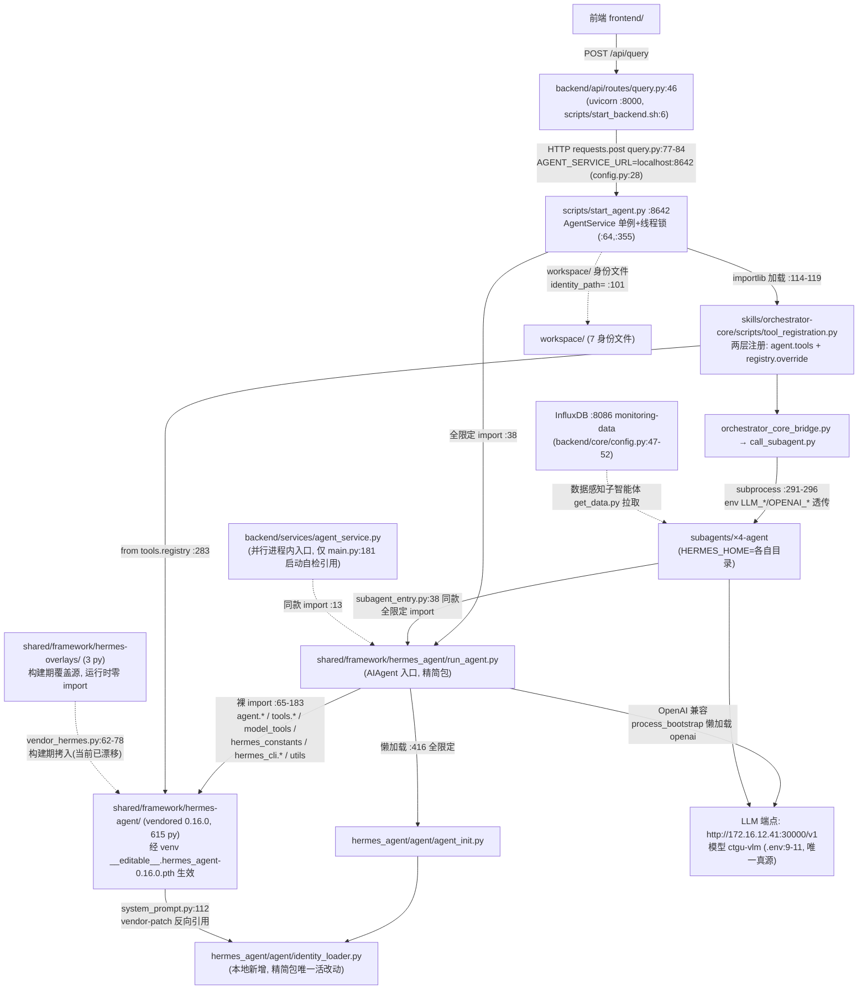

# Hermes Agent 框架评估报告

- 日期：2026-09-14 ｜ 评估基线 commit：`b0db9af4ef8377d32f9e7db6fa8e11794fda384a`（内容见 0.5 节）
- 设计文档：docs/superpowers/specs/2026-09-14-hermes-framework-audit-design.md
- 严重度图例：🔴 阻塞（正确性/可用性风险）｜🟡 应修（质量/维护风险）｜🟢 建议

## 0. 执行摘要（最后写）

## 0.5 基线事实

评估启动时钉死的事实，后续各节结论均以此为基准。核心证据已随报告入库：`docs/superpowers/specs/2026-09-14-hermes-audit-evidence/`（baseline-commit.txt、upstream-version.txt、dir-relation.txt）；大体积产物（baseline-status.txt、framework-py-manifest.txt）留存在本机 `/tmp/hermes-audit/`。

### 0.5.1 基线快照

- 基线 commit：`b0db9af4`（`git rev-parse HEAD`）。注：计划探索时记录的 `609a867` 在当前仓库中不存在（`git cat-file -t 609a867` 无此对象，历史可能已改写）；以实际 HEAD 为准。
- 工作区状态：存在大量未提交改动（frontend/node_modules、subagents/、workspace/、CHANGELOG.md、CLAUDE.md 等），完整快照见 baseline-status.txt。评估全程只读，不触碰这些改动。
- `shared/framework` 下 Python 文件清单：**626 个**（framework-py-manifest.txt）。

### 0.5.2 三目录关系（证据：dir-relation.txt，命令输出 + 逐文件 diff）

| 目录 | 角色 | 证据 |
|---|---|---|
| `shared/framework/hermes-agent/` | 上游仓库根的 vendored 完整副本 | 含 pyproject.toml、Dockerfile、flake.nix、uv.lock、gateway/、plugins/ 等，顶层条目共 **51** 个（`ls … \| wc -l`，dir-relation.txt 补证段）；无 `.git` 元数据；入库提交 `f446f413`（完整 subject："chore: 把 vendored hermes 框架纳入仓库(部署需要)"） |
| `shared/framework/hermes_agent/`（下划线） | 从上游抽取的**精简包副本**，仅 7 个 .py：`__init__.py`、`run_agent.py`、`utils.py`、`agent/{__init__,agent_init,process_bootstrap,identity_loader}.py` | `find` 输出；`__init__.py` 自述"从 https://github.com/NousResearch/hermes-agent 复制并修改，修改内容：扩展身份文件读取支持" |
| `shared/framework/hermes-overlays/` | 覆盖层：`run_agent.py`、`agent/agent_init.py`（与下划线副本逐字节一致）+ 独有 `tools/orchestrator_tool.py`（废水监测主智能体的子智能体调用工具，文件头注释） | `find` + `diff` 输出 |

关键细节：

1. **上、下划线目录不是整体镜像**：上游目录内部无 `hermes_agent/` 包（`ls -d .../hermes-agent/hermes_agent` → 无）；下划线包是「上游顶层 `run_agent.py`、`utils.py` + `agent/` 子集」的部分拷贝，目的应是使其可作为 `hermes_agent` Python 包导入（`process_bootstrap.py` 中出现 `from shared.framework.hermes_agent.utils import ...` 的 fallback 导入）。
2. **逐字节一致**（副本 vs 上游）：`run_agent.py`、`agent/agent_init.py`（cmp 比对 exit 0，dir-relation.txt 补证段）、`agent/__init__.py`（diff 无输出）。即 `run_agent.py` 与 `agent_init.py` 各自在三处（上游目录、`hermes_agent/`、`hermes-overlays/`）存有完全相同的拷贝。
3. **本地改动**（副本 vs 上游 diff）：
   - `utils.py`：3 处差异，副本为 `os.sync(f.fileno())`，上游为 `os.fsync(f.fileno())`（行 134/192/259）。语义影响留待 L2 审计判定。
   - `agent/process_bootstrap.py`：副本的 import 增加 try/except fallback（失败时改从 `shared.framework.hermes_agent.utils` 导入）。
   - `agent/identity_loader.py`：**本地新增**，上游无此文件（即 `__init__.py` 所述"扩展身份文件读取支持"）。

### 0.5.3 上游版本（证据：upstream-version.txt）

- **版本：hermes-agent 0.16.0**，作者 Nous Research。来源：`shared/framework/hermes-agent/pyproject.toml`（`name = "hermes-agent"` / `version = "0.16.0"`），与 `hermes_agent.egg-info/PKG-INFO`（Name/Version/Author）互相佐证。
- 局限：上游目录无 `.git` 元数据、无 CHANGELOG.md，故无法核对 0.16.0 对应的上游 commit 或本地是否在上游之上有过改动；该问题留待 L2 改装审计处理。

### 0.5.4 对设计文档 §1.1 的修正

基线 diff 实证推翻了设计文档「1.1 已确认的事实基础（探索阶段结论）」中的两处结论，后续章节以本节为准（Task 2+ 执行者请勿再按设计文档原文理解）：

1. **「改装集中在 overlays 层且规模重大」不成立**（设计 §1.1 事实表第 2 行）：`hermes-overlays/run_agent.py`（5358 行）与 `hermes-overlays/agent/agent_init.py`（1763 行）与上游对应文件逐字节一致（cmp exit 0，见 0.5.2），是上游文件的原样拷贝而非改装产物；overlays 中真正的本地文件只有 `tools/orchestrator_tool.py`（193 行）。实际的本地改动位于 `hermes_agent/` 包副本内：`utils.py`（3 处 os.sync/os.fsync 差异）、`agent/process_bootstrap.py`（fallback import）、`agent/identity_loader.py`（本地新增）。L2 检查项 2.1 的审计对象需据此重新聚焦。
2. **「hermes-agent/ 626 个 py」计数归属有误**（设计 §1.1 事实表第 1 行）：626 是整个 `shared/framework/` 的 .py 总数；拆分为 `hermes-agent/` 615、`hermes_agent/` 7、`hermes-overlays/` 3、`shared/framework/__init__.py` 1（合计 626，framework-py-manifest.txt 按前缀计数）。检查项 1.3 的覆盖率测算应按此口径分列。

## 1. L1 活链路追踪（真实架构）

<!-- 覆盖设计文档 §3 L1 检查项 1.1–1.5（1.2 overlay 生效机制须先行钉死；1.3 覆盖率按 0.5.4 修正口径分列） -->

核心证据随报告入库：`docs/superpowers/specs/2026-09-14-hermes-audit-evidence/l1-runtime-findspec.txt`（venv 内 15 条 import 解析实证）、`l1-untouched-strict.txt`（严格未触达清单）。大体积产物（touched-all.txt 451 行、pyc-evidence.txt、untouched.txt）在本机 `/tmp/hermes-audit/`。

### 1.1 入口链：活入口是 start_agent.py，不是（只是）backend/services/agent_service.py

设计假设「唯一活入口 = backend/services/agent_service.py」**部分不成立**：存在两条并行入口，import 目标相同，但当前活链路走 HTTP 转发那条。

**活链路（用户查询的真实路径）**：

```
前端 → backend/api/routes/query.py POST /api/query（backend/main.py:122 挂载，uvicorn :8000，scripts/start_backend.sh:6）
     → HTTP requests.post（query.py:77-84）→ AGENT_SERVICE_URL=http://localhost:8642（backend/core/config.py:28）
     → scripts/start_agent.py（uvicorn :8642，start_agent.py:376/508-515）
     → start_agent.py:38  from shared.framework.hermes_agent.run_agent import AIAgent
```

- query.py:1-5 docstring 自述「重构后：通过HTTP请求转发到Agent服务(localhost:8642)，不再直接创建AIAgent实例」；:46 给出架构「FastAPI → HTTP转发 → Agent服务 → AIAgent(主智能体)」。服务不可用时直接 503（:67-74）。流式端点 /query/stream（路由 :236）经 httpx.AsyncClient 流式转发（import :11，调用 :258-262）。
- scripts/start_agent.py（523 行）自带独立的 `AgentService` 类（:64，**与 backend/services/agent_service.py 同名不同类**）：master_agent 单例 + threading.Lock 串行化（:87-91），initialize() 创建 AIAgent（:97-103，identity_path="workspace"，max_iterations=15 :106-108），会话缓存/查询缓存/跨轮 session 目录续传（:72-84）。

**并行入口（进程内，当前非主路径）**：backend/services/agent_service.py（207 行，全读，/tmp/hermes-audit/agent_service.numbered）：

- import：`from shared.framework.hermes_agent.run_agent import AIAgent`（:13，try/except，失败 fallback 裸 `from run_agent import AIAgent` :20，再失败 AIAgent=None :22）；`from backend.models.query import QueryResponse`（:24）。
- 暴露：类 `AgentService`（:30），方法 `get_agent`（:71，env 读 LLM_* 默认值 :95-98，实例缓存）与 `process_query`（:129，调 `agent.run_conversation(user_message, conversation_history=None)` :163）。
- 全同步（无 async）；错误处理：导入期 try/except 降级（:12-22），查询期 broad except 记日志后 re-raise（:203-207）。
- 引用方仅两处：backend/services/__init__.py:3（re-export）与 backend/main.py:181-183（**启动自检**：实例化一次打日志，不接任何路由）。query.py 不 import 它——活查询流量不经过此文件。

**子智能体入口（第三条，同款 import）**：skills/orchestrator-core/scripts/subagent_entry.py:38 `from shared.framework.hermes_agent.run_agent import AIAgent`（「与主智能体同款路径」，:33 注释）。

三条入口的 import 字符串完全一致 ⇒ 1.2 的 overlay 结论对全链路统一成立。

### 1.2 overlay 生效机制：venv 可编辑安装把裸 import 钉到 vendored 树，overlays 目录运行时零参与

**一句话结论：运行时是「精简包 run_agent（全限定名）+ vendored hermes-agent 全家桶（裸顶层名，经 venv 可编辑安装）」的混合体；hermes-overlays/ 从不被 import——它是构建期覆盖源，由 scripts/vendor_hermes.py 拷进 vendored 树。**

机制三件套（证据链）：

1. **全限定 import 无歧义**：`shared.framework.hermes_agent.run_agent` 经 `shared/framework/__init__.py`（纯 docstring，无 sys.path 操作）作普通包解析到精简包副本。venv 实证（l1-runtime-findspec.txt）：`shared.framework.hermes_agent.run_agent → shared/framework/hermes_agent/run_agent.py`。
2. **裸 import 经可编辑安装落到 vendored 树**：run_agent.py 内部全是上游风格的裸顶层 import（:65 `from hermes_constants import…`、:98 `from agent.process_bootstrap import…`、:123 `from model_tools import…`、:129-131 `from tools.… import…`）。venv = `/home/NYJ2025/Ecological_env/ecological_env`（Python 3.12.12，sys.executable 实测值已入 l1-runtime-findspec.txt）；启动脚本用裸 `python`（`start_agent.py` shebang `#!/usr/bin/env python`、`start_backend.sh` `python -m uvicorn`），实际解析到哪个解释器取决于 PATH 激活——本节全部结论以该 venv 为前提。其 site-packages 存在 `__editable__.hermes_agent-0.16.0.pth` + finder，`dist-info/direct_url.json` = `file:///home/NYJ2025/Ecological_env/shared/framework/hermes-agent`（editable）。find_spec 实证（Python 模块解析探针，importlib.util.find_spec，只查加载路径不执行模块代码）：`agent`、`agent.process_bootstrap`、`tools.registry`、`model_tools`、`hermes_constants`、`utils`、`hermes_cli`、裸 `run_agent` **全部解析到 `shared/framework/hermes-agent/`**；裸 `hermes_agent` 反而 NONE（不可导入）。
3. **overlays 是构建期机制**：scripts/vendor_hermes.py:62-78 `apply_overlays()` 把 `hermes-overlays/` 全部文件按相对路径 copy2 进 `hermes-agent/`（DST，:18），再打两个文本 patch（:83-111：model_metadata OpenRouter 超时 10→1；system_prompt 注入身份文件加载块）。目录名带连字符 ⇒ Python 语法上不可能被 import；全仓 grep 无任何 sys.path 注入/importlib 加载指向它。

**逐文件裁决（md5 + find_spec + pyc 三重证据）**：

| 文件 | 三份拷贝关系 | 运行时生效者 | 判定 |
|---|---|---|---|
| `run_agent.py` | 三份逐字节一致（md5 3fb3838d…：hermes_agent/ = hermes-overlays/ = hermes-agent/） | `hermes_agent/run_agent.py`（全限定名加载） | ✅活；因逐字节一致，「谁生效」对本文件无差别 |
| `agent/agent_init.py` | 三份一致（8db8566c…） | `hermes_agent/agent/agent_init.py`（run_agent.py:416 懒加载 `from shared.framework.hermes_agent.agent.agent_init import init_agent`） | ✅活；vendored 的 agent_init.py 反而是严格未触达（无 pyc、无 import 边） |
| `agent/identity_loader.py` | 仅精简包有（本地新增） | `hermes_agent/agent/identity_loader.py`（agent_init.py:1747 引用 + vendored system_prompt.py:112 的 vendor-patch 反向引用） | ✅活——精简包存在的核心理由 |
| `utils.py` | 精简包≠vendored（os.sync×3 vs os.fsync，0.5.2） | **vendored 副本**（裸 `utils` → hermes-agent/utils.py） | 🔴 **精简包的 os.sync 改动是运行时死代码**（该文件无 pyc、无任何全限定 import 引用） |
| `agent/process_bootstrap.py` | 精简包≠vendored（fallback import，0.5.2） | **vendored 副本**（裸 `agent.process_bootstrap` → hermes-agent/） | 🔴 精简包的 fallback 改动同样死代码（vendored 版 :31 只有裸 `from utils import…`，且裸 utils 永远可导入成功，fallback 永不触发） |
| `hermes-overlays/`（3 文件） | — | 无人 import、无 pyc | 构建期源，运行时零参与 |

**对 0.5.4 结论的再修正**：0.5.4 把 L2 审计对象重聚焦到 `hermes_agent/` 副本的三个本地改动；本节实证其中 **只有 identity_loader.py 在活链路上**，utils.py 与 process_bootstrap.py 两处改动运行时不可达（修复它们的正确姿势是重跑 vendor 或改 overlays+patch，而不是改精简包——L2/L4 采纳）。

**已发生的构建期漂移（无运行时影响但须记录）**：`overlays/tools/orchestrator_tool.py` 的 PROJECT_ROOT 用 `parents[4]` 相对推导（:13），vendored 副本仍硬编码 `Path("E:/project/Ecological_env")`（Windows 路径，diff 唯一差异行）⇒ overlays 修正后**未重跑 vendor_hermes.py**。漂移之所以无害：tool_registration.py:279-283 判定 vendored 自带 orchestrator_tool 为「多处损坏的桥接」，用 override=True 以本项目 handler 覆盖（见 1.5），两份 orchestrator_tool 均不在调度路径上。

### 1.3 触达清单数据（静态 import 闭包 + pyc 运行时证据）

方法：从 4 个入口 import 语句作种子（start_agent.py:38、subagent_entry.py:38、agent_service.py:13、tool_registration.py:283；含并行入口 agent_service.py——其模块级 import 于 backend 启动时执行，只是不接查询流量），按与运行时一致的解析规则（1.2 三件套；顶层名清单取自 vendored `hermes_agent.egg-info/top_level.txt`；含缩进的懒加载 import）BFS 求传递闭包（从入口 import 逐层展开到不再新增文件）；运行时证据取 `find shared/framework -name "*.pyc"`（cpython-312，与 venv 3.12.12 一致）。

| 口径 | hermes-agent/（615） | hermes_agent/（7） | hermes-overlays/（3） | 合计（626） |
|---|---|---|---|---|
| 静态 import 闭包 | 448（72.8%） | 3（42.9%：run_agent、agent_init、identity_loader） | 0 | **451（72.0%）** |
| pyc 编译证据（至少被加载过一次） | 382（含闭包外 100 个动态加载，其中 plugins/ 系 79 个经插件扫描动态 import，静态 regex 不可见） | 5（含闭包外 2 个 `__init__.py`） | 0 | 388（另含 shared/framework/__init__.py，父包加载证据） |
| 闭包 ∪ pyc | 548 | 5 | 0 | **554（88.5%）** |
| 严格未触达（无静态边且无 pyc） | 67 | **2（utils.py、process_bootstrap.py）** | **3（全部）** | **72** |

注意事项：

- 闭包内 166 个文件无 pyc（hermes-agent 侧；hermes_cli 系占 67）：静态可达但从未真正执行——try/except 可选依赖（bedrock/gemini 等适配器）或从未走到的懒加载分支。**静态闭包是「静态可见 import 集」的上界、必经集的近似上界（未排除动态必经加载，精确界由 §4 E1 判定）**；pyc 是历史执行证据（含冒烟/手工运行），两者都不是「单次 /api/query 必经集合」。另：闭包按 import 语句追踪，不含父包 `__init__.py`（如 shared/framework/__init__.py 有 pyc 无静态边），故并集口径略偏低估。
- pyc ∖ 闭包 = 103 个，证明存在静态 grep 不可见的动态加载（插件扫描为主）。口径辨析：554/626=88.5% 是「**非死重量**（静态可达 ∪ 历史执行）」口径的下界；若按「执行覆盖」口径，下界是 388/626=62.0%（仅有历史执行证据者）。
- 数据落盘：/tmp/hermes-audit/{touched-l1,touched-all,untouched,untouched-strict,pyc-evidence}.txt + 构建脚本 build_touched.py；严格未触达 72 个见 l1-untouched-strict.txt（附录 A 素材）。

### 1.4 配置与 LLM 端点事实

| 配置源 | 活链路是否读取 | 证据 | 要点 |
|---|---|---|---|
| `.env`（项目根） | ✅ **唯一真源** | start_agent.py:29 load_dotenv → :95-97 os.getenv；call_subagent.py:260-267 透传子进程（含 OPENAI_API_KEY/OPENAI_BASE_URL 映射） | `LLM_BASE_URL=http://172.16.12.41:30000/v1`（.env:9）、`LLM_MODEL=ctgu-vlm`（:11）、`LLM_API_KEY`=<已脱敏>（:10）、`HERMES_TOTAL_TIMEOUT=300`（:33） |
| `$HERMES_HOME/config.yaml`（hermes 自身配置） | ❌ 文件不存在 | hermes_constants.py:423-428（config 路径=HERMES_HOME/config.yaml）+ start_agent.py:33（HERMES_HOME=项目根）+ `ls config.yaml`→无 | hermes 的 yaml 配置整体缺席，框架参数全靠 env 与构造参数 |
| `.hermes/config.yaml` | ❌ 不存在 | `wc -c` 无输出 | — |
| `workspace/config.yaml` | ❌ 非活链路（陈旧） | 内容为 LongCat-2.0 @ api.longcat.chat（旧端点）；HERMES_HOME 指向项目根而非 workspace；AIAgent 的 base_url/model 由构造参数显式传入（start_agent.py:97-103） | 遗留文件，若哪天有人「按注释」把 HERMES_HOME 指回 workspace 会引入错误端点——🟡 建议清理（L3） |
| `shared/configs/llm_config.yaml` | ❌ 零读取 | grep backend/ scripts/ skills/ subagents/ framework 无命中 | 端点描述与 .env 一致，纯文档性质 |
| `backend/core/config.py` | ✅ 仅 backend 侧 | :28 AGENT_SERVICE_URL、:30 AGENT_TIMEOUT=600 | 不含 LLM 密钥 |

**LLM 端点事实**：全链路（主+4 子智能体）唯一活端点 = **`http://172.16.12.41:30000/v1`，模型 `ctgu-vlm`**（内网 vLLM，OpenAI 兼容）；OpenAI SDK 经 process_bootstrap 懒加载（`from openai import OpenAI`，_load_openai_cls）。`.env` 同时保留 LongCat 注释行（:14）为备用端点说明，未启用。

### 1.5 子智能体注册与调用机制（谁把 4 个子智能体变成框架可调用的）

注册主体 = `skills/orchestrator-core/scripts/tool_registration.py`（446 行），由 start_agent.py:113-119 在 master_agent 初始化后经 `importlib.util.spec_from_file_location` 按文件路径加载并调用 `register_orchestrator_tools(agent)`（失败仅告警不阻断，:121-127）。两层注册（:214-283，注释自证 2026-07-21 端到端验证）：

1. **schema 层**：把 4 个工具 schema（call_subagent / list_subagents / create_session / read_result，:231-258）灌进 `agent.tools`——conversation_loop 只读 agent.tools 喂给 LLM；同时裁剪工具表，仅保留编排 4 件套 + skill_view/skills_list（:265-272），砍掉 terminal/browser 等分心工具。
2. **registry 层**：handler 以 `override=True` 注册进 hermes 全局 `tools.registry`（:283 `from tools.registry import registry` → vendored 树），取代 vendored 自带且被判定损坏的 tools/orchestrator_tool.py（:279-283）。dispatch 走全局 registry，故覆盖必须发生在这里。

调用链（LLM 决策 → 子智能体结果回传）：

```
主智能体 LLM 决策调 call_subagent（enum 限定 4 个子智能体名，tool_registration.py:242）
→ _call_subagent_handler → orchestrator_core_bridge.py（importlib 桥接，解决目录名连字符不可 import）
→ call_subagent.py:291-296  subprocess.run([sys.executable, subagent_entry.py], env=LLM_*/OPENAI_* 透传（:260-267）+PYTHONPATH=项目根, cwd=subagents/<x>, timeout=600)
→ subagent_entry.py:38  AIAgent（= 又一个完整 hermes 会话：HERMES_HOME=subagents/<x>、max_iterations=6、toolsets=[skills,terminal]，:174-177）
→ 子智能体 LLM 经 skill_view 读自己的技能 → terminal 跑 canonical 脚本 → 结果 JSON 落 SESSION_DIR
→ read_result 读文件 / _compact_result_for_master 紧凑摘要回主智能体（铁律「LLM 绝不读原始数据」，:138-141）
```

- 4 个子智能体映射：`SUBAGENT_PATHS`（call_subagent.py:26-36）：multi-dimensional-data-perception / anomaly-detection / rule-reasoning / disposition-execution → `subagents/<名>-agent/`（目录实存，各含 SOUL.md/AGENTS.md/MEMORY.md/skills/，ls 实证）。
- 进度流：tool_registration 模块级 `_current_progress_queue`（:46，`_emit_progress` :49 起）由 start_agent 的 /query/stream 注入（:117-118 保留模块引用），子智能体各阶段事件（evidence/chartData）实时推给前端。
- 观测性：子智能体 subprocess 全量 stdout/stderr 落盘 `sessions/_subagent_traces/`（call_subagent.py:304-310）。

### 1.6 真实运行时架构图



要点：框架代码实际由两个目录共同构成（精简包 3 个活文件 + vendored 448 个静态可达文件（∪ 历史执行 548））；「身份文件→system_prompt 注入」是精简包与 vendored 树之间唯一的反向依赖（system_prompt.py:112）。

### 1.7 与专利六层架构的映射/偏差（对照仓库根 CLAUDE.md）

| 专利层 | CLAUDE.md 描述 | 实测（L1） | 判定 |
|---|---|---|---|
| 1 人机交互层 | middleware/ Flask :5000 + Grafana | 活交互 = frontend/ + backend/ FastAPI :8000（main.py:121-126）；`middleware/` 目录**不存在**（全仓 find 仅 backend/middleware/logging_middleware.py，FastAPI 日志中间件，与 Flask 无关） | ❌ 偏差（CLAUDE.md 描述的旧链路整体已删） |
| 2 数据采集层 | stream/dual_data_stream.py 推流模拟 | `stream/` 不存在；活数据源 = InfluxDB localhost:8086 bucket monitoring-data（config.py:47-52），由数据感知子智能体拉取（subagents/…/get_data.py 引用 influxdb） | ❌ 偏差（推流→拉取，双流向单源） |
| 3 主智能体层 | workspace/ 身份文件（IDENTITY/SOUL/AGENTS/MEMORY/USER/TOOLS/HEARTBEAT） | workspace/ 7 个身份文件全部实存且被活链路加载：AIAgent(identity_path="workspace", load_soul_identity=True)（start_agent.py:101-102）→ agent_init → identity_loader；backend 侧另有 _check_identity_files 自检（agent_service.py:46-69） | ✅ 对应（载体从「编排脚本读」换为 hermes AIAgent 读，文件集合不变） |
| 4 任务编排层 | workspace/skills/orchestrator-core/scripts/（task_receiving_and_parsing / execution_control / result_interpretation，~12 次 LLM 调用） | 活编排 = **根目录 skills/**/orchestrator-core（tool_registration + call_subagent + subagent_entry），编排主体是 hermes 主智能体 LLM 决策；CLAUDE.md 所指 workspace/skills/orchestrator-core/scripts/ 仍存在（dynamic_orchestrator/execution_control/resource_matching/task_structuring）但**无任何活代码引用**（直接引用全部位于 tests/，共 8 个：integration/test_orchestrator_simple.py:17、integration/test_e2e_architecture.py:11、integration/test_orchestrator_full_pipeline.py:28、integration/test_orchestrator_integration.py、realtime/realtime_orchestrator.py:25、workspace/test_dynamic_orchestrator.py:8、workspace/test_execution_control_integration.py:16、test_master_agent.py:133/178/239——多经 Path 分段拼接，字面 grep 不可见，归 3.5 盘点；另 verify_architecture.py 与 test_four_layer_architecture.py 引用的是同为退役的 master-agent-core 套件，3.5 盘点退役测试时应一并计入；skills/ 活副本内 subagent_tools.py:29 有一条 try 链 fallback import，详查归 3.5 盘点）；「~12 次调用」口径对应旧套件，新链路 LLM 调用次数更多（主智能体多轮 + 每子智能体一次完整 AIAgent 会话），量化归 §4 | ⚠️ 偏差（位置 + 机制双变；旧套件成死代码） |
| 5 子智能体层 | subagents/ 4 个专业智能体，各自身份文件+脚本 | 4 个目录实存（含 SOUL/AGENTS/MEMORY + skills/<core>/scripts），enum 硬编码于 call_subagent schema（tool_registration.py:242）；驱动方式从「本地 coordinator 调脚本」变为「每个子智能体=一次完整 hermes AIAgent 会话（subagent_entry.py）」 | ✅ 对应（驱动载体换为 hermes 子进程） |
| 6 数据支撑层 | shared/（data、models、configs、knowledge、operators） | shared/data、knowledge、operators 实存（是否仍被子智能体脚本消费未逐条核证，归 3.2/3.3 待证）；但 `shared/configs/llm_client.py` 不存在（CLAUDE.md 的 LLM 客户端封装已删），配置真源移至 .env（1.4）；framework/ 新增三大目录（0.5.2）不在 CLAUDE.md 描述内 | ⚠️ 偏差（部分失活 + 未收录新增） |

**总判定**：六层中的 3、5 两层在活链路上成立（载体换成 hermes）；1、2 两层的 CLAUDE.md 实现已整体不存在（❌）；4 迁移且留死代码；6 部分失活+未收录新增（⚠️）。CLAUDE.md 本身已落后真实架构一个代差，应随 L4 裁决一并重写（P1 候选）。

## 2. L2 改装审计

<!-- 覆盖设计文档 §3 L2 检查项 2.1–2.6（按 0.5.4 重聚焦执行；§2.0 含 L2 对 0.5.2/§1.2 两处基线的实证修正） -->

核心证据随报告入库：`docs/superpowers/specs/2026-09-14-hermes-audit-evidence/`（l2-upstream-base-id.txt 上游基线取证、l2-real-mods-vs-upstream.patch 真实改动全集 180 行、l2-exact-diff-summary.txt 文件级差异清单、l2-sim-vs-actual.txt 复现性缺口）。大体积产物（上游 git 浅克隆、sim-dst 模拟树、vendored-vs-upstream-full.txt 初版全量 diff）在本机 `/tmp/hermes-audit/`。

### 2.0 方法升级与基线修正：取得上游 pristine 参考，推翻「上游 commit 无法核对」

0.5.3 声明的局限（「无 .git 元数据，上游 commit 无法核对」）在 L2 被消除：PyPI 不存在 hermes-agent（pypi.org 与镜像均 `versions: none`），但 GitHub 上游可达。取证过程（l2-upstream-base-id.txt）：

1. 上游用日历标签（v2026.X.Y）发版；逐一抓取 33 个标签的 pyproject.toml 建立版本映射：**v2026.6.5 = 0.16.0**，下一版 v2026.6.19 = 0.17.0。
2. 但 vendored 树 ≠ v2026.6.5：对 v2026.6.5..v2026.6.19 区间全部 **1748 个 commit** 逐个做 blob-hash 匹配（vendored 795 个文件 hash vs 各 commit `git ls-tree`），最佳匹配 **`7df3aa34`（2026-06-10，v2026.6.5 后 5 天，pyproject 仍 0.16.0）：764/795 blob 完全一致**，次优 763 且逐日递减——基线唯一确定。
3. 31 个不一致文件全部有归属（7 个差异文件见 2.1 表；24 个 vendored 独有文件 = 23 个 `hermes_cli/web_dist/` 构建产物 + `start-api-server.bat`；运行时 marker .hermes-bootstrap-complete 已排除在 795 计数外），无「无法解释」残差 ⇒ 基线判定置信度高。
4. 对基线忠实复演 vendor 三步（拷贝→overlays→PATCHES，`/tmp/hermes-audit/simulate_vendor.py`）得模拟树 sim-dst，与实际 vendored 树的残差 = 复现性缺口（见 2.6）。

**对 0.5.2/§1.2 的两处实证修正**（0.5.2 的比对基准是 vendored 树本身，属循环论证——三份本地拷贝互证一致 ≠ 与上游一致）：

- **修正 1**：`run_agent.py` 与 `agent/agent_init.py` **不是上游原样拷贝**。对真上游 7df3aa3：run_agent.py **+12/−2**（:413 新增 `identity_path` 构造参数、:416 `from agent.agent_init import` 改为 `from shared.framework.hermes_agent.agent.agent_init import`（跨树引用）、:487 传参、:5105-5113 run_conversation 调用改关键字参数）；agent_init.py **+19**（:224 新增参数、:1740-1760 identity_path 解析块）。§1.2 表格「三份逐字节一致⇒原样拷贝」的结论作废（三份一致仍真，但一致的是**改装后**版本）；§1.6 架构图中 VEND 与 RA 的边界不变，仅「run_agent/agent_init = 上游原样」这一定性需更正。
- **修正 2**：vendored 树内另有 **3 处 vendor 脚本未声明的源码改动**（agent/\_\_init\_\_.py、agent/chat_completion_helpers.py、hermes_constants.py，见 2.1 表 #5/#7/#9），其中 2 处（hermes_constants、agent/\_\_init\_\_）曾在 overlays 中声明（31345964，2026-07-21，共 5 文件）后被 e263fb67（07-23「清理框架层」）从 overlays 删除，改动本体只在 vendored 树里存活。

### 2.1 改动全集分类表（检查项 2.1：每处改动归四类 + 生死 + 声明状态）

「全集」口径 = vendored 树 ∪ hermes_agent/ 精简包 ∪ hermes-overlays/ 对真上游 7df3aa3 的全部差异（l2-real-mods-vs-upstream.patch + l2-exact-diff-summary.txt）。**vendor 脚本声明面与实际 diff 对不上**（Before You Begin 预警的情形，实证成立）：声明的 = overlays 3 文件 + PATCHES 2 条；实际的 = 下表 11 处代码改动 + 3 项内容差异。

| # | 改动 | 位置（生效副本） | ±行 | 四类归属 | 运行时生死（引 §1） | 声明状态 |
|---|---|---|---|---|---|---|
| 1 | identity_loader.py 本地新增 | hermes_agent/agent/（103 行，上游无此文件） | +103 | 身份文件扩展 | ✅ 活（§1.2 裁决：精简包存在的核心理由） | hermes_agent/\_\_init\_\_.py 自述声明 ✅ |
| 2 | run_agent.py：identity_path 参数 + 跨树 import | hermes_agent/run_agent.py = vendored = overlays（三份一致） | +12/−2 | 身份文件扩展 | ✅ 活（入口链 §1.1） | overlays 拷贝携带 ✅（但语义未注明） |
| 3 | agent_init.py：identity_path 解析块 :1740-1760 | 同上三份一致 | +19 | 身份文件扩展 | ✅ 活（§1.2：run_agent.py:416→agent_init） | overlays 拷贝携带 ✅ |
| 4 | system_prompt.py：身份文件注入块 :102-118（含 :112 反向引用 identity_loader） | vendored（PATCHES 产物） | +16 | 身份文件扩展 | ✅ 活（主+子智能体 system prompt 均经此） | PATCHES :93-110 声明 ✅（实树仅引号风格微漂移，语义等价） |
| 5 | hermes_constants.py：IDENTITY_FILES 常量 + get_identity_files() :112-133 | vendored | +19 | 身份文件扩展 | ❌ 死代码（全仓零调用方，grep 实证；活链路用的是 identity_loader.py:13 的另一份副本） | 🔴 未声明：曾入 overlays（31345964）后被 e263fb67 删除，重跑 vendor 即静默丢失 |
| 6 | tools/orchestrator_tool.py 本地新增 193 行 | vendored（E:/ 硬编码版）≠ overlays（parents[4] 修正版） | +193 | 编排改动 | ❌ 判死 + override（§1.2/§1.5；详析见 2.4） | overlays 拷贝声明 ✅，但修正后未重跑 vendor（L1 已钉） |
| 7 | chat_completion_helpers.py：注释掉 `stream_options` :1743-1744 | vendored | +2/−1 | 项目特化（vLLM 适配） | ✅ **活**——流式端点 /query/stream 经 start_agent.py:475 stream_callback → conversation_loop :1002 走流式补全 | 🔴 **从未声明**（不在 overlays、不在 PATCHES，仅存活于 vendored 树） |
| 8 | model_metadata.py：OpenRouter 超时 10→1 :631 | vendored | +1/−1 | 项目特化（内网适配） | ✅ 活（模型元数据冷启动路径） | PATCHES :86-89 声明，但**声明文本与实树已分叉**（实树注释文本不同且位置正确；按现 PATCHES 重跑会产出语法错误文件，2.6） |
| 9 | agent/\_\_init\_\_.py：删除 jiter 预载 import + 中文 docstring | vendored | +2/−5 | 无法完全推断（无注释；行为变化=去掉 OpenAI SDK 流式解析器 jiter 的提前导入） | ✅ 活（agent 包加载即执行；Linux 无影响，Windows 开发机理论上有 import-order 风险，jiter_preload.py docstring 自证其为 Windows 专用 workaround） | 🔴 未声明：同 #5，07-23 被移出 overlays |
| 10 | utils.py：os.fsync→os.sync ×3 :134/192/259 | 仅 hermes_agent/（vendored 不带） | +3/−3 | 无法推断（无注释） | ❌ 运行时死（§1.2 裁决）+ 本身是必炸 bug：`posix.sync() takes no arguments`（实测 TypeError），非「语义差异」而是**写错 API**——也反证该改动从未被执行过 | 未声明（0.5.2 已记录差异，L1 已裁决） |
| 11 | process_bootstrap.py：import fallback :31-35 | 仅 hermes_agent/ | +5/−1 | 项目特化（为精简包独立可导入） | ❌ 死（§1.2：裸 utils 经 venv 永远可导入，except 分支不可达） | 未声明（0.5.2 已记录） |

内容级差异（非逐行代码改动，同样属「对上游改了什么」）：**(a) 上游整棵 `skills/` 目录（467 文件，含 38 个 .py）在 vendored 树中缺席**——vendor 脚本 EXCLUDE_DIRS 只排除了 optional-skills，未排除 skills（vendor_hermes.py:22-27），缺席未声明（推测系 Windows 源树 D:\Hermes 无此目录或拷后手工删除；后果见 2.6）；**(b)** `.env.example` 缺席（同理未声明）；**(c)** vendored 独有 `hermes_cli/web_dist/`（23 文件，上游 git 内无此构建产物，系源树带入）与 `start-api-server.bat`（Windows 遗留启动脚本，内含 test-key-123/sk-test 占位密钥与内网端点，走的是上游 gateway 而非项目 start_agent.py，同为历史残留）。

### 2.2 hermes_agent/ 精简包差异裁决（检查项 2.2）

§1.2 的生死结论全部维持并加严一处：

- **utils.py（#10）**：不只是「语义影响待判定」——`os.sync(f.fileno())` 在 CPython/Linux 上是 **TypeError（sync() 不接受参数）**，一旦该文件被导入执行，三处原子写（save_json/save_text/save_yaml）全部抛异常。当前因运行时走 vendored 副本（§1.2）而未爆雷，但这是**埋在仓库里的必炸点**：任何「复活精简包 utils」的重构（如把 hermes_agent 变成真正自洽的包）都会踩中。🟡 建议：直接改回 os.fsync（或整文件对齐 vendored 版后从精简包删除该文件——它本就无人引用）。
- **process_bootstrap.py（#11）**：fallback 逻辑不可达的根因是 venv 可编辑安装使裸 `utils` 恒可导入（§1.2 三件套之 2）。改动无害但无效——精简包 7 文件中 4 个（utils、process_bootstrap、两个 \_\_init\_\_）对运行时无贡献，真正被用的只有 run_agent、agent_init、identity_loader 三个（§1.3 口径一致）。
- **新增修正（§2.0 修正 1）**：精简包 run_agent.py/agent_init.py 相对上游是**改装版**（identity 扩展链的组成部分，归入 #2/#3，非原样拷贝）。精简包不是「干净的镜像 + 3 个小改动」，而是「3 个活改装 + 2 个死改动 + 2 个顺带拷贝的 \_\_init\_\_」。

### 2.3 identity_loader.py：新增文件而非改写（检查项 2.3）

**定性：全新增**（上游 7df3aa3 无此文件，hermes_agent/\_\_init\_\_.py 自述「扩展身份文件读取支持」与实证一致；不是对上游某文件的改写或移植）。

**职责**（103 行，3 个公开函数，identity_loader.py）：

- `load_identity_files_from_path(path)` :24-59——按 IDENTITY_FILES 顺序（:13-21 七文件）读目录中实际存在的身份文件，拼 `## {文件名}\n\n{内容}` 返回；文件级 try/except 容错、空文件跳过。**消费方 = vendored system_prompt.py:112**（PATCHES 注入块内，主智能体经 `agent._identity_path`、子智能体经 HERMES_HOME，§1.2）。
- `resolve_identity_path(path, project_root)` :84-102——相对路径相对 project_root 解析，缺省回落 `project_root/workspace`。**消费方 = agent_init.py:1744-1747**（先尝试裸 `agent.identity_loader`——vendored 树无此文件必失败——再回落全限定名，恒走回落分支）。
- `load_single_identity_file` :62-81——**零调用方，死函数**。
- :52-54 悬空注释记录 2026-07-27 决策（编排技能不再预载、改用 hermes 原生 skill_view），注释位置错放在拼接函数中段——文件内部留着演进痕迹。

**质量评价**：接口窄、无全局状态、debug 级日志、逐文件容错，作为模块设计 🟢 合格。问题是**结构性的**：(a) IDENTITY_FILES 列表双份维护（此处 :13 与 hermes_constants.py:115，后者整段死代码），靠注释「与hermes_constants保持一致」自律，无测试约束；(b) 它是跨树反向依赖的锚点——vendored system_prompt.py:112 与 agent_init.py:1747 都 import `shared.framework.hermes_agent.agent.identity_loader`，即 **vendored 树的运行时正确性依赖精简包目录存在**（§1.6 已标注该唯一反向依赖；L2 确认依赖方向为 vendored→精简包，且无任何包级别声明保障，仅靠 venv + 相对布局巧合成立）。

### 2.4 orchestrator_tool.py：功能、判死实证、被替代史（检查项 2.4）

**注册了什么**（overlays/tools/orchestrator_tool.py，193 行）：模块级向 hermes 全局 registry 注册 4 个工具（:55/:108/:137/:167，toolset="hermes-cli"，check_fn 恒 True，requires_env 空）：`call_subagent`（:58-92 schema，enum **8 个名**——4 正名 + data-perception/anomaly/rule/disposition 4 别名；context 参数类型 object）、`create_session`、`list_subagents`、`read_result`。handler 惰性经 `_get_subagent_tools()`（:16-43）import `workspace.skills.orchestrator_core_bridge` 取 4 函数。

**如何被加载**：vendored tools/registry.py:57-79 `discover_builtin_tools()` 扫描 tools/*.py 中含顶层 `registry.register` 调用者并自动 import ⇒ vendored 副本随模型工具初始化自动注册（这正是它必须被 override 而不能无视的原因）。

**判死三重实证**（tool_registration.py:279-281 判词「多处损坏的桥接」逐条核实）：

1. **import 目标不存在**：`workspace/skills/orchestrator_core_bridge.py` 全仓不存在（workspace/skills/ 下仅 orchestrator-core 目录）。git 考古：该桥接 02bc229e（2026-07-29「迁移orchestrator-core到skills/」）由 workspace/skills/ 迁至根 skills/ 后，此 import 恒 ImportError ⇒ 4 个 handler 全部落入 :38-43 `_not_available` 桩，调用即返回 `{"error": "Subagent tools not available: ..."}`。**overlays 修正版同样死**——它只修了 PROJECT_ROOT（E:/→parents[4]），import 目标缺失是两份共同死因。
2. **schema 双层包裹**：registry 约定存**裸 function dict**、由 get_definitions 统一包 `{"type":"function",…}` 外壳（registry.py:99-106 ToolEntry docstring），本文件却传预包裹形式（:59-91）⇒ 双层包裹，LLM 侧 400（判词实证）。对照：tool_registration.py:285-288 override 时传的就是裸 function dict。
3. **vendored 副本 E:/ 硬编码漂移**（§1.2 已钉；diff-C-orchestrator.patch 唯一差异行）。

**存在却被判死的原因 = 历史演进残留**，时间线（git 考古）：07-21（31345964）它作为**初代集成载体**诞生（commit 自述「fixed orchestrator_tool signatures」，当时 import 目标 workspace/skills 桥接真实存在、registry 层集成是新尝试）；07-27（3edb0a4f）去硬编码只修 overlays 未重跑 vendor（漂移出生）；07-29（02bc229e）orchestrator-core 迁到根 skills/，桥接 import 路径死亡——**同一 commit 内 tool_registration.py 两层注册成为替代实现**，此后 orchestrator_tool 再无提交，成为不再被调度但仍随 vendor 管道分发的尸体。

**被谁替代、替代质量**：tool_registration.py:214-297——第 1 层把 4 个 schema 灌 agent.tools（conversation_loop 只读此处），第 2 层以 `override=True` 注册进全局 registry（:283-294）。关键：**override=True 正是上游 registry 为「插件替换内建工具」预留的官方扩展点**（registry.py:251-254 docstring 自证设计意图）⇒ 替代实现走在正规扩展点上，enum 收敛为 4 正名（:242）、context 改 string、handler 直连活桥接，正确。**残留问题是负面外部性**：vendored 副本每次启动仍被 discover_builtin_tools 自动 import 并注册 4 个坏工具，再被 override 仪式性盖掉——纯噪音 + 双份 193 行文件 + E:/ 死路径。🟡 建议：直接从 overlays 删除本文件并清理 vendored 副本（runtime override 已自足），或在报告 §5 裁决后随胜出路线一并处置。

**与上游工具的关系**：非改装上游工具（上游无同名/同功能工具），是**仿上游 tools/*.py 模式新增的本地文件**；上游对该模式的官方支持恰是它想用的机制，坏在实现细节（schema 包裹层级、import 目标）与后续失修。

### 2.5 四属性评分表（检查项 2.5）

评分依据 = hunk 上下文精读（上文逐条）+ vendored 树扩展点扫描（`hook|register|plugin|patch` grep：registry.register/override、plugins/ 插件体系、config.yaml、check_fn、dynamic_schema_overrides）。

| 改动（#） | 动机可推断性 | 正确性风险 | 上游同步冲突面 | 松耦合替代方案（本可用 X 而不必改源码） |
|---|---|---|---|---|
| 身份扩展链 #1-#4 | ✅ 高：PATCHES :90-92 与代码注释自证（主 7/子 3 文件、双路径探测） | 🟢 低：try/except 包裹 + `_identity_path` 缺省回落 HERMES_HOME；实测活链路依赖它工作 | 🟡 中：system_prompt 补丁锚定上游 17 行文本（改写法则 no-match，脚本 :123 有告警防护不炸）；**run_agent/agent_init 以整文件 overlay 锁死**（5358+1763 行，上游任何演进全部丢失，且 overlays 版与精简包版三份一致性靠手工维护） | 🟡 部分：上游 system_prompt 无身份扩展点（仅 SOUL.md :88-100 + DEFAULT_AGENT_IDENTITY 回落），确需改源或**部署期把 7 文件合并生成 SOUL.md**（数据级替代，代价失文件粒度、子智能体目录同理）；更优路径是给上游提 feature/PR |
| #7 stream_options 移除 | ✅ 高：注释「removed for vLLM compatibility」 | 🟡 中：流式 usage 恒缺失（vLLM 不发 usage chunk），usage_obj=None 传入 mock response（chat_completion_helpers.py:2038/:2062）——不炸但**流式路径 token 计量退化为空**（account_usage/上下文预算拿不到服务端数据）；活路径（/query/stream） | 🟡 中：该文件是上游高频改动区（基线后上游已多次演进该函数），行级手工改动每次 re-vendor 都要对齐 | 🟡 存在模式不存在开关：上游有 per-provider extra_body 机制先例（:656 github_reasoning_extra、:1377 reasoning 分支）——**本可按 provider 条件分支**（vLLM 才不带 stream_options）而非全局删除；升级 vLLM 版本可能根本不需要此改动（待查：172.16.12.41 vLLM 版本） |
| #8 OpenRouter timeout | ✅ 高：注释自证（内网不可达、阻塞 ~12s、已由 vLLM /v1/models 提供） | 🟢 低：超时→静态回退（上游 :234 自带 offline fallback），语义无损 | 🟢 小：锚定单行 | ❌ 无：OPENROUTER_MODELS_URL 是编译期常量（hermes_constants.py:496），无 env/config 开关——**四类改动中最正当的一处**；但现 PATCHES 文本已漂移成重跑即产出语法错误文件（🔴，2.6），须先修声明再谈复现 |
| #9 去 jiter 预载 | ❌ 低：无注释；对照 jiter_preload.py docstring（Windows 专用 import-order workaround）推测为「清理无关代码」，但项目恰从 Windows 开发（D:\Hermes） | 🟢 低（Linux 部署无影响）/ Windows 开发机理论风险 | 🟢 小 | ✅ 本可不改：`# noqa: F401` 的预载无害；如要移除也应记入 overlays 而非只改 vendored 树 |
| #5 hermes_constants 死扩展 | ✅ 高（身份扩展配套）但**从未接线** | 🟢 无（零调用） | 🟢 小 | 应删除（活链路用 identity_loader 那份） |
| #10 os.sync | ❌ 不可推断（疑编辑事故） | 🔴 必炸 TypeError——幸为死代码，属「埋雷」 | 🟢 小（仅精简包） | 不应存在：改回 fsync 或删文件 |
| #11 fallback import | ✅ 高（为精简包独立可导入） | 🟢 无（不可达） | 🟢 小 | 不必要：venv 下裸 utils 恒可导入（§1.2） |
| #6 orchestrator_tool | ✅ 高（初代集成载体） | 🔴 三重损坏（2.4）——已被 override 隔离，无现行风险 | 🟢 小（上游无此文件） | ✅ 存在且已被用：registry override=True 即官方扩展点；文件本身应删（2.4 建议） |

### 2.6 量化与上游同步策略评估（检查项 2.6）

**改动行数分布**（对真上游 7df3aa3，l2-real-mods-vs-upstream.patch）：

| 类别 | 文件数 | +行/−行 | 占比 |
|---|---|---|---|
| 身份文件扩展（#1-#5，含死代码 #5） | 5 | +169/−2 | 45% |
| 编排（#6 orchestrator_tool） | 1 | +193 | 51% |
| 项目特化/环境适配（#7/#8/#11） | 3 | +8/−3 | 2% |
| 无法推断（#9/#10） | 2 | +5/−8 | 2% |
| **合计（.py 代码改动）** | **11** | **+375/−13** | 626 个 .py 中涉及 11 个（9 改 2 新增）≈ 1.8% |

**文件耦合度**：(a) 三份拷贝组 ×3（run_agent.py、agent_init.py、orchestrator_tool.py 前两者三份逐字节一致靠手工同步，后者两份已漂移——拷贝一致性无任何机制保障）；(b) 跨树 import 3 条且方向倒挂：vendored→精简包 2 条（system_prompt.py:112、agent_init.py:1747——**上游树代码 import 项目精简包**，venv editable install 是唯一粘合剂）、精简包内 1 条（run_agent.py:416）；(c) IDENTITY_FILES 双份（2.3）；(d) 上游 lockstep 缺失：uv.lock/版本声明仍是上游 0.16.0，无任何「本树 = 7df3aa3 + 11 处改动」的 provenance 记录（0.5.3 声明的局限经 L2 已可消除，建议在 vendored 根落一个 BASE_COMMIT/PROVENANCE 文件）。

**上游同步策略评估（一句话：vendor 管道设计思路正确、现状完全不可复现，处于「一次性快照」状态）**。四个断点（全部有实证）：

1. 🔴 **脚本本身语法错误**：`python3 -m py_compile scripts/vendor_hermes.py` → SyntaxError（:89 多一个 `)`），**自 e263fb67（07-23）入库起即坏**，工作区与 HEAD 同坏；此前版本（311f23db 及更早，07-21）可解析但无 PATCHES 段 ⇒ **没有任何一版已提交脚本能重放出当前 vendored 树**（08-03 的树由未提交的本地版本或手工补丁产出）。脚本自述「本脚本 + overlays 进 git，保证可复现」不成立。
2. 🔴 **PATCHES 文本漂移**：按现 PATCHES（修复语法后）对 pristine 基线复演，model_metadata 产出 `'(' was never closed` 的语法错误文件（模拟实测，l2-sim-vs-actual.txt）——声明文本是旧的，实树是手改正确的。
3. 🟡 **overlays 不完整**：#5/#9 两个改动 07-23 被移出 overlays 后仅存于 vendored 树，重跑 vendor 即**静默丢失**（其中 #7 从未有过声明载体，同样丢失）。
4. 🟡 **排除集与实树不符**：skills/（467 文件）与 .env.example 缺席但未被 EXCLUDE 声明——重跑会引入 467 个文件，且**框架内建技能库将出现在 skill_view/skills_list 里，改变主智能体可见技能集**（行为差异，非纯体积问题）；vendored 独有的 web_dist/、start-api-server.bat 则会在重跑后消失。

上游演进压力：上游至今已发布至 v2026.9.11 = 0.21.2，vendored 0.16.0 **落后 11 个 release**；结合 §1.3（554/626 非死重量）与 2.5 冲突面评估，升级须先修 4 个断点并把「整文件 overlay」（run_agent/agent_init）降级为「最小 patch 或上游 PR」，否则每次升级都是手工重做。修复清单为 §6 P0 候选：①修脚本语法+PATCHES 文本（以实树为准回填）；②把 #5/#7/#9 补进 overlays/PATCHES 或显式决策删除；③EXCLUDE_DIRS 显式加入 skills/（或决策保留上游技能库）；④落 PROVENANCE 文件记录基线 commit；⑤删除 orchestrator_tool（2.4）。

## 3. L3 项目适配审计

<!-- 覆盖设计文档 §3 L3 检查项 3.1–3.5 -->

## 4. LLM 调用实证

<!-- 覆盖设计文档 §3 E 最小实证 E1–E4（E1 计数 wrapper 仅注入 /tmp；E4 降级时本节须显著标注「未实证」）；对照 CLAUDE.md「~12 次调用/流程」口径 -->

## 5. L4 双路线裁决书

<!-- 覆盖设计文档 §3 L4 检查项 4.1–4.4（4.4 终审三选一，不许和稀泥；含过渡步骤与被裁一方处置） -->

## 6. 路线图 P0/P1/P2

<!-- 覆盖设计文档 §4 输出物「路线图」（P0 立即修/P1 短期/P2 方向性演进，P2 含借鉴 pi-subagents、OpenClaw 的具体机制清单）+ 验收标准 §7-4（P0 项可直接转化为后续修复任务） -->

## 附录 A. 触达/未触达文件清单

## 附录 B. 实证原始数据
