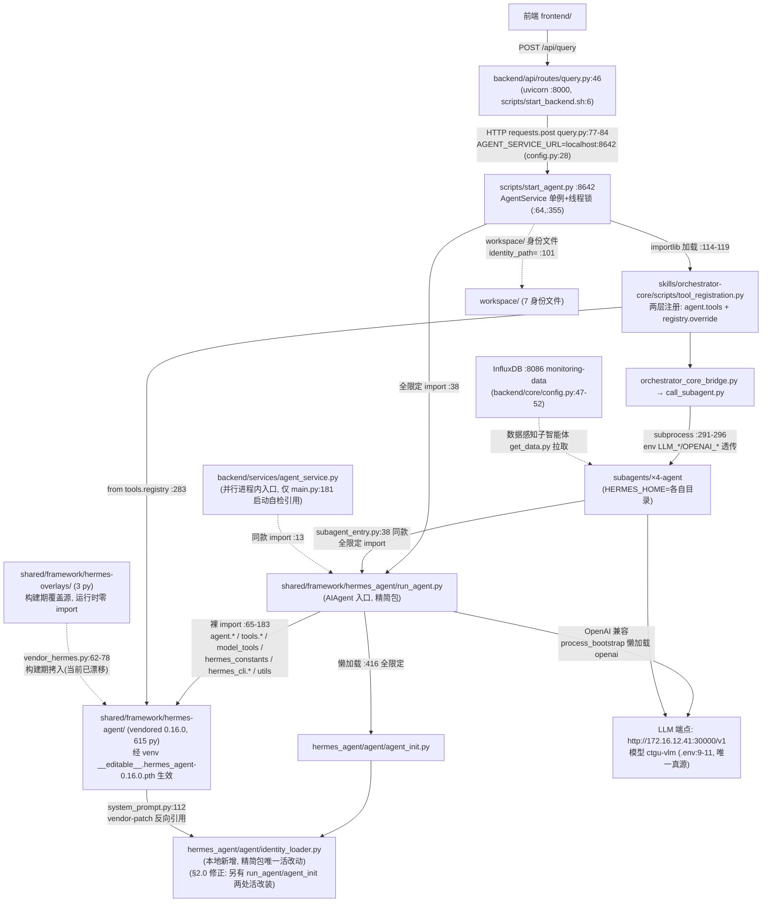

# Hermes Agent 框架评估报告

- 日期：2026-09-14 ｜ 评估基线 commit：`b0db9af4ef8377d32f9e7db6fa8e11794fda384a`（内容见 0.5 节）
- 设计文档：docs/superpowers/specs/2026-09-14-hermes-framework-audit-design.md
- 严重度图例：🔴 阻塞（正确性/可用性风险）｜🟡 应修（质量/维护风险）｜🟢 建议

## 0. 执行摘要

**框架这条路走对了。** 本次评估把 626 个框架文件的真实调用链、对上游的全部本地改动、四个子智能体的接缝、一次真实查询的完整调用过程都查到了文件:行号粒度。对「Hermes 框架对不对」的直接回答：对——它撑起了当前全部活链路，阻塞级问题没有一个出在框架原生代码上。

三个最说明问题的数字：

| 数字 | 含义 | 出处 |
|---|---|---|
| **11 处改动 ≈ 1.8%** | 626 个框架文件里被项目改动的只有 11 个，且近半是同一件事（读身份文件）的配套改动——小针脚缝合，不是侵入式手术 | §2.6 |
| **37 次调用 ≈ 3.1 倍，其中 57% 是浪费** | 实测一个最小监测任务（查进水 pH）全程 37 次 LLM 调用，是旧文档口径「约 12 次」的 3 倍多；多出来的部分主要败在可修的映射表错配与文档过时，不是架构死症 | §4 |
| **8 个红项，落在框架本体的是 0 个** | 全部阻塞级问题：6 个在项目自己的接缝代码/文档/环境，1 个在已退役旧套件，1 个是零测试这类与选型无关的工程债 | §5.4 论据二 |

**裁决：继续用并加固**（三选一里的明确一项；旧 orchestrator-core 套件按「拆弹→归档→抽取→删除」处置，§5.4）。理由一句话：框架链路是三条候选路线里唯一端到端实证跑通过的，用一个从未跑通过的实现去换它，在一人研究项目里没有胜算。

**需要立即修的是 8 项 P0（§6.1，每项带可检验的验收标准）。最危险的一条是「续传伪装」**：同一会话追问时，一旦本轮数据脚本失败，系统会把上一轮的旧结果文件拷进来、改写任务编号、当作本轮成果返回——实测把 7 周前的数据当成「最近 24 小时」交付，全程无报错（§3.1、§4）。它不崩溃、日志也不难看，错的数据长得和对的一模一样——这是监测系统最不能要的一类错。

**所谓「双路线」其实是「现路线 + 一条 7 月底就已退役的前代」**：旧套件在 07-29 已被一次性替换，遗留的只是处置没做完（没归档、没删、文档还在教人用，还埋着一个让全仓测试一跑就炸的旧测试，§5.0/§5.1）。把 §6 的 P0 清单修完，「继续用并加固」这一结论即可复评（触发条件见 §6.4）。

## 0.5 基线事实

评估启动时钉死的事实，后续各节结论均以此为基准。核心证据已随报告入库：`docs/superpowers/specs/2026-09-14-hermes-audit-evidence/`（baseline-commit.txt、upstream-version.txt、dir-relation.txt）；大体积产物（baseline-status.txt、framework-py-manifest.txt）留存在本机 `/tmp/hermes-audit/`。

### 0.5.1 基线快照

- 基线 commit：`b0db9af4`（`git rev-parse HEAD`）。注：计划探索时记录的 `609a867` 在当前仓库中不存在（`git cat-file -t 609a867` 无此对象，历史可能已改写）；以实际 HEAD 为准。
- 工作区状态：存在大量未提交改动（frontend/node_modules、subagents/、workspace/、CHANGELOG.md、CLAUDE.md 等），完整快照见 baseline-status.txt。评估全程只读，不触碰这些改动。
- `shared/framework` 下 Python 文件清单：**626 个**（framework-py-manifest.txt）。

### 0.5.2 三目录关系（证据：dir-relation.txt，命令输出 + 逐文件 diff）

| 目录 | 角色 | 证据 |
|---|---|---|
| `shared/framework/hermes-agent/` | 上游仓库根的 vendored 完整副本 | 含 pyproject.toml、Dockerfile、flake.nix、uv.lock、gateway/、plugins/ 等，顶层条目共 **51** 个（`ls … \| wc -l`，dir-relation.txt 补证段）；无 `.git` 元数据；入库提交 `f446f413`（完整 subject："chore: 把 vendored hermes 框架纳入仓库(部署需要)"） |
| `shared/framework/hermes_agent/`（下划线） | 从上游抽取的**精简包副本**，仅 7 个 .py：`__init__.py`、`run_agent.py`、`utils.py`、`agent/{__init__,agent_init,process_bootstrap,identity_loader}.py` | `find` 输出；`__init__.py` 自述"从 https://github.com/NousResearch/hermes-agent 复制并修改，修改内容：扩展身份文件读取支持" |
| `shared/framework/hermes-overlays/` | 覆盖层：`run_agent.py`、`agent/agent_init.py`（与下划线副本逐字节一致）+ 独有 `tools/orchestrator_tool.py`（废水监测主智能体的子智能体调用工具，文件头注释） | `find` + `diff` 输出 |

关键细节：

1. **上、下划线目录不是整体镜像**：上游目录内部无 `hermes_agent/` 包（`ls -d .../hermes-agent/hermes_agent` → 无）；下划线包是「上游顶层 `run_agent.py`、`utils.py` + `agent/` 子集」的部分拷贝，目的应是使其可作为 `hermes_agent` Python 包导入（`process_bootstrap.py` 中出现 `from shared.framework.hermes_agent.utils import ...` 的 fallback 导入）。
2. **逐字节一致**（副本 vs 上游）：`run_agent.py`、`agent/agent_init.py`（cmp 比对 exit 0，dir-relation.txt 补证段）、`agent/__init__.py`（diff 无输出）。即 `run_agent.py` 与 `agent_init.py` 各自在三处（上游目录、`hermes_agent/`、`hermes-overlays/`）存有完全相同的拷贝。（经 §2.0 修正：此处『上游』实为 vendored 树参照，一致性对象是改装后版本）
3. **本地改动**（副本 vs 上游 diff；经 §2.0 修正：此处『上游』实为 vendored 树参照，一致性对象是改装后版本）：
   - `utils.py`：3 处差异，副本为 `os.sync(f.fileno())`，上游为 `os.fsync(f.fileno())`（行 134/192/259）。语义影响留待 L2 审计判定。
   - `agent/process_bootstrap.py`：副本的 import 增加 try/except fallback（失败时改从 `shared.framework.hermes_agent.utils` 导入）。
   - `agent/identity_loader.py`：**本地新增**，上游无此文件（即 `__init__.py` 所述"扩展身份文件读取支持"）。

### 0.5.3 上游版本（证据：upstream-version.txt）

- **版本：hermes-agent 0.16.0**，作者 Nous Research。来源：`shared/framework/hermes-agent/pyproject.toml`（`name = "hermes-agent"` / `version = "0.16.0"`），与 `hermes_agent.egg-info/PKG-INFO`（Name/Version/Author）互相佐证。
- 局限：上游目录无 `.git` 元数据、无 CHANGELOG.md，故无法核对 0.16.0 对应的上游 commit 或本地是否在上游之上有过改动；该问题留待 L2 改装审计处理。

### 0.5.4 对设计文档 §1.1 的修正

基线 diff 实证推翻了设计文档「1.1 已确认的事实基础（探索阶段结论）」中的两处结论，后续章节以本节为准（Task 2+ 执行者请勿再按设计文档原文理解）：

1. **「改装集中在 overlays 层且规模重大」不成立**（设计 §1.1 事实表第 2 行）：`hermes-overlays/run_agent.py`（5358 行）与 `hermes-overlays/agent/agent_init.py`（1763 行）与上游对应文件逐字节一致（cmp exit 0，见 0.5.2），是上游文件的原样拷贝而非改装产物；overlays 中真正的本地文件只有 `tools/orchestrator_tool.py`（193 行）。实际的本地改动位于 `hermes_agent/` 包副本内：`utils.py`（3 处 os.sync/os.fsync 差异）、`agent/process_bootstrap.py`（fallback import）、`agent/identity_loader.py`（本地新增）。L2 检查项 2.1 的审计对象需据此重新聚焦。（经 §2.0 修正：run_agent.py/agent_init.py 相对真实上游基线 7df3aa34 含 identity 扩展改装，非上游原样拷贝）
2. **「hermes-agent/ 626 个 py」计数归属有误**（设计 §1.1 事实表第 1 行）：626 是整个 `shared/framework/` 的 .py 总数；拆分为 `hermes-agent/` 615、`hermes_agent/` 7、`hermes-overlays/` 3、`shared/framework/__init__.py` 1（合计 626，framework-py-manifest.txt 按前缀计数）。检查项 1.3 的覆盖率测算应按此口径分列。

## 1. L1 活链路追踪（真实架构）

<!-- 覆盖设计文档 §3 L1 检查项 1.1–1.5（1.2 overlay 生效机制须先行钉死；1.3 覆盖率按 0.5.4 修正口径分列） -->

核心证据随报告入库：`docs/superpowers/specs/2026-09-14-hermes-audit-evidence/l1-runtime-findspec.txt`（venv 内 15 条 import 解析实证）、`l1-untouched-strict.txt`（严格未触达清单）。大体积产物（touched-all.txt 451 行、pyc-evidence.txt、untouched.txt）在本机 `/tmp/hermes-audit/`。

### 1.1 入口链：活入口是 start_agent.py，不是（只是）backend/services/agent_service.py

设计假设「唯一活入口 = backend/services/agent_service.py」**部分不成立**：存在两条并行入口，import 目标相同，但当前活链路走 HTTP 转发那条。

**活链路（用户查询的真实路径）**：

```
前端 → backend/api/routes/query.py POST /api/query（backend/main.py:122 挂载，uvicorn :8000，scripts/start_backend.sh:6）
     → HTTP requests.post（query.py:77-84）→ AGENT_SERVICE_URL=http://localhost:8642（backend/core/config.py:28）
     → scripts/start_agent.py（uvicorn :8642，start_agent.py:376/508-515）
     → start_agent.py:38  from shared.framework.hermes_agent.run_agent import AIAgent
```

- query.py:1-5 docstring 自述「重构后：通过HTTP请求转发到Agent服务(localhost:8642)，不再直接创建AIAgent实例」；:46 给出架构「FastAPI → HTTP转发 → Agent服务 → AIAgent(主智能体)」。服务不可用时直接 503（:67-74）。流式端点 /query/stream（路由 :236）经 httpx.AsyncClient 流式转发（import :11，调用 :258-262）。
- scripts/start_agent.py（523 行）自带独立的 `AgentService` 类（:64，**与 backend/services/agent_service.py 同名不同类**）：master_agent 单例 + threading.Lock 串行化（:87-91），initialize() 创建 AIAgent（:97-103，identity_path="workspace"，max_iterations=15 :106-108），会话缓存/查询缓存/跨轮 session 目录续传（:72-84）。

**并行入口（进程内，当前非主路径）**：backend/services/agent_service.py（207 行，全读，/tmp/hermes-audit/agent_service.numbered）：

- import：`from shared.framework.hermes_agent.run_agent import AIAgent`（:13，try/except，失败 fallback 裸 `from run_agent import AIAgent` :20，再失败 AIAgent=None :22）；`from backend.models.query import QueryResponse`（:24）。
- 暴露：类 `AgentService`（:30），方法 `get_agent`（:71，env 读 LLM_* 默认值 :95-98，实例缓存）与 `process_query`（:129，调 `agent.run_conversation(user_message, conversation_history=None)` :163）。
- 全同步（无 async）；错误处理：导入期 try/except 降级（:12-22），查询期 broad except 记日志后 re-raise（:203-207）。
- 引用方仅两处：backend/services/__init__.py:3（re-export）与 backend/main.py:181-183（**启动自检**：实例化一次打日志，不接任何路由）。query.py 不 import 它——活查询流量不经过此文件。

**子智能体入口（第三条，同款 import）**：skills/orchestrator-core/scripts/subagent_entry.py:38 `from shared.framework.hermes_agent.run_agent import AIAgent`（「与主智能体同款路径」，:33 注释）。

三条入口的 import 字符串完全一致 ⇒ 1.2 的 overlay 结论对全链路统一成立。

### 1.2 overlay 生效机制：venv 可编辑安装把裸 import 钉到 vendored 树，overlays 目录运行时零参与

**一句话结论：运行时是「精简包 run_agent（全限定名）+ vendored hermes-agent 全家桶（裸顶层名，经 venv 可编辑安装）」的混合体；hermes-overlays/ 从不被 import——它是构建期覆盖源，由 scripts/vendor_hermes.py 拷进 vendored 树。**

机制三件套（证据链）：

1. **全限定 import 无歧义**：`shared.framework.hermes_agent.run_agent` 经 `shared/framework/__init__.py`（纯 docstring，无 sys.path 操作）作普通包解析到精简包副本。venv 实证（l1-runtime-findspec.txt）：`shared.framework.hermes_agent.run_agent → shared/framework/hermes_agent/run_agent.py`。
2. **裸 import 经可编辑安装落到 vendored 树**：run_agent.py 内部全是上游风格的裸顶层 import（:65 `from hermes_constants import…`、:98 `from agent.process_bootstrap import…`、:123 `from model_tools import…`、:129-131 `from tools.… import…`）。venv = `/home/NYJ2025/Ecological_env/ecological_env`（Python 3.12.12，sys.executable 实测值已入 l1-runtime-findspec.txt）；启动脚本用裸 `python`（`start_agent.py` shebang `#!/usr/bin/env python`、`start_backend.sh` `python -m uvicorn`），实际解析到哪个解释器取决于 PATH 激活——本节全部结论以该 venv 为前提。其 site-packages 存在 `__editable__.hermes_agent-0.16.0.pth` + finder，`dist-info/direct_url.json` = `file:///home/NYJ2025/Ecological_env/shared/framework/hermes-agent`（editable）。find_spec 实证（Python 模块解析探针，importlib.util.find_spec，只查加载路径不执行模块代码）：`agent`、`agent.process_bootstrap`、`tools.registry`、`model_tools`、`hermes_constants`、`utils`、`hermes_cli`、裸 `run_agent` **全部解析到 `shared/framework/hermes-agent/`**；裸 `hermes_agent` 反而 NONE（不可导入）。
3. **overlays 是构建期机制**：scripts/vendor_hermes.py:62-78 `apply_overlays()` 把 `hermes-overlays/` 全部文件按相对路径 copy2 进 `hermes-agent/`（DST，:18），再打两个文本 patch（:83-111：model_metadata OpenRouter 超时 10→1；system_prompt 注入身份文件加载块）。目录名带连字符 ⇒ Python 语法上不可能被 import；全仓 grep 无任何 sys.path 注入/importlib 加载指向它。

**逐文件裁决（md5 + find_spec + pyc 三重证据）**：

| 文件 | 三份拷贝关系 | 运行时生效者 | 判定 |
|---|---|---|---|
| `run_agent.py` | 三份逐字节一致（md5 3fb3838d…：hermes_agent/ = hermes-overlays/ = hermes-agent/） | `hermes_agent/run_agent.py`（全限定名加载） | ✅活；因逐字节一致，「谁生效」对本文件无差别（§2.0 修正：三份一致的是改装后版本，非上游原样） |
| `agent/agent_init.py` | 三份一致（8db8566c…） | `hermes_agent/agent/agent_init.py`（run_agent.py:416 懒加载 `from shared.framework.hermes_agent.agent.agent_init import init_agent`） | ✅活；vendored 的 agent_init.py 反而是严格未触达（无 pyc、无 import 边）（§2.0 修正：三份一致的是改装后版本，非上游原样） |
| `agent/identity_loader.py` | 仅精简包有（本地新增） | `hermes_agent/agent/identity_loader.py`（agent_init.py:1747 引用 + vendored system_prompt.py:112 的 vendor-patch 反向引用） | ✅活——精简包存在的核心理由 |
| `utils.py` | 精简包≠vendored（os.sync×3 vs os.fsync，0.5.2） | **vendored 副本**（裸 `utils` → hermes-agent/utils.py） | 🔴 **精简包的 os.sync 改动是运行时死代码**（该文件无 pyc、无任何全限定 import 引用） |
| `agent/process_bootstrap.py` | 精简包≠vendored（fallback import，0.5.2） | **vendored 副本**（裸 `agent.process_bootstrap` → hermes-agent/） | 🔴 精简包的 fallback 改动同样死代码（vendored 版 :31 只有裸 `from utils import…`，且裸 utils 永远可导入成功，fallback 永不触发） |
| `hermes-overlays/`（3 文件） | — | 无人 import、无 pyc | 构建期源，运行时零参与 |

**对 0.5.4 结论的再修正**：0.5.4 把 L2 审计对象重聚焦到 `hermes_agent/` 副本的三个本地改动；本节实证其中 **只有 identity_loader.py 在活链路上**，utils.py 与 process_bootstrap.py 两处改动运行时不可达（修复它们的正确姿势是重跑 vendor 或改 overlays+patch，而不是改精简包——L2/L4 采纳；§2.6 修正：vendor 管道现状不可复现，见 4 断点，重跑前须先修管道）。

**已发生的构建期漂移（无运行时影响但须记录）**：`overlays/tools/orchestrator_tool.py` 的 PROJECT_ROOT 用 `parents[4]` 相对推导（:13），vendored 副本仍硬编码 `Path("E:/project/Ecological_env")`（Windows 路径，diff 唯一差异行）⇒ overlays 修正后**未重跑 vendor_hermes.py**。漂移之所以无害：tool_registration.py:279-283 判定 vendored 自带 orchestrator_tool 为「多处损坏的桥接」，用 override=True 以本项目 handler 覆盖（见 1.5），两份 orchestrator_tool 均不在调度路径上。

### 1.3 触达清单数据（静态 import 闭包 + pyc 运行时证据）

方法：从 4 个入口 import 语句作种子（start_agent.py:38、subagent_entry.py:38、agent_service.py:13、tool_registration.py:283；含并行入口 agent_service.py——其模块级 import 于 backend 启动时执行，只是不接查询流量），按与运行时一致的解析规则（1.2 三件套；顶层名清单取自 vendored `hermes_agent.egg-info/top_level.txt`；含缩进的懒加载 import）BFS 求传递闭包（从入口 import 逐层展开到不再新增文件）；运行时证据取 `find shared/framework -name "*.pyc"`（cpython-312，与 venv 3.12.12 一致）。

| 口径 | hermes-agent/（615） | hermes_agent/（7） | hermes-overlays/（3） | 合计（626） |
|---|---|---|---|---|
| 静态 import 闭包 | 448（72.8%） | 3（42.9%：run_agent、agent_init、identity_loader） | 0 | **451（72.0%）** |
| pyc 编译证据（至少被加载过一次） | 382（含闭包外 100 个动态加载，其中 plugins/ 系 79 个经插件扫描动态 import，静态 regex 不可见） | 5（含闭包外 2 个 `__init__.py`） | 0 | 388（另含 shared/framework/__init__.py，父包加载证据） |
| 闭包 ∪ pyc | 548 | 5 | 0 | **554（88.5%）** |
| 严格未触达（无静态边且无 pyc） | 67 | **2（utils.py、process_bootstrap.py）** | **3（全部）** | **72** |

注意事项：

- 闭包内 166 个文件无 pyc（hermes-agent 侧；hermes_cli 系占 67）：静态可达但从未真正执行——try/except 可选依赖（bedrock/gemini 等适配器）或从未走到的懒加载分支。**静态闭包是「静态可见 import 集」的上界、必经集的近似上界（未排除动态必经加载，精确界由 §4 E1 判定）**；pyc 是历史执行证据（含冒烟/手工运行），两者都不是「单次 /api/query 必经集合」。另：闭包按 import 语句追踪，不含父包 `__init__.py`（如 shared/framework/__init__.py 有 pyc 无静态边），故并集口径略偏低估。
- pyc ∖ 闭包 = 103 个，证明存在静态 grep 不可见的动态加载（插件扫描为主）。口径辨析：554/626=88.5% 是「**非死重量**（静态可达 ∪ 历史执行）」口径的下界；若按「执行覆盖」口径，下界是 388/626=62.0%（仅有历史执行证据者）。
- 数据落盘：/tmp/hermes-audit/{touched-l1,touched-all,untouched,untouched-strict,pyc-evidence}.txt + 构建脚本 build_touched.py；严格未触达 72 个见 l1-untouched-strict.txt（附录 A 素材）。

### 1.4 配置与 LLM 端点事实

| 配置源 | 活链路是否读取 | 证据 | 要点 |
|---|---|---|---|
| `.env`（项目根） | ✅ **唯一真源** | start_agent.py:29 load_dotenv → :95-97 os.getenv；call_subagent.py:260-267 透传子进程（含 OPENAI_API_KEY/OPENAI_BASE_URL 映射） | `LLM_BASE_URL=http://172.16.12.41:30000/v1`（.env:9）、`LLM_MODEL=ctgu-vlm`（:11）、`LLM_API_KEY`=<已脱敏>（:10）、`HERMES_TOTAL_TIMEOUT=300`（:33） |
| `$HERMES_HOME/config.yaml`（hermes 自身配置） | ❌ 文件不存在 | hermes_constants.py:423-428（config 路径=HERMES_HOME/config.yaml）+ start_agent.py:33（HERMES_HOME=项目根）+ `ls config.yaml`→无 | hermes 的 yaml 配置整体缺席，框架参数全靠 env 与构造参数 |
| `.hermes/config.yaml` | ❌ 不存在 | `wc -c` 无输出 | — |
| `workspace/config.yaml` | ❌ 非活链路（陈旧） | 内容为 LongCat-2.0 @ api.longcat.chat（旧端点）；HERMES_HOME 指向项目根而非 workspace；AIAgent 的 base_url/model 由构造参数显式传入（start_agent.py:97-103） | 遗留文件，若哪天有人「按注释」把 HERMES_HOME 指回 workspace 会引入错误端点——🟡 建议清理（L3） |
| `shared/configs/llm_config.yaml` | ❌ 零读取 | grep backend/ scripts/ skills/ subagents/ framework 无命中 | 端点描述与 .env 一致，纯文档性质 |
| `backend/core/config.py` | ✅ 仅 backend 侧 | :28 AGENT_SERVICE_URL、:30 AGENT_TIMEOUT=600 | 不含 LLM 密钥 |

**LLM 端点事实**：全链路（主+4 子智能体）唯一活端点 = **`http://172.16.12.41:30000/v1`，模型 `ctgu-vlm`**（内网 vLLM，OpenAI 兼容）；OpenAI SDK 经 process_bootstrap 懒加载（`from openai import OpenAI`，_load_openai_cls）。`.env` 同时保留 LongCat 注释行（:14）为备用端点说明，未启用。

### 1.5 子智能体注册与调用机制（谁把 4 个子智能体变成框架可调用的）

注册主体 = `skills/orchestrator-core/scripts/tool_registration.py`（446 行），由 start_agent.py:113-119 在 master_agent 初始化后经 `importlib.util.spec_from_file_location` 按文件路径加载并调用 `register_orchestrator_tools(agent)`（失败仅告警不阻断，:121-127）。两层注册（:214-283，注释自证 2026-07-21 端到端验证）：

1. **schema 层**：把 4 个工具 schema（call_subagent / list_subagents / create_session / read_result，:231-258）灌进 `agent.tools`——conversation_loop 只读 agent.tools 喂给 LLM；同时裁剪工具表，仅保留编排 4 件套 + skill_view/skills_list（:265-272），砍掉 terminal/browser 等分心工具。
2. **registry 层**：handler 以 `override=True` 注册进 hermes 全局 `tools.registry`（:283 `from tools.registry import registry` → vendored 树），取代 vendored 自带且被判定损坏的 tools/orchestrator_tool.py（:279-283）。dispatch 走全局 registry，故覆盖必须发生在这里。

调用链（LLM 决策 → 子智能体结果回传）：

```
主智能体 LLM 决策调 call_subagent（enum 限定 4 个子智能体名，tool_registration.py:242）
→ _call_subagent_handler → orchestrator_core_bridge.py（importlib 桥接，解决目录名连字符不可 import）
→ call_subagent.py:291-296  subprocess.run([sys.executable, subagent_entry.py], env=LLM_*/OPENAI_* 透传（:260-267）+PYTHONPATH=项目根, cwd=subagents/<x>, timeout=600)
→ subagent_entry.py:38  AIAgent（= 又一个完整 hermes 会话：HERMES_HOME=subagents/<x>、max_iterations=6、toolsets=[skills,terminal]，:174-177）
→ 子智能体 LLM 经 skill_view 读自己的技能 → terminal 跑 canonical 脚本 → 结果 JSON 落 SESSION_DIR
→ read_result 读文件 / _compact_result_for_master 紧凑摘要回主智能体（铁律「LLM 绝不读原始数据」，:138-141）
```

- 4 个子智能体映射：`SUBAGENT_PATHS`（call_subagent.py:26-36）：multi-dimensional-data-perception / anomaly-detection / rule-reasoning / disposition-execution → `subagents/<名>-agent/`（目录实存，各含 SOUL.md/AGENTS.md/MEMORY.md/skills/，ls 实证）。
- 进度流：tool_registration 模块级 `_current_progress_queue`（:46，`_emit_progress` :49 起）由 start_agent 的 /query/stream 注入（:117-118 保留模块引用），子智能体各阶段事件（evidence/chartData）实时推给前端。
- 观测性：子智能体 subprocess 全量 stdout/stderr 落盘 `sessions/_subagent_traces/`（call_subagent.py:304-310）。

### 1.6 真实运行时架构图



要点：框架代码实际由两个目录共同构成（精简包 3 个活文件 + vendored 448 个静态可达文件（∪ 历史执行 548））；「身份文件→system_prompt 注入」是精简包与 vendored 树之间唯一的反向依赖（system_prompt.py:112）。

### 1.7 与专利六层架构的映射/偏差（对照仓库根 CLAUDE.md）

| 专利层 | CLAUDE.md 描述 | 实测（L1） | 判定 |
|---|---|---|---|
| 1 人机交互层 | middleware/ Flask :5000 + Grafana | 活交互 = frontend/ + backend/ FastAPI :8000（main.py:121-126）；`middleware/` 目录**不存在**（全仓 find 仅 backend/middleware/logging_middleware.py，FastAPI 日志中间件，与 Flask 无关） | ❌ 偏差（CLAUDE.md 描述的旧链路整体已删） |
| 2 数据采集层 | stream/dual_data_stream.py 推流模拟 | `stream/` 不存在；活数据源 = InfluxDB localhost:8086 bucket monitoring-data（config.py:47-52），由数据感知子智能体拉取（subagents/…/get_data.py 引用 influxdb） | ❌ 偏差（推流→拉取，双流向单源） |
| 3 主智能体层 | workspace/ 身份文件（IDENTITY/SOUL/AGENTS/MEMORY/USER/TOOLS/HEARTBEAT） | workspace/ 7 个身份文件全部实存且被活链路加载：AIAgent(identity_path="workspace", load_soul_identity=True)（start_agent.py:101-102）→ agent_init → identity_loader；backend 侧另有 _check_identity_files 自检（agent_service.py:46-69） | ✅ 对应（载体从「编排脚本读」换为 hermes AIAgent 读，文件集合不变） |
| 4 任务编排层 | workspace/skills/orchestrator-core/scripts/（task_receiving_and_parsing / execution_control / result_interpretation，~12 次 LLM 调用） | 活编排 = **根目录 skills/**/orchestrator-core（tool_registration + call_subagent + subagent_entry），编排主体是 hermes 主智能体 LLM 决策；CLAUDE.md 所指 workspace/skills/orchestrator-core/scripts/ 仍存在（dynamic_orchestrator/execution_control/resource_matching/task_structuring）但**无任何活代码引用**（直接引用全部位于 tests/，共 8 个：integration/test_orchestrator_simple.py:17、integration/test_e2e_architecture.py:11、integration/test_orchestrator_full_pipeline.py:28、integration/test_orchestrator_integration.py、realtime/realtime_orchestrator.py:25、workspace/test_dynamic_orchestrator.py:8、workspace/test_execution_control_integration.py:16、test_master_agent.py:133/178/239——多经 Path 分段拼接，字面 grep 不可见，归 3.5 盘点；另 verify_architecture.py 与 test_four_layer_architecture.py 引用的是同为退役的 master-agent-core 套件，3.5 盘点退役测试时应一并计入；skills/ 活副本内 subagent_tools.py:29 有一条 try 链 fallback import，详查归 3.5 盘点）；「~12 次调用」口径对应旧套件，新链路 LLM 调用次数更多（主智能体多轮 + 每子智能体一次完整 AIAgent 会话），量化归 §4 | ⚠️ 偏差（位置 + 机制双变；旧套件成死代码） |
| 5 子智能体层 | subagents/ 4 个专业智能体，各自身份文件+脚本 | 4 个目录实存（含 SOUL/AGENTS/MEMORY + skills/<core>/scripts），enum 硬编码于 call_subagent schema（tool_registration.py:242）；驱动方式从「本地 coordinator 调脚本」变为「每个子智能体=一次完整 hermes AIAgent 会话（subagent_entry.py）」 | ✅ 对应（驱动载体换为 hermes 子进程） |
| 6 数据支撑层 | shared/（data、models、configs、knowledge、operators） | shared/data、knowledge、operators 实存（是否仍被子智能体脚本消费未逐条核证，归 3.2/3.3 待证）；但 `shared/configs/llm_client.py` 不存在（CLAUDE.md 的 LLM 客户端封装已删），配置真源移至 .env（1.4）；framework/ 新增三大目录（0.5.2）不在 CLAUDE.md 描述内 | ⚠️ 偏差（部分失活 + 未收录新增） |

**总判定**：六层中的 3、5 两层在活链路上成立（载体换成 hermes）；1、2 两层的 CLAUDE.md 实现已整体不存在（❌）；4 迁移且留死代码；6 部分失活+未收录新增（⚠️）。CLAUDE.md 本身已落后真实架构一个代差，应随 L4 裁决一并重写（P1 候选）。

## 2. L2 改装审计

<!-- 覆盖设计文档 §3 L2 检查项 2.1–2.6（按 0.5.4 重聚焦执行；§2.0 含 L2 对 0.5.2/§1.2 两处基线的实证修正） -->

核心证据随报告入库：`docs/superpowers/specs/2026-09-14-hermes-audit-evidence/`（l2-upstream-base-id.txt 上游基线取证、l2-real-mods-vs-upstream.patch 真实改动全集 180 行、l2-exact-diff-summary.txt 文件级差异清单、l2-sim-vs-actual.txt 复现性缺口）。大体积产物（上游 git 浅克隆、sim-dst 模拟树、vendored-vs-upstream-full.txt 初版全量 diff）在本机 `/tmp/hermes-audit/`。

严重度约定（本节）：🔴 = **触发即必炸/必然损坏的潜伏风险**——「红 + 无现行风险」不矛盾（红定的是一旦触发的后果，现行触发路径另注明，如「已判死隔离」「运行时死代码」），供 §6/Task 7 定级；🟡/🟢 沿用报告总图例。

### 2.0 方法升级与基线修正：取得上游 pristine 参考，推翻「上游 commit 无法核对」

0.5.3 声明的局限（「无 .git 元数据，上游 commit 无法核对」）在 L2 被消除：PyPI 无该包（未入库证据，GitHub 为准），GitHub 上游可达。取证过程（l2-upstream-base-id.txt）：

1. 上游用日历标签（v2026.X.Y）发版；逐一抓取 33 个标签的 pyproject.toml 建立版本映射：**v2026.6.5 = 0.16.0**，下一版 v2026.6.19 = 0.17.0。
2. 但 vendored 树 ≠ v2026.6.5：对 v2026.6.5..v2026.6.19 区间 **1746 个 commit + 2 个端点 tag（共 1748）** 逐个做 blob-hash 匹配（vendored 795 个文件 hash vs 各 commit `git ls-tree`），最佳匹配 **`7df3aa34`（2026-06-10，v2026.6.5 后 5 天，pyproject 仍 0.16.0）：764/795 blob 完全一致**，次优 763 且逐日递减——基线唯一确定。
3. 31 个不一致文件全部有归属（7 个差异文件见 2.1 表；24 个 vendored 独有文件 = 22 个 `hermes_cli/web_dist/` 构建产物 + `start-api-server.bat` + `tools/orchestrator_tool.py`（后者即 2.1 表 #6，vendor 管道带入的本地新文件）；运行时 marker .hermes-bootstrap-complete 已排除在 795 计数外），无「无法解释」残差 ⇒ 基线判定置信度高。
4. 对基线忠实复演 vendor 三步（拷贝→overlays→PATCHES，`/tmp/hermes-audit/simulate_vendor.py`）得模拟树 sim-dst，与实际 vendored 树的残差 = 复现性缺口（见 2.6）。

**对 0.5.2/§1.2 的两处实证修正**（0.5.2 的比对基准是 vendored 树本身，属循环论证——三份本地拷贝互证一致 ≠ 与上游一致）：

- **修正 1**：`run_agent.py` 与 `agent/agent_init.py` **不是上游原样拷贝**。对真上游 7df3aa34：run_agent.py **+12/−2**（:413 新增 `identity_path` 构造参数、:416 `from agent.agent_init import` 改为 `from shared.framework.hermes_agent.agent.agent_init import`（跨树引用）、:487 传参、:5105-5113 run_conversation 调用改关键字参数）；agent_init.py **+22**（:224 新增参数、:1740-1760 identity_path 解析块，含 3 空行）。§1.2 表格「三份逐字节一致⇒原样拷贝」的结论作废（三份一致仍真，但一致的是**改装后**版本）；§1.6 架构图中 VEND 与 RA 的边界不变，仅「run_agent/agent_init = 上游原样」这一定性需更正。
- **修正 2**：vendored 树内另有 **3 处 vendor 脚本未声明的源码改动**（agent/\_\_init\_\_.py、agent/chat_completion_helpers.py、hermes_constants.py，见 2.1 表 #5/#7/#9），其中 2 处（hermes_constants、agent/\_\_init\_\_）曾在 overlays 中声明（31345964，2026-07-21，共 5 文件）后被 e263fb67（07-23「清理框架层」）从 overlays 删除，改动本体只在 vendored 树里存活。

### 2.1 改动全集分类表（检查项 2.1：每处改动归四类 + 生死 + 声明状态）

「全集」口径 = vendored 树 ∪ hermes_agent/ 精简包 ∪ hermes-overlays/ 对真上游 7df3aa34 的全部差异（±行 = 标准 diffstat 口径含空行；合计双口径见 2.6）。证据覆盖面：l2-real-mods-vs-upstream.patch 仅含 vendored 侧 7 文件；#1/#10/#11（hermes_agent/ 独有）以 0.5.2/dir-relation.txt 的副本-vs-vendored 比对佐证（上游无对应文件或差异仅存在于精简包侧）；#9 同样存在于会执行的精简包 agent/__init__.py（hermes_agent/agent/__init__.py 同内容，随包加载生效）。**vendor 脚本声明面与实际 diff 对不上**（Before You Begin 预警的情形，实证成立）：声明的 = overlays 3 文件 + PATCHES 2 条；实际的 = 下表 11 处代码改动 + 3 项内容差异。

| # | 改动 | 位置（生效副本） | ±行 | 四类归属 | 运行时生死（引 §1） | 声明状态 |
|---|---|---|---|---|---|---|
| 1 | identity_loader.py 本地新增 | hermes_agent/agent/（102 行，上游无此文件） | +102 | 身份文件扩展 | ✅ 活（§1.2 裁决：精简包存在的核心理由） | hermes_agent/\_\_init\_\_.py 自述声明 ✅ |
| 2 | run_agent.py：identity_path 参数 + 跨树 import | hermes_agent/run_agent.py = vendored = overlays（三份一致） | +12/−2 | 身份文件扩展 | ✅ 活（入口链 §1.1） | overlays 拷贝携带 ✅（但语义未注明） |
| 3 | agent_init.py：identity_path 解析块 :1740-1760 | 同上三份一致 | +22 | 身份文件扩展 | ✅ 活（§1.2：run_agent.py:416→agent_init） | overlays 拷贝携带 ✅ |
| 4 | system_prompt.py：身份文件注入块 :102-118（含 :112 反向引用 identity_loader） | vendored（PATCHES 产物） | +17 | 身份文件扩展 | ✅ 活（主+子智能体 system prompt 均经此） | PATCHES :93-110 声明 ✅（实树仅引号风格微漂移，语义等价） |
| 5 | hermes_constants.py：IDENTITY_FILES 常量 + get_identity_files() :112-133 | vendored | +25 | 身份文件扩展 | ❌ 死代码（全仓零调用方，grep 实证；活链路用的是 identity_loader.py:13 的另一份副本） | 🔴 未声明：曾入 overlays（31345964）后被 e263fb67 删除，重跑 vendor 即静默丢失 |
| 6 | tools/orchestrator_tool.py 本地新增 193 行 | vendored（E:/ 硬编码版）≠ overlays（parents[4] 修正版） | +193 | 编排改动 | ❌ 判死 + override（§1.2/§1.5；详析见 2.4） | overlays 拷贝声明 ✅，但修正后未重跑 vendor（L1 已钉） |
| 7 | chat_completion_helpers.py：注释掉 `stream_options` :1743-1744 | vendored | +2/−1 | 项目特化（vLLM 适配） | ✅ **活**——流式端点 /query/stream 经 start_agent.py:475 stream_callback → conversation_loop :1002 走流式补全 | 🔴 **从未声明**（不在 overlays、不在 PATCHES，仅存活于 vendored 树） |
| 8 | model_metadata.py：OpenRouter 超时 10→1 :631 | vendored | +1/−1 | 项目特化（内网适配） | ✅ 活（模型元数据冷启动路径） | PATCHES :86-89 声明，但**声明文本与实树已分叉**（实树注释文本不同且位置正确；按现 PATCHES 重跑会产出语法错误文件，2.6） |
| 9 | agent/\_\_init\_\_.py：删除 jiter 预载 import + 中文 docstring | vendored | +2/−7 | 无法完全推断（无注释；行为变化=去掉 OpenAI SDK 流式解析器 jiter 的提前导入） | ✅ 活（agent 包加载即执行；Linux 无影响，Windows 开发机理论上有 import-order 风险，jiter_preload.py docstring 自证其为 Windows 专用 workaround） | 🔴 未声明：同 #5，07-23 被移出 overlays |
| 10 | utils.py：os.fsync→os.sync ×3 :134/192/259 | 仅 hermes_agent/（vendored 不带） | +3/−3 | 无法推断（无注释） | ❌ 运行时死（§1.2 裁决）+ 本身是必炸 bug：`posix.sync() takes no arguments`（实测 TypeError），非「语义差异」而是**写错 API**——也反证该改动从未被执行过 | 未声明（0.5.2 已记录差异，L1 已裁决） |
| 11 | process_bootstrap.py：import fallback :31-35 | 仅 hermes_agent/ | +5/−1 | 项目特化（为精简包独立可导入） | ❌ 死（§1.2：裸 utils 经 venv 永远可导入，except 分支不可达） | 未声明（0.5.2 已记录） |

内容级差异（非逐行代码改动，同样属「对上游改了什么」）：**(a) 上游整棵 `skills/` 目录（467 文件，含 38 个 .py）在 vendored 树中缺席**——vendor 脚本 EXCLUDE_DIRS 只排除了 optional-skills，未排除 skills（vendor_hermes.py:22-27），缺席未声明（推测系 Windows 源树 D:\Hermes 无此目录或拷后手工删除；后果见 2.6）；**(b)** `.env.example` 缺席（同理未声明）；**(c)** vendored 独有 `hermes_cli/web_dist/`（22 文件 = assets 10 + favicon + fonts 7 + fonts-terminal 3 + index.html，上游 git 内无此构建产物，系源树带入）与 `start-api-server.bat`（Windows 遗留启动脚本，内含 test-key-123/sk-test 占位密钥与内网端点，走的是上游 gateway 而非项目 start_agent.py，同为历史残留）。

### 2.2 hermes_agent/ 精简包差异裁决（检查项 2.2）

§1.2 的生死结论全部维持并加严一处：

- **utils.py（#10）**：不只是「语义影响待判定」——`os.sync(f.fileno())` 在 CPython/Linux 上是 **TypeError（sync() 不接受参数）**，一旦该文件被导入执行，三处原子写（save_json/save_text/save_yaml）全部抛异常。当前因运行时走 vendored 副本（§1.2）而未爆雷，但这是**埋在仓库里的必炸点**：任何「复活精简包 utils」的重构（如把 hermes_agent 变成真正自洽的包）都会踩中。🟡 建议：直接改回 os.fsync（或整文件对齐 vendored 版后从精简包删除该文件——它本就无人引用）。
- **process_bootstrap.py（#11）**：fallback 逻辑不可达的根因是 venv 可编辑安装使裸 `utils` 恒可导入（§1.2 三件套之 2）。改动无害但无效——精简包 7 文件中 4 个（utils、process_bootstrap、两个 \_\_init\_\_）对运行时无贡献，真正被用的只有 run_agent、agent_init、identity_loader 三个（§1.3 口径一致）。
- **新增修正（§2.0 修正 1）**：精简包 run_agent.py/agent_init.py 相对上游是**改装版**（identity 扩展链的组成部分，归入 #2/#3，非原样拷贝）。精简包不是「干净的镜像 + 3 个小改动」，而是「3 个活改装 + 2 个死改动 + 2 个顺带拷贝的 \_\_init\_\_」。

### 2.3 identity_loader.py：新增文件而非改写（检查项 2.3）

**定性：全新增**（上游 7df3aa34 无此文件，hermes_agent/\_\_init\_\_.py 自述「扩展身份文件读取支持」与实证一致；不是对上游某文件的改写或移植）。

**职责**（102 行，3 个公开函数，identity_loader.py）：

- `load_identity_files_from_path(path)` :24-59——按 IDENTITY_FILES 顺序（:13-21 七文件）读目录中实际存在的身份文件，拼 `## {文件名}\n\n{内容}` 返回；文件级 try/except 容错、空文件跳过。**消费方 = vendored system_prompt.py:112**（PATCHES 注入块内，主智能体经 `agent._identity_path`、子智能体经 HERMES_HOME，§1.2）。
- `resolve_identity_path(path, project_root)` :84-102——相对路径相对 project_root 解析，缺省回落 `project_root/workspace`。**消费方 = agent_init.py:1744-1747**（先尝试裸 `agent.identity_loader`——vendored 树无此文件必失败——再回落全限定名，恒走回落分支）。
- `load_single_identity_file` :62-81——**零调用方，死函数**。
- :52-54 悬空注释记录 2026-07-27 决策（编排技能不再预载、改用 hermes 原生 skill_view），注释位置错放在拼接函数中段——文件内部留着演进痕迹。

**质量评价**：接口窄、无全局状态、debug 级日志、逐文件容错，作为模块设计 🟢 合格。问题是**结构性的**：(a) IDENTITY_FILES 列表双份维护（此处 :13 与 hermes_constants.py:115，后者整段死代码），靠注释「与hermes_constants保持一致」自律，无测试约束；(b) 它是跨树反向依赖的锚点——vendored system_prompt.py:112 与 agent_init.py:1747 都 import `shared.framework.hermes_agent.agent.identity_loader`，即 **vendored 树的运行时正确性依赖精简包目录存在**（§1.6 已标注该唯一反向依赖；L2 确认依赖方向为 vendored→精简包，且无任何包级别声明保障，仅靠 venv + 相对布局巧合成立）。

### 2.4 orchestrator_tool.py：功能、判死实证、被替代史（检查项 2.4）

**注册了什么**（overlays/tools/orchestrator_tool.py，193 行）：模块级向 hermes 全局 registry 注册 4 个工具（:55/:108/:137/:167，toolset="hermes-cli"，check_fn 恒 True，requires_env 空）：`call_subagent`（:58-92 schema，enum **8 个名**——4 正名 + data-perception/anomaly/rule/disposition 4 别名；context 参数类型 object）、`create_session`、`list_subagents`、`read_result`。handler 惰性经 `_get_subagent_tools()`（:16-43）import `workspace.skills.orchestrator_core_bridge` 取 4 函数。

**如何被加载**：vendored tools/registry.py:57-79 `discover_builtin_tools()` 扫描 tools/*.py 中含顶层 `registry.register` 调用者并自动 import ⇒ vendored 副本随模型工具初始化自动注册（这正是它必须被 override 而不能无视的原因）。

**判死实证 = 现状静态核证 3 条 + 历史 e2e 佐证**。注意：tool_registration.py:279-281 判词（「handler 签名错、schema 双层包裹致 LLM 400」）系 07-29 的历史转述，与下列各条**不一一对应**（判词中的「签名错」对应的是诞生版问题，见时间线），分立列证：

1. **import 目标不存在**：`workspace/skills/orchestrator_core_bridge.py` 全仓不存在（workspace/skills/ 下仅 orchestrator-core 目录）。git 考古：该桥接 02bc229e（2026-07-29「迁移orchestrator-core到skills/」）由 workspace/skills/ 迁至根 skills/ 后，此 import 恒 ImportError ⇒ 4 个 handler 全部落入 :38-43 `_not_available` 桩，调用即返回 `{"error": "Subagent tools not available: ..."}`。**overlays 修正版同样死**——它只修了 PROJECT_ROOT（E:/→parents[4]），import 目标缺失是两份共同死因。
2. **schema 双层包裹**（本次静态核证）：registry 约定存**裸 function dict**、由 get_definitions 统一包 `{"type":"function",…}` 外壳（registry.py:99-106 `__init__` 内联注释），本文件却传预包裹形式（:59-91）⇒ 双层包裹。**历史 e2e 佐证（2b532b00，07-21 16:11，orchestrator_tool 诞生 38 分钟后）**：commit 自述实测 "triply broken: (1) handler **kwargs signature, (2) _get_subagent_tools pointed at subagent_tools which lacks create_session, (3) double-wrapped schema -> LLM HTTP 400"，恢复 override 后 "call_subagent completed 74s, real COD answer, no errors"。对照：tool_registration.py:285-288 override 时传的就是裸 function dict。
3. **vendored 副本 E:/ 硬编码漂移**（§1.2 已钉；diff-C-orchestrator.patch 唯一差异行）。

**存在却被判死的原因 = 历史演进残留**，时间线（git 考古）：07-19（ef184ebc）tool_registration.py 雏形（353 行）已存在，**先于 orchestrator_tool 两天——替代机制与旧工具自始并行**；07-21 15:32（31345964）orchestrator_tool 诞生（import 指向 workspace/skills/…/subagent_tools、E:/ 硬编码）；07-21 16:11（2b532b00）诞生 38 分钟即被同日 e2e 判「triply broken」，恢复 override 并修 overlay import 指向桥接 workspace.skills.orchestrator_core_bridge；07-27（3edb0a4f）仅一行改动：E:/→parents[4] 去硬编码，**只修 overlays 未重跑 vendor**（漂移出生）；07-29（02bc229e）orchestrator-core 迁到根 skills/，桥接 import 目标死亡——旧工具彻底死亡，tool_registration 两层注册（07-19 起并行存在）成为唯一机制，此后 orchestrator_tool 再无提交，成为不再被调度但仍随 vendor 管道分发的尸体。

**被谁替代、替代质量**：tool_registration.py:214-297——第 1 层把 4 个 schema 灌 agent.tools（conversation_loop 只读此处），第 2 层以 `override=True` 注册进全局 registry（:283-294）。关键：**override=True 正是上游 registry 为「插件替换内建工具」预留的官方扩展点**（registry.py:251-254 docstring 自证设计意图）⇒ 替代实现走在正规扩展点上，enum 收敛为 4 正名（:242）、context 改 string、handler 直连活桥接，正确。**残留问题是负面外部性**：vendored 副本每次启动仍被 discover_builtin_tools 自动 import 并注册 4 个坏工具，再被 override 仪式性盖掉——纯噪音 + 双份 193 行文件 + E:/ 死路径。🟡 建议：直接从 overlays 删除本文件并清理 vendored 副本（runtime override 已自足），或在报告 §5 裁决后随胜出路线一并处置。

**与上游工具的关系**：非改装上游工具（上游无同名/同功能工具），是**仿上游 tools/*.py 模式新增的本地文件**；上游对该模式的官方支持恰是它想用的机制，坏在实现细节（schema 包裹层级、import 目标）与后续失修。

### 2.5 四属性评分表（检查项 2.5）

评分依据 = hunk 上下文精读（上文逐条）+ vendored 树扩展点扫描（`hook|register|plugin|patch` grep：registry.register/override、plugins/ 插件体系、config.yaml、check_fn、dynamic_schema_overrides）。

| 改动（#） | 动机可推断性 | 正确性风险 | 上游同步冲突面 | 松耦合替代方案（本可用 X 而不必改源码） |
|---|---|---|---|---|
| 身份扩展链 #1-#4 | ✅ 高：PATCHES :90-92 与代码注释自证（主 7/子 3 文件、双路径探测） | 🟢 低：try/except 包裹 + `_identity_path` 缺省回落 HERMES_HOME；活链路证据 = import 边 + pyc（身份内容实际落入 prompt 的直接观测归 §4 E1；try/except 静默失败 ⇒ 非硬依赖，身份缺失时退回原生 SOUL.md 行为） | 🟡 中：system_prompt 补丁锚定上游 17 行文本（改写法则 no-match，脚本 :123 有告警防护不炸）；**run_agent/agent_init 以整文件 overlay 锁死**（5358+1763 行，上游任何演进全部丢失，且 overlays 版与精简包版三份一致性靠手工维护） | 🟡 部分：上游 system_prompt 无身份扩展点（仅 SOUL.md :88-100 + DEFAULT_AGENT_IDENTITY 回落），确需改源或**部署期把 7 文件合并生成 SOUL.md**（数据级替代，代价失文件粒度、子智能体目录同理）；更优路径是给上游提 feature/PR |
| #7 stream_options 移除 | ✅ 高：注释「removed for vLLM compatibility」 | 🟡 中：按代码注释与 usage_obj=None 路径**推断**流式 usage 缺失（vLLM 是否真不发 usage chunk 未直接观测），usage_obj=None 传入 mock response（chat_completion_helpers.py:2038/:2062）——不炸但**流式路径 token 计量退化为空**（account_usage/上下文预算拿不到服务端数据）；活路径（/query/stream） | 🟡 中：该文件是上游高频改动区（基线后上游已多次演进该函数），行级手工改动每次 re-vendor 都要对齐 | 🟡 存在模式不存在开关：上游有 per-provider extra_body 机制先例（:656 github_reasoning_extra、:1377 reasoning 分支）——**本可按 provider 条件分支**（vLLM 才不带 stream_options）而非全局删除；升级 vLLM 版本可能根本不需要此改动（待查：172.16.12.41 vLLM 版本——归属 §4 E 系实证或 §3 项目适配盘点处理） |
| #8 OpenRouter timeout | ✅ 高：注释自证（内网不可达、阻塞 ~12s、已由 vLLM /v1/models 提供） | 🟢 低：超时→静态回退（上游 :234 自带 offline fallback），语义无损 | 🟢 小：锚定单行 | ❌ 无：OPENROUTER_MODELS_URL 是编译期常量（hermes_constants.py:496），无 env/config 开关——**四类改动中最正当的一处**；但现 PATCHES 文本已漂移成重跑即产出语法错误文件（🔴，2.6），须先修声明再谈复现 |
| #9 去 jiter 预载 | ❌ 低：无注释；对照 jiter_preload.py docstring（Windows 专用 import-order workaround）推测为「清理无关代码」，但项目恰从 Windows 开发（D:\Hermes） | 🟢 低（Linux 部署无影响）/ Windows 开发机理论风险 | 🟢 小 | ✅ 本可不改：`# noqa: F401` 的预载无害；如要移除也应记入 overlays 而非只改 vendored 树 |
| #5 hermes_constants 死扩展 | ✅ 高（身份扩展配套）但**从未接线** | 🟢 无（零调用） | 🟢 小 | 应删除（活链路用 identity_loader 那份） |
| #10 os.sync | ❌ 不可推断（疑编辑事故） | 🔴 必炸 TypeError——幸为死代码，属「埋雷」 | 🟢 小（仅精简包） | 不应存在：改回 fsync 或删文件 |
| #11 fallback import | ✅ 高（为精简包独立可导入） | 🟢 无（不可达） | 🟢 小 | 不必要：venv 下裸 utils 恒可导入（§1.2） |
| #6 orchestrator_tool | ✅ 高（初代集成载体） | 🔴 三重损坏（2.4）——已被 override 隔离，无现行风险 | 🟢 小（上游无此文件） | ✅ 存在且已被用：registry override=True 即官方扩展点；文件本身应删（2.4 建议） |

### 2.6 量化与上游同步策略评估（检查项 2.6）

**改动行数分布**（对真上游 7df3aa34，l2-real-mods-vs-upstream.patch）：

| 类别 | 文件数 | +行/−行 | 占比 |
|---|---|---|---|
| 身份文件扩展（#1-#5，含死代码 #5） | 5 | +178/−2 | 46% |
| 编排（#6 orchestrator_tool） | 1 | +193 | 50% |
| 项目特化/环境适配（#7/#8/#11） | 3 | +8/−3 | 2% |
| 无法推断（#9/#10） | 2 | +5/−10 | 1% |
| **合计（.py 代码改动）** | **11** | **标准 diffstat +384/−15；非空行口径 +333/−13**（新文件空行占比高：identity_loader 102 行中非空 78、orchestrator_tool 193 行中非空 176；占比按 diffstat 行数四舍五入，列和不等于 100%） | 626 个 .py 中涉及 11 个（9 改 2 新增）≈ 1.8% |

**文件耦合度**：(a) 三份拷贝组 ×3（run_agent.py、agent_init.py、orchestrator_tool.py 前两者三份逐字节一致靠手工同步，后者两份已漂移——拷贝一致性无任何机制保障）；(b) 跨树 import 3 条且方向倒挂：vendored→精简包 2 条（system_prompt.py:112、agent_init.py:1747——**上游树代码 import 项目精简包**，venv editable install 是唯一粘合剂）、精简包内 1 条（run_agent.py:416）——静态口径 2 条倒挂，运行时口径仅 system_prompt.py:112 一条真正跨树执行（vendored agent_init.py 严格未触达（§1.2），:1747 从不执行；运行时 agent_init 是精简包自身文件，其 identity_loader import 属包内自引）；(c) IDENTITY_FILES 双份（2.3）；(d) 上游 lockstep 缺失：uv.lock/版本声明仍是上游 0.16.0，无任何「本树 = 7df3aa34 + 11 处改动」的 provenance 记录（0.5.3 声明的局限经 L2 已可消除，建议在 vendored 根落一个 BASE_COMMIT/PROVENANCE 文件）。

**上游同步策略评估（一句话：vendor 管道设计思路正确、现状完全不可复现，处于「一次性快照」状态）**。四个断点（全部有实证）：

1. 🔴 **脚本本身语法错误**：`python3 -m py_compile scripts/vendor_hermes.py` → SyntaxError（:89 多一个 `)`），**自 e263fb67（07-23）入库起即坏**，工作区与 HEAD 同坏；此前版本（311f23db 及更早，07-21）可解析但无 PATCHES 段 ⇒ **没有任何一版已提交脚本能重放出当前 vendored 树**（08-03 的树由未提交的本地版本或手工补丁产出）。脚本自述「本脚本 + overlays 进 git，保证可复现」不成立。
2. 🔴 **PATCHES 文本漂移**：按现 PATCHES（修复语法后）对 pristine 基线复演，model_metadata 产出 `'(' was never closed` 的语法错误文件（模拟实测，l2-sim-vs-actual.txt）——声明文本是旧的，实树是手改正确的。
3. 🟡 **overlays 不完整**：#5/#9 两个改动 07-23 被移出 overlays 后仅存于 vendored 树，重跑 vendor 即**静默丢失**（其中 #7 从未有过声明载体，同样丢失）。
4. 🟡 **排除集与实树不符**：skills/（467 文件）与 .env.example 缺席但未被 EXCLUDE 声明——重跑会引入 467 个文件，且**框架内建技能库将出现在 skill_view/skills_list 里，改变主智能体可见技能集**（行为差异，非纯体积问题）；vendored 独有的 web_dist/、start-api-server.bat 则会在重跑后消失。

上游演进压力：上游至今已发布至 v2026.9.11 = 0.21.2，vendored 0.16.0 落后 **16 个 tag / 15 个版本化 release（0.17.0→0.21.2，l2-upstream-base-id.txt 标签映射）**；结合 §1.3（554/626 非死重量）与 2.5 冲突面评估，升级须先修 4 个断点并把「整文件 overlay」（run_agent/agent_init）降级为「最小 patch 或上游 PR」，否则每次升级都是手工重做。修复清单为 §6 P0 候选：①修脚本语法+PATCHES 文本（以实树为准回填）；②把 #5/#7/#9 补进 overlays/PATCHES 或显式决策删除；③EXCLUDE_DIRS 显式加入 skills/（或决策保留上游技能库）；④落 PROVENANCE 文件记录基线 commit；⑤删除 orchestrator_tool（2.4）；⑥utils.py os.sync 必炸点改回 os.fsync 或删除该死文件（§2.2 🟡，该建议在 §2.2 另有上下文）。

## 3. L3 项目适配审计

<!-- 覆盖设计文档 §3 L3 检查项 3.1–3.5 -->

**范围与方法**：按实际三入口审（计划原文"唯一入口=agent_service.py"已被 §1.1 修正），主审 `scripts/start_agent.py`（523 行，活链路服务）、`skills/orchestrator-core/scripts/subagent_entry.py`（227 行，第三入口；计划所写 scripts/subagent_entry.py 实际位于活编排目录）、`backend/services/agent_service.py`（207 行，仅 backend/main.py:179-186 启动自检引用）+ HTTP 转发端 backend/api/routes/query.py。运行时证据：`sessions/_subagent_traces/`（5 份全量 subprocess 日志，全部 2026-08-04）+ `sessions/session_*/`（结果文件与 task.json）+ git 工作区状态。严重度沿用 §2 约定：🔴=触发即必炸（含"触发即必错"的数据正确性红线，单独注明）、🟡=确定性缺陷/风险、🟢=健康。红项另按实际语义标注子类型，统一方括号记法：【触发即必错·数据正确性】【假声明/保障失效】【工程保障红线】【业务断链·运行时口径】（④⑤ 沿用第四类，见 §3.3）——后三类无"触发即炸"形态，属 §3 实践扩展。🔴 的最终归级（尤其数据正确性类与运行时口径类，如 ④⑤ 无崩溃但标红的边缘分级）由 §5 裁决与 §6 路线图终裁。

### 3.1 接入层逐行审（检查项 3.1）

五维逐条（文件:行号）：

| 维度 | start_agent.py（主入口 :8642） | subagent_entry.py（子智能体入口） | agent_service.py（自检入口） |
|---|---|---|---|
| 异常处理 | 🟢 无裸 except；process_query broad-except 记日志返 500（:344-351）；流式 worker except→error 事件（:481-483）。🟡 工具注册失败仅 `logger.warning` 后照常 serve（:123-126），/health 仍报 healthy（:395-401 只看 master_agent 非空）——注册一坏，业务全降级为纯聊天而健康检查全绿 | 🟢 import 失败 sys.exit(1) 快速失败（:39-41）；LLM 块 broad-except 带 exc_info 落盘（:204-207）；结果文件缺失/无效诚实标 failed（:86-108, :190-200，注释自证旧版曾用 glob 顶替伪装成功，已修） | 🟡 :12-22 三级 import 降级链，末级静默 fallback 裸 `from run_agent import AIAgent`——实现被静默换掉无告警（运行时若 venv editable 缺失则 AIAgent=None，:84-85 才报） |
| 超时与重试 | 🟡 **超时体系无端到端 deadline**：锁排队 300s（:82-83, :265）+ 后端转发 600s（backend/core/config.py:29 AGENT_TIMEOUT，query.py:77-84 透传）+ 子进程默认 600s/个（call_subagent.py:289 SUBAGENT_TIMEOUT）×最多 4 子智能体 + 主智能体 max_iterations=15（:106-108）——各层独立，最坏叠加远超任何外层上限。🔴 **HERMES_TOTAL_TIMEOUT 是死旋钮**【子类型：假声明/保障失效——宣称的服务级上限不存在】：start_agent.py:34-36 注释宣称"服务级上限 300s"并 setdefault，但全 vendored 树 grep 零消费者（仅 auxiliary_client.py:774 的 Codex 专用局部参数撞名）——宣称的整体超时不存在 | 🟢 外层 subprocess timeout 硬杀（call_subagent.py:291-299, 335-342 TimeoutExpired 处理完备）；内层仅 max_iterations=6（:177）兜底。🟡 :169 LLM_MODEL 默认值仍是 `LongCat-2.0`（退役端点遗物，仅 .env 缺失时触发） | 🟡 run_conversation 无任何 timeout（:163-166），仅 max_iterations=10（:117）；无重试（LLM 重试全靠框架内建 jittered_backoff，vendored run_agent.py:145，本层不配置） |
| 同步阻塞 | 🟢 /query 用 sync def 走 FastAPI 线程池（:415-421，注释自证若 async 会冻事件循环）；master_agent 共享单例用 threading.Lock 串行化 + 排队超时拒"忙"（:80-83, :265-266）——正确的守门。🟡 /query/stream worker 为 daemon 线程持锁跑全程（:489），客户端断连后 SSE 生成器终止但 worker 不受影响、锁要占到跑完；`_tool_reg._current_progress_queue` 模块级全局靠锁保证安全（tool_registration.py:42-46，注释自证 contextvars 不透传 executor 线程） | 🟢 一次性 subprocess（同步等待），不占服务 worker；结尾 os._exit 跳过 bg-review 后台线程（:220-227，注释给出 ~20-30s/次 的省耗依据） | 🟡 **:39-44 `os.chdir` 进程级副作用**——backend 进程 cwd 被整体改到项目根，影响同进程一切相对路径假设；无锁（agent_cache 按 session 缓存实例，同 session 并发调 run_conversation 会串台）——现仅启动自检构造（不触 LLM、不触 chdir 路径外的逻辑），地雷属性 |
| 配置硬编码 | 🟡 :89-91 LLM_BASE_URL/MODEL 硬编码回退值 `http://172.16.12.41:30000/v1`/`ctgu-vlm`（agent_service.py:95-97、call_subagent.py:245/258 同款）——.env 缺失时静默指向内网 IP 而非报错；:33 无条件覆盖系统 HERMES_HOME（有注释说明动机，🟢）；:508 端口默认 8642 可 env 覆盖 🟢；:51 `session_id: str = None` 类型不合法但 pydantic 默认不校验 default，能跑 | 🟢 LLM 配置全经 call_subagent.py:260-269 显式透传（含 OPENAI_* 映射）；:167-171 缺 API key 直接 raise（外层 :248-256 已先行拦截，双保险） | 同款硬编码回退（:95-97）；🟢 :36 项目根用 parents[2] 推导不写死绝对路径 |
| 日志与可观测 | 🟢 分级清晰（初始化/查询耗时/消息数/子智能体计数 :322）；trace 队列让阻塞 /query 也回传 decision_path+subagent_calls（:267-319）→ backend 落审计表（query.py:120-140）；子智能体全量 stdout/stderr 落盘 sessions/_subagent_traces/（call_subagent.py:304-319，成败都写）——L3 实证全靠它 | 🟢 每步 [START]/[LLM]/[WRITE]/[WARN] 结构化日志，stderr 收 subprocess 全量 | 🟡 :46-69 `_check_identity_files`（检查 workspace 7 文件）**零调用方，死代码**——写了身份自检从未接上；:186-188 decision_path/sub_agent_calls 恒空（"可以后续实现"） |

**3.1 补充裁决**：

- 🔴 **续传机制把失败轮伪装成成功（触发即必错，数据正确性红线）**：start_agent.py:187-223 `_fresh_session_dir` 在每轮开头把同会话上一轮的 `*_result.json` 拷进新目录（设计意图=追问链式消费），但 subagent_entry.py:182-216 读结果文件时**无法区分本轮产出与续传旧文件**，且 :214 强制 `result["task_id"] = task_id` 重标。实证（sessions/_subagent_traces/task_20260804153354_79c04c46）：15:33:54 感知子智能体 get_data.py 因缺模块崩溃（6/6 迭代耗尽在 pip install 上），同会话上一轮（15:32:55，成功，数据 2026-07-24~07-25）的 data_result.json 被续传进来，本轮以 `[LLM] 回传脚本结构化结果` 判"completed"——而本轮任务要的是 **7 月 14-15 日**数据（task.json 实文），交付的却是 7 月 24-25 日旧数据。触发条件确定：同会话追问轮里 canonical 脚本一旦失败，旧数据必被重标为本次结果。
- 🟡 **子智能体 LLM 可运行时改写业务脚本，且已发生一次**：subagent_entry.py:177 `enabled_toolsets=["skills","terminal"]`，skills 工具组含 **skill_manage**（trace 实证："Enabled toolset 'skills': skill_manage, skill_view, skills_list"）。tool_registration.py:267-276 只为**主智能体**剪除了 skill_manage（"砍掉真·分心工具"），子智能体全保留。实证：trace task_20260804151453 显示子智能体 LLM 调 `skill_manage patch` 修改 get_data.py（"Patched scripts/get_data.py … 1 replacement"）——git diff 确认工作区该文件有且仅有一处未提交改动 `freq="H"→"h"`（pandas 2.x 弃用修复，技术上正确）。该补丁无害甚至有益，但**受版本控制的业务代码被 LLM 在运行时改写、以未提交状态留在工作区**，无任何 review 门槛（subagents/ 下共 39 个未提交修改文件，仅此一处可由 trace 直接归因）。
- 🟢 接入层整体工程质量好于预期：锁+排队超时、线程池让位、subprocess 超时硬杀、全量 trace 落盘、失败诚实标注（15:14:53 轮 get_data 未产出即标 failed）都是正确做法；问题集中在**跨层接缝**（死旋钮、续传重标、剪枝不对称）。

**3.1 红黄速查（供 §5/§6/Task 7 扫描）**：🔴×2——①HERMES_TOTAL_TIMEOUT 死旋钮【假声明/保障失效类】（上表"超时与重试"行）；②续传重标伪装成功【触发即必错·数据正确性类】（下条）。🟡 TOP——①skill_manage 未从子智能体剪除（LLM 已实证运行时改写 get_data.py）；②超时体系无端到端 deadline；③LLM 端点硬编码回退值三处（start_agent.py:89-91 / agent_service.py:95-97 / call_subagent.py:245）；④/health 不反映工具注册成败；⑤agent_service.py 地雷属性（os.chdir 副作用:39-44 / 无 identity_path / 静默 import 降级:12-22）；⑥死代码对（查询缓存 start_agent.py:137-160 已禁用、_check_identity_files agent_service.py:46-69 零调用）。

### 3.2 四子代理身份文件齐全度矩阵 + 加载对照（检查项 3.2）

框架实际读取清单（identity_loader.py:13-21 `IDENTITY_FILES`，经 vendored system_prompt.py:102-118 注入——主智能体走 `agent._identity_path`（start_agent.py:101 identity_path="workspace"），子智能体走 HERMES_HOME 回退（system_prompt.py:106-108，call_subagent.py:239 设 HERMES_HOME=子智能体目录））：

| 子智能体 | IDENTITY.md | SOUL.md | AGENTS.md | MEMORY.md | USER.md | TOOLS.md | HEARTBEAT.md | 实际被加载 |
|---|---|---|---|---|---|---|---|---|
| multi-dimensional-data-perception | ✓ | ✓ | ✓ | ✓ | ✓ | ✓ | ✗ | 6 文件全载（HEARTBEAT 跳过 :40-41） |
| anomaly-detection | ✗ | ✓ | ✓ | ✓ | ✗ | ✗ | ✗ | 仅 SOUL/AGENTS/MEMORY 3 个 |
| rule-reasoning | ✗ | ✓ | ✓ | ✓ | ✗ | ✗ | ✗ | 仅 SOUL/AGENTS/MEMORY 3 个 |
| disposition-execution | ✓ | ✓ | ✓ | ✓ | ✓ | ✓ | ✗ | 6 文件全载 |

裁决：

- 🟡 **齐全度不对称且与文档冲突**：根 CLAUDE.md 宣称每个子智能体有 IDENTITY/AGENTS/SOUL/TOOLS/USER/MEMORY 六件套——实测 4 个中只有 2 个齐全，anomaly-detection 与 rule-reasoning 仅 3 件。system_prompt.py:104 注释"子智能体 3 个自然区分"说明 3 文件形态是有意设计，但同一批 4 个目录两种形态并存，且 CLAUDE.md 未同步——按文档补齐会把无用的模板塞进 prompt，按设计走则该修 CLAUDE.md（属 §1.7 六层映射文档漂移的又一实例）。加载器对缺失文件静默 debug 级跳过（identity_loader.py:40-41），无任何告警。
- 🟡 **子智能体 SOUL.md/AGENTS.md 双重注入**：原生 load_soul_md（prompt_builder.py:1401-1420，读 HERMES_HOME/SOUL.md，system_prompt.py:93-100 首位注入）与定制 identity_loader 块（system_prompt.py:112-114 再读同一目录的 SOUL.md）**同一文件进 prompt 两次**；AGENTS.md 同理（skip_context_files=False（subagent_entry.py:176）时原生 context 注入读 cwd 的 AGENTS.md（agent_init.py:267），子智能体 cwd=自身目录（call_subagent.py:299），与 identity_loader 读的又是同一文件）。每次子智能体启动白耗 prompt 且人格指令双倍加权。主智能体因 cwd（项目根）无 AGENTS.md 幸免一半，但见 3.4 的 SOUL 问题。
- 🟢 身份加载链本身按 §1.2/§2.3 结论健康：identity_loader 是活链路唯一精简包新增文件，缺失身份静默退回原生行为（system_prompt.py:118-119 `except Exception: pass`）——本节实证退路不必要：四目录身份文件均在，注入路径每轮 trace 可见（skill 前的 system prompt 组装无报错）。
- 🟢 HERMES_HOME 复用的副作用：Hermes 把子智能体目录当完整 home 使用，运行时在 subagents/*/ 下长出 audio_cache/、auth.lock、cron/、hooks/、sessions/、memories/ 等运行时目录（multi-dimensional 与 anomaly-detection 目录实测，git check-ignore 确认已忽略，不污染 git 状态）——功能无害，接缝观感差，建议 HERMES_HOME 指向独立运行目录、身份与技能以软链/显式路径供给。

### 3.3 业务闭环证据链（检查项 3.3）

五环节逐个取证（工具注册名 → handler → 脚本 → 运行时证据）。注册与调用总链见 §1.5；本节补业务侧：

| 环节 | 代码证据（谁在哪行调用什么） | 运行时证据 | 判定 |
|---|---|---|---|
| ① 数据源接入（InfluxDB） | 感知子智能体 canonical 脚本 `get_data.py`：:30/64 经 `shared.data.influxdb_query.fetch_wastewater_df` 查 InfluxDB（:160 InfluxDBClient，url/token/org/bucket 全走 env，.env 实有 INFLUXDB_URL/TOKEN/ORG/BUCKET 四件套），:202-210 写 `SESSION_DIR/data_result.json` | trace task_20260804153255：脚本跑通，取回进出水各 24 条 | 🟢 **框架链路直连 InfluxDB 实证**（非 CSV；根 CLAUDE.md 的 stream/dual_data_stream CSV 数据流叙事属退役链，§1.7 已定）。🟡 数据新鲜度：证据窗（2026-08-04）内查询取回的是 07-24 14:00~07-25 13:00 数据——**最新数据止于 2026-07-25**，距证据窗 ~10 天、距报告日（09-14）约 7 周（51 天）；成因二选一（InfluxDB 数据停更 / --hours 语义=最近N条而非墙钟N小时），未再深挖 |
| ② 多维感知 | LLM enum 注册（tool_registration.py:242）→ `_call_subagent_handler`（:301）→ bridge → call_subagent.py:26-36 路径映射 → subprocess subagent_entry.py → 子智能体 LLM skill_view 读 SKILL.md → terminal 跑 get_data.py | 4 份感知 trace（15:14/15:15/15:32/15:33）：2 成 2 败（15:14 缺结果标 failed 诚实；15:33 见 3.1 🔴 续传重标） | 🟢 链路通。🟡 SKILL.md 文档漂移：data-perception-core/SKILL.md 全文只讲 CSV 工作流（acquire_from_csv、"path/to/influent.csv" 占位），**get_data.py（真正的 InfluxDB 入口）在 SKILL.md 与该子智能体 AGENTS.md 中零记载**——LLM 靠 skill_view 翻目录/猜名才发现（trace: skill_view file_path=scripts/get_data.py） |
| ③ 异常检测 | `run_anomaly_detection_simple.py`：:102-129 优先链式消费 SESSION_DIR/data_result.json（字段映射注释自证与 InfluxDB 契约的差异处理），:505 起写 anomaly_result.json；算子经 operator_adapter 接 shared/operators/ | trace task_20260804151515：跑通，检出 19 处异常，写 anomaly_result.json（sessions/ 实存 1 份） | 🟢 链路通（代码+运行时双证）。🟡 同款文档漂移：anomaly SKILL.md 推荐 `from scripts import detect_anomalies`，canonical 脚本 run_anomaly_detection_simple.py 零记载 |
| ④ 规则推理 | `run_rule_reasoning.py`：:61-126 读 SESSION_DIR/anomaly_result.json + data_result.json（含废弃绝对路径 fallback :83/:116），写 rule_reasoning_result.json。🟡 **知识库接缝是假的**：regulation_matcher.py:35 设 `regulations_dir = Path("E:/project/...")`（Windows 死路径，本机必不存在）但 `_load_regulations`（:43-79）根本不读它——法规全是内联硬编码 dict（GB 18918-2002/HJ 355-2019/水污染防治法）；**shared/knowledge/regulations/（排放标准.md、水污染防治法.md）零读取**，"数据支撑层"对规则推理未接线（E:/ 全仓扫描仅此一处功能性残留 + robust_estimator.py:11 一处 docstring 提及） | **零运行时证据**：sessions/ 全树检索 rule_reasoning_result.json = 0 份；_subagent_traces/ 5 份全量日志中 rule-reasoning 0 份 | 🔴 **业务断链**【业务断链·运行时口径】：代码链完整、**现存零执行记录**（记录缺失≠全称否定——sessions/ 是唯一证据留存地，更早记录若被清理则无法排除历史上曾跑通）。已搜：sessions/ 全树、_subagent_traces/ 全量、进程日志（agent.log/backend.log 未含子智能体调度明细） |
| ⑤ 处置执行 | `run_disposition.py`：:58-126 读 anomaly_result + rule_reasoning_result（:91 因④现存零执行记录而必空），融合/分级/工单接 shared/configs/*（untracked 新文件 consensus/disposition/rule_config.yaml），写 disposition_result.json | **零运行时证据**：disposition_result.json = 0 份；trace 0 份 | 🔴 **业务断链**【业务断链·运行时口径】，同上 |

**断链定性**：④⑤的"断"按现存证据口径是**零执行记录**而非"接不上"——每次查询是否走到④⑤由主智能体 LLM 即兴决定（无强制 pipeline 编排；tool_registration 只给工具不给顺序，顺序引导在 workspace/AGENTS.md:99-135 的任务链描述里，且 :135 指向的还是退役路径 workspace/skills/orchestrator-core/）。sessions/ 里唯一有完整多环节的会话（session_20260804_151448：data+anomaly）也止步于③。结论：**五环节代码全通、运行时通 3 断 2**；"influxdb→感知→异常检测"闭环成立（含数据新鲜度保留意见），"→规则推理→处置执行"后两环在活框架链路上零执行记录，专利叙事的完整违规判定-预警闭环（根 CLAUDE.md"4 类违规/预警分级"）在现运行时没有一次完整走通的实证。

**依赖接缝补充**：🟡 influxdb-client **未声明依赖**（requirements.txt/pyproject.toml 均无，venv 实装 1.50.0 系 LLM 运行时 pip install 所致——trace 实证两次安装，且装进了 `~/.local/lib/python3.10`（terminal 裸 `python` 解析到 3.10 用户环境，与服务 venv 3.12 不是一个解释器）；15:33 轮崩溃正因解释器解析不稳定）。归级说明：此条曾是 🔴 断链候选，因环节①已有 InfluxDB 直连跑通的 trace 实证（链路本身通）降为 🟡——风险是环境脆弱性（venv 重建后 get_data.py 必然 ModuleNotFoundError，直到 LLM 再自己 pip install 一次）叠加①行数据新鲜度存疑，而非当前断链。修法一行：requirements.txt 加 influxdb-client。

### 3.4 workspace 身份文件 vs 框架加载一致性（检查项 3.4）

| 文件 | 存在 | 框架是否真读 | 证据（读它的代码行） |
|---|---|---|---|
| IDENTITY.md | ✓ | ✅ 读 | identity_loader.py:14（IDENTITY_FILES[0]）经 system_prompt.py:112-114 注入；内容=废水监测主智能体身份卡（与运行 persona 一致） |
| SOUL.md | ✓ | ✅ 读（但见下） | identity_loader.py:15 同上。🟡 **另有第二处 SOUL 注入**：原生 load_soul_md（system_prompt.py:93-100）读的是 **HERMES_HOME/SOUL.md = 项目根/SOUL.md**（start_agent.py:33 把 HERMES_HOME 定为项目根）——该文件 513 字节，内容是 **"You are Hermes Agent… created by Nous Research" 原版人格**（框架 ensure_hermes_home 自动生成物）。主智能体 system prompt 首位身份句是 Nous Hermes，废水监测身份卡在其后第二块——双重人格注入，每轮必现 |
| AGENTS.md | ✓ | ✅ 读 | identity_loader.py:16；编排引导实际在此（:99-135 任务链），但 :135 引用的编排技能路径是**退役的** workspace/skills/orchestrator-core/，而 skill_view 实际作用域是 HERMES_HOME/skills = 根 skills/（活副本）——引导文与机制指向两棵树，靠 LLM 不到错的树上找才不出事。identity_loader.py:53-54 注释"引导见 workspace/AGENTS.md（主智能体用 skill_view 读编排技能，HERMES_HOME=workspace 作用域）"对 HERMES_HOME 的表述也是错的（实际=项目根） |
| MEMORY.md | ✓ | ✅ 读 | identity_loader.py:17；19K 长期记忆每轮全量入 prompt（有体积隐患，未见截断逻辑——identity_loader 无 _truncate_content 调用，与原生 load_soul_md 的截断（prompt_builder.py:1422）不对称）🟡 |
| USER.md | ✓ | ✅ 读 | identity_loader.py:18 |
| TOOLS.md | ✓ | ✅ 读 | identity_loader.py:19；内容质量好：编排工具用法/数据路径表（InfluxDB bucket、算子库、知识库）与实况一致，:7 的 `skills/orchestrator-core/SKILL.md` 根相对路径指向活副本 ✓ |
| HEARTBEAT.md | ✓ | ✅ 作为文本读 | identity_loader.py:20——但**心跳机制未接线**：内容是周期检查清单（InfluxDB 连续性/服务健康/异常回顾），活链路无任何调度器触发它（start_agent 不起 cron/heartbeat；根 cron/ 目录是 HERMES_HOME 运行时产物非配置）。纯 prompt 装饰 🟡 |
| config.yaml | ✓ | ❌ 零读取 | §1.4 已定（LongCat 旧端点遗留）；§1.4 挂账的 🟡 清理建议在此闭环确认：文件头注释还在教人 `set HERMES_HOME=...workspace`，照做会同时换错模型端点+丢根 skills 作用域，建议删除 |
| skills/（orchestrator-core） | ✓ | ❌ 主智能体不可见 | 退役区（§1.7：仅 tests/ 8 文件引用）；主智能体 skill_view 作用域=根 skills/（HERMES_HOME=项目根），workspace/skills/ 整棵不可见 ✓ 与 §1.7 一致 |

**3.4 总裁决**：workspace 7 个身份文件全部真被加载、无一被忽略——加载覆盖面 ✅；不一致集中在**内容层**：根 SOUL.md 原版人格抢首位（应删根 SOUL.md 或清空）、AGENTS.md 编排路径指退役树、HEARTBEAT 无调度器、config.yaml 死文件、MEMORY.md 无截断。

### 3.5 测试覆盖盘点（检查项 3.5）

tests/ 共 28 个 .py（含 2 个 `__init__.py`）。关键词 `agent_service|start_agent|subagent_entry|AIAgent|hermes` 全树 grep **零命中**（复查两遍）——没有任何测试提及活框架链路的任何组成：

| 押注方向 | 文件数 | 清单 | 判定 |
|---|---|---|---|
| 活框架链路（三入口/tool_registration/call_subagent/subagent_entry/AIAgent/registry override） | **0** | — | 🔴 **活链路零测试**【子类型：工程保障红线——无触发无崩溃，是 §3 其余红/黄项的放大器（无一可被测试拦截）】。3.1 的 🔴 续传重标、死旋钮、3.3 的断链，全部无测试可拦截 |
| 活业务脚本（绕过框架直 import 子智能体脚本） | 13 | tests/subagents/ 全部 10 个（data_acquisition/data_decomposition/data_cleaning/violation_detector×2/consensus_engine/report_generator/work_order_generator/alert_classifier/action_executor）+ tests/integration/{test_full_pipeline, test_end_to_end, run_simple_test} | 🟢 业务算子层有单测；但**全部绕过 LLM/编排**（sys.path 直插 scripts/ 目录），canonical 脚本中 get_data.py（InfluxDB 入口）、run_anomaly_detection_simple、run_rule_reasoning、run_disposition 四个入口脚本零测试 |
| 退役编排链 | 10 | ① workspace/skills/orchestrator-core 直 import 8 个（§1.7 清单逐一复核确认）：test_master_agent、test_orchestrator_{simple,full_pipeline,integration}、test_e2e_architecture、test_dynamic_orchestrator、test_execution_control_integration、realtime/realtime_orchestrator；② master-agent-core 2 个：verify_architecture.py、test_four_layer_architecture.py | 🔴 ①引用退役路径。②中 **test_four_layer_architecture.py:46-50 `from workspace.skills.master_agent_core.scripts...` import 的模块已不存在——直接运行或全树 pytest 收集（test_* 命名在默认收集范围内）即 ImportError（触发即必炸）**；verify_architecture.py:22 硬编码 `Path("E:/project/Ecological_env")`（Windows 路径），本机运行所有存在性检查恒 ✗——不炸但输出全错（仅直接运行触发；无 test_ 前缀，不在 pytest 默认收集内） |
| 其他（runner/实时流残件/`__init__`） | 5 | run_tests.py、realtime/{test_realtime_integration, realtime_analyzer}、`__init__`×2 | 🟢 中性 |

**押注结论**：测试重量押在**退役链（10 个）+ 与框架无关的业务算子（13 个）**，活框架接缝（三入口、注册覆盖、subprocess 编排、续传/会话目录语义、SKILL.md↔脚本契约）**一个测试都没有**。CLAUDE.md「Testing」节的指引漂移面比"3 条命令"更大（计数口径）：3 条命令中 2 条指向退役链（test_orchestrator_simple :23/:55、test_master_agent :58）、1 条指向绕框架的业务直连测试（test_full_pipeline :61）；另有 `python -c` 示例代码块（:42）sys.path 直插退役的 workspace/skills/orchestrator-core/scripts，并引用 §1.4 已判零读取的 shared/configs/llm_config.yaml 与退役 middleware/.env——Testing 节 4 处指引无一指向活链路，测试文档需随 §1.7 一并重写（归 §6 路线图处置，此处只记录事实）。

**对 §4/E1 的预警（L3 证据边界向实证环节传递）**：

- (a) **证据窗距今约 6 周，当前存活状态未探测**：全部运行时证据止于 2026-08-04；本审计**未探测** agent 服务（:8642）、LLM 端点（172.16.12.41:30000）、InfluxDB（:8086）三者当前是否存活——E1 执行前应先做存活探测，否则实证对象可能已不是 §3 描述的形态。
- (b) **InfluxDB 数据停滞风险**：证据窗内最新数据止于 2026-07-25（§3.3① 新鲜度保留意见向 §4 传递）——若 E1 时仍停滞，"最近 N 小时"类活查询会取回陈数据或空结果；E1 判读须校验返回数据的时间戳，不能只看查询成败。
- (c) **续传污染**：E1 协议若含同会话追问轮，§3.1 🔴 续传重标会把上一轮 `*_result.json` 伪装成本轮产出，污染一切基于结果文件的观察——E1 观察须以 `sessions/_subagent_traces/` 日志为准，结果文件只作交叉验证。

## 4. LLM 调用实证

<!-- 覆盖设计文档 §3 E 最小实证 E1–E4（E1 计数 wrapper 仅注入 /tmp；E4 降级时本节须显著标注「未实证」）；对照 CLAUDE.md「~12 次调用/流程」口径 -->

**裁决：全活实证（未触发降级链）**。2026-09-14 14:25 对活链路完成一轮带计数插桩的真实运行，LLM 端点（172.16.12.41:30000，ctgu-vlm/vLLM）、agent 服务（:8642）、InfluxDB（:8086）三项存活探测全绿后才执行（L3 预警 a 落实）。核心数字：**最小监测任务（单子智能体即可满足的 pH 查询）全程 37 次 LLM 调用**（主智能体 9 + 子智能体 4 个会话×7），墙钟 79.7s，任务成功。

### E1 方法：计数 wrapper（仅注入 /tmp，零源码改动）

TDD 完成（计划唯一 TDD 任务）：先写失败测试（ModuleNotFoundError，红）→ 最小实现 `CountingProxy`/`Waterfall` → 测试通过（绿）。chokepoint 经代码核实选在**双层**（互为交叉验证）：① patch `openai.resources.chat.completions.Completions.create`——run_agent 单点建 client（:3412 `_create_openai_client`，注释自证唯一构造点）、chat_completion_helpers 非流式 :239/流式 :1767/迭代摘要 :1458 全走此方法、auxiliary_client 15+ 构造点经 :635-648 shim 同样收敛于此，故它是精确的「LLM 调用次数」计数器；② patch `httpx.Client.send/AsyncClient.send`（openai SDK 底座）过滤 :30000 authority 作兜底网，任何不经 ① 的端点请求均现形。注入方式 `PYTHONPATH=/tmp/hermes-audit + sitecustomize.py`（解释器启动即旁路记录，只读不消费流式响应体）；call_subagent 以 env 继承启子进程 ⇒ 主进程 + 4 个子智能体进程共 **5 个 AIAgent 全部插桩**（各进程日志首行实证）。两层数字对账：httpx 层 /chat/completions 请求 37 = openai 层调用 37，**零漏计**。

### E2 执行与瀑布

任务「查询进水 pH 最近数据并给出一句话结论」经探针实例（:8643，独立于活服务 :8642）POST /query 执行；护栏全记录在案（附录 B）：四树 705 .py 跑前 md5 快照+备份、跑后 **705/705 零 drift**、.env 临时改动已恢复（md5 一致）、900s 内建预算实际 81.9s 用毕、无残留进程。瀑布（按进程会话，全表见附录 B）：

| 阶段（会话） | 调用 | 流/非流 | 消息数增长 | 结局 |
|---|---|---|---|---|
| 主智能体 master | 9 | 9/0 | 2→20 | 完成编排+最终回答 |
| 子会话1 multi-dimensional-data-perception（下称 mddp） | 7 | 6/1 | 2→16 | failed：读 skill 未跑脚本 |
| 子会话2 mddp | 7 | 6/1 | 2→15 | failed：同上 |
| 子会话3 "data-perception"（合法别名·名称变体） | 7 | 6/1 | 2→16 | **误判 failed**（脚本已产出，文件名错配） |
| 子会话4 mddp | 7 | 6/1 | 2→16 | success |
| **合计** | **37** | 33/4 | — | 3/4 子会话浪费 |

结构规律：**每个子智能体会话固定 7 次** = 6 轮流式（全部打满 subagent_entry 的 max_iterations=6）+ 1 次非流式收尾摘要（仅此 4 次有 usage：pt 78,025 / ct 2,475）；33 次流式全部无 usage——§2.1 改动分类表 #7（stream_options 删除⇒流式计量退化）在活链路原样复现（该推断由本次实证坐实）。累计重发 prompt 1.84M 字符（主智能体首轮 35,785 → 末轮（第 9 轮，20 条消息）85,861 字符，2.4×）。另有 **50 次非对话探测请求**（每 AIAgent init 2 轮×5 个 Ollama 风格端点×5 进程，/version 200 余 404）。

### E3 对照「~12 次调用/流程」口径

CLAUDE.md 的 ~12 次属**已退役** orchestrator-core 链路（1 计划 + 4 子×2 + 3 中间处理，且是**完整 4 子智能体**流程）；本次活链路**最小单子智能体任务即 37 次**（≈3.1 倍，任务规模还不对等）。偏差三构成：① **架构换代**——旧协调器单发函数（每子 2 次），新链路每个子智能体是完整 hermes AIAgent 会话（≥7 次）；② **失败放大**——3/4 子会话浪费（21 次，占 57%），主智能体对每次失败整会话重试；③ 主智能体多轮决策循环本身 9 次。外推全 4 子流程 ≈ 4×7+主轮（≥9）≈ 37+ 起，≥3 倍旧口径——CLAUDE.md 口径对新链路彻底失效（§1.7 判断获量化确认）。

### E4 降级声明

**未降级**：端点/服务/数据库三项存活，活链路一次跑通并成功返回结论；mock LLM 与静态推演两级降级路径备而未用，本节数字均为实测，无「未实证」标注项。唯一妥协：为与活服务 :8642 并行，探针实例以临时 .env 改动落位 :8643（跑后已恢复并 md5 验证），端口差异不影响调用结构。

### 实证新增发现（§3 未及/升级，移交 §6）

1. 🔴 **别名键在两份重复映射间漂移→成功被误判失败**【触发即必错·数据正确性】：主智能体第 3 次重试用了非规范名 "data-perception"——它是 call_subagent.py:32-33 SUBAGENT_PATHS 白名单里的合法别名（8 键 = 4 规范名 + 4 简化别名），call_subagent 自带的 RESULT_FILE_NAMES（:40-51）同样 8 键并正确把该别名映射到 data_result.json，名称校验层**存在**（:167-172 按 8 键表校验，表外名直接拒）；真缺陷在 subagent_entry.py:52-57 维护了**第二份同语义映射却只收 4 个规范名**，且 `.get(name, "result.json")`（:182 取结果、:209/:216 写结果同用）静默兜底——脚本按规范名写 data_result.json、entry 却读 result.json → 误标 failed → 又多烧一整轮会话（7 次）。另注：tool_registration.py:242 的 call_subagent 参数 enum 只列 4 个规范名，但 dispatch 侧未按 enum 强制（LLM 传枚举外的别名仍被别名表放行）。修法应指向「两表合一/给 subagent_entry 补别名键」，而非「加校验层」（校验已在，错在映射漂移）。本例同时是 L3 预警 c 的活体例证：会话 3 的 result.json 把「脚本已跑成」标为 failed——结果文件只作旁证、以 trace 日志+探针计数为准的取证规则再次成立。
2. 🔴 **「最近」数据静默返陈（升级 §3.3① 🟡→🔴）**【触发即必错·数据正确性】：任务问"最近数据"，脚本实际返回 2026-07-24（约 7 周前）数据，最终回答仍称"最近 24 小时"——L3 预警 b（InfluxDB 停更于 07-25）在活链路原样兑现。定级对账：与 §3.3① 同一根因（数据停更），但实证新增证据——**用户侧实际拿到顶着「最近 24 小时」话术的 7 周陈数据且无任何提示**，已从「数据新鲜度保留意见」升为用户侧静默数据错误，故 🟡→🔴。
3. 🟡 **服务层 trace 显著少计**：/query 回传 trace 的 decision_path=2、subagent_calls=1（仅成功项），实际子进程启动 4 次（探针+落盘日志双证）——失败重试对后端审计不可见，「trace 供审计」的承诺打折。
4. 🟡 **AGENT_PORT 环境覆盖已死**：hermes_cli/env_loader.py:238 以 override=True 加载 HERMES_HOME/.env，import 时碾压一切进程环境变量——start_agent.py 头注「可通过环境变量 AGENT_PORT 配置」失效，.env 永远赢（并行实例被迫临时改 .env）。
5. 🟡 **每 AIAgent init 10 次盲探**：5 进程×10 次 Ollama 风格端点探测（404 为主）打向 vLLM；子智能体是短命进程，探测无缓存复用，纯噪音请求。
6. 🟡 **重复读同一 SKILL.md**：成功会话内 skill_view 同一技能 3 次（trace skill_calls 自证）；主智能体 prompt 自首轮 35,785 → 末轮（第 9 轮，20 条消息）85,861 字符，约 2.4×——上下文成本随轮数线性放大无压缩介入（未过 50% 阈值，compressor 未触发是符合设计的，但说明常规任务已顶着高基数 prompt 跑）。
7. 观察：auxiliary client（openrouter/nous）每次 init 都探测并标 unhealthy（payment/credit error），无 aux LLM 调用实际服务流程；其外部端点流量不计入 :30000 口径（按「.env 唯一真源」界定）。

**样本限度**：n=1，LLM 行为非确定（「读 skill 未跑脚本」失败率、重试次数逐次浮动），37 是一次完整样本而非稳定均值；结构结论（每子会话 7 次封顶、双层零漏计、trace 少计）为确定机制，数值结论（37、57% 浪费率）待多样本收窄。

## 5. L4 双路线裁决书

<!-- 覆盖设计文档 §3 L4 检查项 4.1–4.4（4.4 终审三选一，不许和稀泥；含过渡步骤与被裁一方处置） -->

**决策输入（用户立场，不预设结论）**：①废水监测研究项目（非生产，无外部用户/SLA 压力）；②专利六层架构是初始构想、可演进（§1.7 总判定：3/5 两层成立、1/2 两层叙事已不存在、4/6 两层偏差）；③作者懂业务不懂框架内部（框架维护动作须可由业务视角验收）；④团队规模=1 人。**取证方法**：git 时间线命令按计划 Step 1 原文执行（全部 commit hash 可在仓库复验）；旧链路侧行号来自 workspace/skills/orchestrator-core/ 残存代码实测（4 文件共 3772 行：execution_control.py 2281 / resource_matching.py 899 / task_structuring.py 334 / dynamic_orchestrator.py 258）；外部参照只取本机材料机制，不引入任何新依赖。

### 5.0 git 时间线取证（检查项 4.1·前半）

| 事件 | 日期 | commit | 事实 |
|---|---|---|---|
| 旧套件诞生 | 2026-06-03 | b2a97f2d | workspace/skills/orchestrator-core 首次入库（feat(master-agent): add master-agent SKILL.md）；累计 **52 个提交**（6 月 15 + 7 月 37），末次即迁移日 02bc229e |
| 框架进场 | 2026-07-09 | b076b2f8 | shared/framework 目录创建；此后 **18 个提交**全部落在 7 月 |
| 框架接入层成形 | 07-16 / 07-19 | 85b2f7c9 / 5b001cc1 | agent_service.py（07-16）、start_agent.py（07-19）入库；tool_registration.py 雏形同日（ef184ebc，§2.4 已引：替代机制与旧工具自始并行） |
| **替换已执行过一次** | 07-29 | 02bc229e + 9d8a7d88 | 「迁移orchestrator-core到skills/」——旧路径当天死亡，subagent_entry.py 随迁；同日合并旧技能精华（9d8a7d88）；根 skills/ 全部历史仅 4 个提交（docs→迁移→合并→清理） |
| 框架快照入库 | 07-30 | f446f413 | vendored 树入库（§0.5.2）；同日清理提交 7ea6c4fe——**shared/framework 与两条编排链路此后零提交** |
| 冻结期 | 07-30 → 09-14 | b0db9af4（08-04）等 | 全仓仅 08-04 两条提交（其一即本评估基线 b0db9af4）+ 09-14 审计系列；运行时证据止于 08-04（§3.5 预警 a） |

时间线裁决三点：

1. **「谁是后写的」**：框架链路后写（编排机制 07-19 vs 旧套件 06-03），且 07-29 迁移本身是一次**已执行的单向替换**——旧套件不是「并行备选」而是被替换的前代实现（02bc229e 自述动机「修复主智能体编排技能从未生效」）。所谓「双路线」实为「现路线 vs 已退役前代」。
2. **双轨期约 3 周**（07-09/07-19 → 07-29）：旧套件 8 周 52 提交的投入沉淀为退役代码；活链路（根 skills/ 4 提交）自 07-30 起同样停止演进——两链皆冻结，不存在「一方在演进一方在腐化」的动态。
3. **事实标准 = 框架链路**：活引用唯一（旧套件直接引用全部在 tests/ 共 8 处，§1.7）、活实证唯一（§4 E1 端到端跑通；旧套件无任何一次完整五环节运行记录，「~12 次调用」系设计口径非实测，§4 E3）。

### 5.1 职责矩阵与重复度（检查项 4.1·后半）

| 职责 | 框架链路（活） | 旧 orchestrator-core 链路（退役） | 重复判定 |
|---|---|---|---|
| 任务解析 | 主智能体 LLM 多轮即兴（vendored conversation_loop）；引导文 workspace/AGENTS.md:99-135（§3.4——引导文自身还指向退役路径） | task_structuring.py:115 TaskStructuringModule.structure_task（:142）→ StructuredTask（:70）；CLAUDE.md 叙事的 task_receiving_and_parsing.py 在残存树中**已不存在**（CLAUDE.md 漂移再加一例，归 P1 重写） | 重复（机制不同：LLM 即兴 vs 规则结构化） |
| 子代理调度 | tool_registration.py:242 enum → call_subagent.py:291-296 subprocess（§1.5） | execution_control.py:315 coordinate_agent_execution、:1469 _llm_plan_subagent_execution、:1578 _llm_process_agent_output；resource_matching.py:85 SchedulingDecisionModule | **完整重复**（CLAUDE.md「Two-Layer LLM-Driven Coordination」的两层协调器职责同构——新链路由主智能体循环+子智能体会话分别承担） |
| 结果解释 | read_result（orchestrator_core_bridge.py:68）+ _compact_result_for_master（tool_registration.py:134，「LLM 绝不读原始数据」铁律 docstring :138）+ 主智能体末轮汇总（§1.5） | execution_control.py:1092 _llm_analyze_result、:2015 实例化 ExecutionReport（类定义 :117） | 重复 |
| 身份文件 | identity_loader.py:13-21 七文件 → system_prompt.py:102-118 注入（§2.3/§3.4） | execution_control.py:223 load_agent_identity（:246-249 读 SKILL/AGENTS/SOUL/MEMORY，:221 缓存） | 重复（文件集合设计被完整沿用——§1.7 层 3「载体换、文件集合不变」的实证） |
| 工具脚本调用 | 子智能体 skill_view 选脚本 → terminal 跑 canonical 脚本（subagent_entry.py:174-177，§1.5） | execution_control.py:554 _get_available_scripts、:647 _execute_script_by_decision（LLM 单发选脚本直执行） | 重复（调用经济学不同：单发函数 vs 整会话——§4 E3 偏差①的史源） |

**重复度判定：5/5 全重复**——同一职责空间的两次先后实现。但重复的现实代价不是运行时（旧套件零活加载，§1.7），而是：①认知混乱（CLAUDE.md/workspace/AGENTS.md/tests 持续指向退役树，§1.7/§3.4/§3.5 合计 4 处指引漂移）；②测试炸弹（10 个测试押注退役链，test_four_layer_architecture.py:46-50 全树 pytest 收集即 ImportError，§3.5）；③维护面虚增（3772 行退役代码 + 8 个退役测试，每次全局改动都要人脑排除）。**结论：重复本身已由 07-29 迁移裁决过一次，遗留问题只是处置未完成（未归档、未删、文档未同步）**——这正是 5.4 过渡步骤的对象。

### 5.2 外部参照一：pi-subagents（检查项 4.2）

机制依据：~/pi-subagent-tutorial.md（本机，2026-09-10 实测版）。核心模式：**角色文件制**（子智能体=一个 .md：frontmatter name/description/tools/model + 正文系统提示，教程 §4.1）、**技能三供给**（全继承/点名/skillPath 私有库，教程 §10 实测表）、**编排交自然语言+固化模板**（链式 {previous}/并行≤8，教程 §5 模式、§9.2 数字出处）、FleetView 观测（教程 §3.5）、maxSubagentSpawnsPerRun=64 递归上限（教程 §6.3）。

**若采用其模式，本系统哪些痛点消失**：

1. **§4 发现 1（两表别名漂移 🔴）结构性不可能**：pi 子智能体的 name 在 .md 里声明一次即是调度名，不存在可漂移的第二映射表；本系统同一语义三处硬编码（call_subagent.py:26-36 SUBAGENT_PATHS 8 键、:40-51 RESULT_FILE_NAMES 8 键、subagent_entry.py:52-57 第二份 4 键表），漂移已实际把成功误判为失败（§4 会话 3）。
2. **skill_manage 越权（§3.1 🟡）有声明式解**：pi 的 per-agent `tools:` 白名单（教程 §7 安全表「侦察类配 read,grep 从源头限权」）对应本系统手写剪枝的不对称（tool_registration.py:267-276 只剪主智能体，子智能体 LLM 实证已运行时改写 get_data.py）。
3. **SKILL.md 文档漂移面收窄（§3.3②③）**：description「做什么+何时用」即调度依据（教程 §4.1 字段表），声明面与调度面合一；本系统 get_data.py 在 SKILL.md/AGENTS.md 零记载、LLM 靠翻目录猜名（§3.3 trace 实证）属「文档与机制分叉」。
4. 主智能体重复读技能（§4 发现 6：同一 SKILL.md skill_view 3 次）对应 pi 的技能定向供给（教程 §10：省略 inheritSkills=不继承、skillPath 解析到私有库）。

**哪些代价出现**：

1. **形态不符（决定性）**：pi-subagents 是终端随用随起编排——教程 §1.3 自定位「Hermes 是服务端的多智能体系统（常驻服务、消息总线、共识引擎）；pi-subagents 是终端里的轻量编排」，§9.4 对照表同口径。无 :8642 常驻服务、无 /query/stream 前端流式协议（§1.1 链路须整体自建）、无跨轮会话目录语义。
2. 结果回传=纯文本 50KB 上限（教程 §5.2）；本系统「LLM 绝不读原始数据」铁律 + SESSION_DIR 结果文件 + 前端 evidence/chartData 推送（§1.5 进度流）无对应物。
3. 观测面向人眼（FleetView）而非审计表（本系统 trace→backend 落库，§3.1——尽管该 trace 现少计，§4 发现 3）。

**参照结论**：不引运行时；借三个机制入 §6 P2——声明式角色文件（单一事实源消灭多表）、per-agent 工具白名单、技能定向供给。

### 5.3 外部参照二：OpenClaw（检查项 4.3）

机制依据：~/openclaw/docs/tools/subagents.md（本机官方文档）。核心模式：**sessions_spawn 非阻塞**（返回 runId 不等完成）、**announce 推送式完成 + sessions_yield 等待原语**（文档明令禁止轮询循环）、**深度分级**（默认 5 层，叶层剥夺递归工具）、**工具硬拒绝层**（子代理恒失 message/session 类工具，「ordinary allow/alsoAllow entries cannot override it」）、**runTimeoutSeconds 每子超时**、**崩溃恢复**（gateway 重启自动续跑被中断子代理）、**完成状态由运行时判定**（Announce context 表：Status「not inferred from model text」）。

**若采用其模式，本系统哪些痛点消失**：

1. **§3.1 🔴 续传伪装成功**在「Status 由 runtime 判定」模式下结构性不可能——完成状态不经结果文件约定协商，就没有被上轮旧文件污染的接缝；本系统的污染链（start_agent.py:187-223 续传拷贝 + subagent_entry.py:182-216 无法区分新旧 + :214 重标 task_id）整条源于「以文件为状态载体」。
2. **57% 浪费（§4）**对应 announce 链的 review instruction（「verify the result before deciding whether the original task is done」）+ 失败子代保留 bounded failure reason——本系统主智能体对失败子会话无差别整会话重试 3 轮，浪费是编排协议缺失的产物，不是 LLM 之罪。
3. **skill_manage 越权**对应硬拒绝层（deny 恒赢、allow 不可回加）——本系统剪枝是 additive 白名单，漏剪一处即越权一处（§3.1 实证已发生一次）。
4. **HERMES_TOTAL_TIMEOUT 死旋钮（§3.1 🔴 假声明）**对应 runTimeoutSeconds/announceTimeoutMs——超时在编排层是一等参数，而非全树 grep 零消费者的 env（§3.1）。
5. /query/stream worker 持锁全程（§3.1 🟡）对应非阻塞 spawn + 并发 lane（maxConcurrent 默认 8）。

**哪些代价出现**：

1. **体量不符（决定性）**：OpenClaw 是完整 gateway 产品（SQLite 状态库/频道适配/Control UI/设备配对，文档通篇）——引入=换掉整个服务层，远超 1 人团队运维面，且与本研究项目不引入新依赖的约束冲突。
2. 通道线程绑定/多用户/sandbox 能力对单用户废水研究场景全数闲置。
3. 其子代理上下文**只注入 AGENTS.md**（Limitations 节明示无 SOUL/IDENTITY/USER/MEMORY）——七件套身份注入（§3.4 全载实证）反而是本系统 hermes 已兑现、OpenClaw 反而不提供的能力。

**参照结论**：不引运行时；借四个机制入 §6 P2——runtime 判定完成状态（结果文件降级为纯数据载体）、推送式完成+子级失败原因回传、工具硬围栏、每子显式超时。

### 5.4 终审裁决（检查项 4.4）

**结论：继续用并加固。** hermes 框架链路保留为唯一编排路线；「收缩框架为库」与「替换路线」否决；被裁方=旧 orchestrator-core 套件，按「先拆弹→归档→抽取→删除」顺序处置（过渡步骤见后）。

**论据一（架构收益）——三条路线中唯一有活实证的。** E1 端到端跑通（§4：最小任务 79.7s 成功返回、未降级）与业务闭环①②③代码+运行时双证（§3.3）都发生在框架链路上；旧套件则无一次完整运行记录（§5.0 裁决 3）；替换=用一个从未被实证的实现换掉一个刚被实证的实现。框架扩展点使用正确（registry override=True 系上游官方插件机制，§2.4；身份注入锚定于 PATCHES，§2.1 #4），最重耦合面（run_agent/agent_init 整文件 overlay，§2.5）有已列明的松耦合降级路径。专利六层的 3/5 两层以 hermes 为载体成立（§1.7 ✅）——保框架=保专利叙事的载体连续性（该架构是「可演进的初始构想」，载体不变时演进成本最低）。框架承担的会话循环/流式/工具注册/技能发现/上下文压缩若自建，量级不少于旧套件 3772 行，且旧套件只覆盖其中「调度」一职（5.1 矩阵）。

**论据二（实证数据）——8 个红项无一落在 vendored 框架本体上。** 红项归属盘点（§3 共 6 红：死旋钮、续传重标、④⑤断链、活链路零测试、退役测试必炸；§4 新增 2 红：两表别名漂移、陈数据当「最近 24 小时」）：**项目接缝代码/文档/环境 6 处**——死旋钮（start_agent.py:34-36 假声明）、续传重标（start_agent.py:187-223 + subagent_entry.py:182-216）、④⑤断链（编排顺序无强制 + 知识库假接缝 regulation_matcher.py:35 E:/ 死路径，§3.3）、两表漂移（call_subagent.py:26-51 + subagent_entry.py:52-57）、陈数据（InfluxDB 停更——环境侧，§3.3①/§4 发现 2；SKILL.md 漂移的影响计入浪费侧，见反论②）；**被裁方 1 处**——退役测试必炸（恰由过渡步骤 1 拆除）；**路线无关工程债 1 处**——零测试（§3.5）；**vendored 框架本体 0 处**。框架侧活改动全景=身份扩展链 #1-#4（四处声明齐、§2.5 评分正确性 🟢 低）+ 特化 #7/#8/#9（#7 未声明且已致流式 usage 退化——§4 实证 33/37 次无 usage；#8 声明文本漂移；#9 无注释），合计 11 文件 ≈1.8%（§2.6 表）。框架本体 88.5% 非死重量（执行覆盖口径下界 62.0%，两口径见 §1.3）——它是引擎不是行李。

**论据三（维护成本）——1 人团队、作者不懂框架内部的算术。** 路线 A：修 §2.6 六项清单 + §3 红 4 项 + 两表合一 + 补 3 条接缝测试，量级以天计，且每项验收标准都是业务可观察的（复现管道重放一致、结果不再误标、追问轮不再返陈数据）。路线 B（收缩为库，只取身份与工具系统）：§1.2 已证运行时=「精简包 + vendored 全家桶」混合体（448 静态可达 + 79 动态加载插件）且存在 vendored→精简包反向依赖（system_prompt.py:112）——收缩即自维护一个无上游映射的私有子集，§2.6 四断点原样保留且失去 overlays 管道这一（可修复的）重建机制，上游 PyPI 又无包可装（§2.0），同步成本不降反升，且「懂业务不懂内部」的作者从此独自面对全部框架内部。路线 C（替换）：回旧套件=复活退役代码并丢掉唯一实证基线；引 pi/OpenClaw=形态/体量不符（5.2/5.3 决定性代价）；自建=旧套件 8 周 52 提交的历史已证明 1 人写不全，且其自身也从未跑通五环节（5.0）。另一事实：07-30 后框架零提交仍通过 09-14 活实证（5.0）——框架处于**稳态低维护**，不在持续失血（保留意见：活实证仅 n=1，稳态判断系单点证据）。

**四大反论正面回应**：

- **① vendor 管道坏了（§2.6 四断点）**：全盘承认——今日不可复现、重跑即坏（脚本语法错 + PATCHES 文本漂移 + overlays 不完整 + 排除集失真）。但定性是**构建期脚本缺陷**（1 个多余括号、2 条文本漂移、3 项未声明），不是架构死局，修复清单 §2.6 ①-⑥ 已逐项有锚。裁决是条件化的：**修复管道是路线 A 的准入 P0 而非可选项**——若明确不修，vendored 树将持续腐坏，届时结论翻向 B/C（敏感条件 1）。
- **② 37 次/57% 浪费（§4）**：分解归属——9 次主智能体（框架决策循环，按设计运行）；每子会话 7 次=项目配置（max_iterations=6 + 摘要 1，subagent_entry.py:177）；57% 浪费=3 个失败子会话，其中 ≥1 个直接归因两表漂移误判（§4 发现 1）、「读 skill 未跑脚本」归因 SKILL.md 文档漂移（§3.3②③）——**主因可在不动框架架构的前提下降解**（两表合一 + 文档修正 + 迭代上限调低 + 技能预注入）。保留意见：n=1 样本（§4 样本限度）。
- **③ 零测试（§3.5）**：承认，且是全路线等价负债——替换不继承任何保护（旧 10 测试押注退役链且 1 个收集即炸）。测试债与框架选型正交——全新薄协调器同样从零测试起步、且无 E1 探针基线可对照；路线 A 下首批接缝测试（续传语义/两表映射/注册覆盖）有 E1 探针基线可对照（§4 E1 方法可复用）。
- **④ 上游落后 15 releases（§2.6）**：对内网冻结端点（.env 唯一真源 ctgu-vlm@172.16.12.41，§1.4）的研究项目，升级是低频事件；0.16.0 于 09-14 活实证通过（§4 E4）。处置=把「留在 0.16.0」写成显式决策（PROVENANCE 记基线 7df3aa34，§2.6 建议④）而非被动漂移；升级解锁条件=先修完 ①。

**敏感条件（X 变了，结论会翻）**：

1. 管道修复被否决/拖延到一次必须的上游升级（安全修复或协议变更）出现——vendored 树「不可复现 + 过期」双坏，翻向 C。
2. 成本成为硬约束：两表/文档修复后，完整 4 子流程调用数仍显著高于 §4 E3 外推基线（≈37 次起，如 >100 次）或浪费率仍 >30%——「每子会话=完整 AIAgent」的架构税坐实，翻向 C 的薄协调器变体（旧套件单发经济学的上翻，execution_control.py:377-505）。
3. 团队 >1 人或项目产品化（多用户/通道/常驻编排）——OpenClaw 形态进入可行集，重开裁决。
4. ④⑤被证明是框架能力缺失而非单纯未执行（§3.3 现口径：零执行记录，不能排除历史跑通）——框架收益主张削弱，重估。
5. 反向敏感：上游 0.21.x 原生吸收身份文件/多智能体机制（#1-#4 上游化）——同步成本大降，本结论加固。

以上五条件即 §6 路线图的复评触发器（§6 已设触发器栏收录）。

**过渡步骤（被裁方处置 + 胜出路线启动；细目排期归 §6）**：

1. **先拆弹（P0，立即，先于一切删除动作）**：test_four_layer_architecture.py（pytest 收集即 ImportError，§3.5）移出收集范围或删除——不拆则后续任何全树测试动作都被阻断；verify_architecture.py（E:/ 硬编码恒错输出，§3.5；在 pytest 收集范围外）顺带清理。
2. **归档（P0→P1，不直删）**：workspace/skills/orchestrator-core/ 全部 4 文件 3772 行 + 8 个押注测试（§1.7 清单）git mv 入 archive/（或先打 tag）——git 历史即备份，为抽取留窗口。
3. **抽取可复用件（与 2 同批）**：代码件=**无**（活链路零依赖 §1.7；子智能体业务脚本本就在 subagents/，与旧套件无关）；设计件=旧套件「每子 2 次调用」的经济学（execution_control.py:377-505 单发模式）作为 §6 P2 调用预算研究的输入；文档件=CLAUDE.md 按 §1.7 实测重写（必须与归档同批，否则文档指向已删路径——现 CLAUDE.md 已引用不存在的 task_receiving_and_parsing.py 与 middleware/，5.1/§1.7）。
4. **删除（P1 末，验收后）**：活链路 E2E 回归测试建立且绿（§6 P1 测试项）后物理删除 archive/；同批清理 workspace/config.yaml 死文件（§1.4/§3.4）。
5. **加固启动（P0，与 1 并行）**：§2.6 修复清单 ①-⑥ 为路线 A 准入条件；随后 §3.1 红 ①②、§4 发现 1 两表合一、requirements.txt 补 influxdb-client（§3.3 依赖接缝）、删根 SOUL.md 双重人格（§3.4）——细目与排期归 §6。

## 6. 路线图 P0/P1/P2

<!-- 覆盖设计文档 §4 输出物「路线图」（P0 立即修/P1 短期/P2 方向性演进，P2 含借鉴 pi-subagents、OpenClaw 的具体机制清单）+ 验收标准 §7-4（P0 项可直接转化为后续修复任务） -->

### 6.0 发现总表（§2/§3/§4 红黄汇总，绿仅计数）

编号规则：**R** = 运行时红（§3/§4，共 8，即 §5.4 论据二「8 红」口径：项目接缝 6 + 被裁方 1 + 路线无关 1，vendored 框架本体 0）；**Y** = 黄（§3/§4，共 22）；**V** = 改装与 vendor 管道问题（§2 侧，共 9；其 🔴 为「触发即坏」的构建期红/埋雷，不属 8 红口径——两者不矛盾，§2 侧红全部落在项目改装与管道脚本上，同样 0 个在 vendored 本体）。严重度逐条照抄原节，未升未降；🟢 不入表仅计数（各节合计十余处：锁与排队守门、subprocess 超时硬杀、全量 trace 落盘、identity_loader 模块设计、身份文件全载、业务算子层 13 个单测等）。

| 编号 | 严重度 | 一句话 | 证据锚点（原节） | 层 |
|---|---|---|---|---|
| R1 | 🔴 | 续传伪装成功：失败轮拷旧结果 + 重标 task_id，旧数据冒充本轮产出 | §3.1 补充裁决（start_agent.py:187-223 + subagent_entry.py:182-216/:214；trace task_20260804153354_79c04c46） | 接入层 |
| R2 | 🔴 | HERMES_TOTAL_TIMEOUT 死旋钮：宣称的服务级上限全树零消费者 | §3.1 速查①（start_agent.py:34-36） | 接入层 |
| R3 | 🔴 | ④规则推理零执行记录 + 知识库假接缝（E:/ 死路径、法规内联硬编码） | §3.3④（sessions 全树 0 份；regulation_matcher.py:35） | 业务层 |
| R4 | 🔴 | ⑤处置执行零执行记录（run_disposition.py:91 因④必空） | §3.3⑤（disposition_result.json = 0 份） | 业务层 |
| R5 | 🔴 | 活链路零测试（其余红黄项的放大器） | §3.5 押注表（tests/ 关键词 grep 零命中） | 测试 |
| R6 | 🔴 | 退役测试必炸：全树 pytest 收集即 ImportError + E:/ 恒错输出 | §3.5（test_four_layer_architecture.py:46-50；verify_architecture.py:22） | 被裁方 |
| R7 | 🔴 | 两表别名漂移：8 键 vs 4 键映射错配，成功被误判失败多烧整轮会话 | §4 发现1（call_subagent.py:26-36/:40-51 + subagent_entry.py:52-57；E2 会话3） | 接入层·实证坐实 |
| R8 | 🔴 | 陈数据当「最近」数据：7 周前数据顶着「最近 24 小时」话术交付（§3.3① 🟡→🔴，依据 §4） | §4 发现2（E2 实测；升级依据节内载明） | 业务层·实证坐实 |
| Y1 | 🟡 | skill_manage 未从子智能体剪除，LLM 已实证运行时改写业务脚本 | §3.1 补充裁决2（tool_registration.py:267-276；trace task_20260804151453） | 接入层 |
| Y2 | 🟡 | 超时体系无端到端 deadline，各层独立最坏叠加 | §3.1 速查② | 接入层 |
| Y3 | 🟡 | LLM 端点硬编码回退三处 + LongCat 退役默认值 | §3.1 速查③（start_agent.py:89-91 / agent_service.py:95-97 / call_subagent.py:245；subagent_entry.py:169） | 接入层 |
| Y4 | 🟡 | /health 不反映工具注册成败（注册坏仍全绿） | §3.1 速查④（start_agent.py:123-126/:395-401） | 接入层 |
| Y5 | 🟡 | agent_service.py 地雷属性：os.chdir 副作用、三级静默 import 降级、恒空 trace 字段、run_conversation 无超时 | §3.1 速查⑤（agent_service.py:39-44/:12-22/:186-188/:163-166） | 并行入口 |
| Y6 | 🟡 | 死代码对：查询缓存已禁用、身份自检零调用 | §3.1 速查⑥（start_agent.py:137-160；agent_service.py:46-69） | 接入层 |
| Y7 | 🟡 | /query/stream worker daemon 线程持锁全程 | §3.1 同步阻塞行（start_agent.py:489） | 接入层 |
| Y8 | 🟡 | 身份文件齐全度不对称（2 个子代理仅 3 件）且与 CLAUDE.md 冲突 | §3.2 加载矩阵 | 身份层 |
| Y9 | 🟡 | 子智能体 SOUL.md/AGENTS.md 双重注入（原生 + 定制各一次） | §3.2（system_prompt.py:93-100 与 :112-114） | 身份层 |
| Y10 | 🟡 | SKILL.md/AGENTS.md 文档漂移：canonical 脚本零记载、推荐退役 import | §3.3②③ | 业务层 |
| Y11 | 🟡 | influxdb-client 未声明依赖（venv 重建即断） | §3.3 依赖接缝（trace 实证 LLM 运行时 pip install） | 业务层 |
| Y12 | 🟡 | InfluxDB 数据停滞成因未排查（最新止 07-25；用户侧后果已由 R8 承载） | §3.3① | 业务层·环境 |
| Y13 | 🟡 | 根 SOUL.md 原版人格双重注入（Nous Hermes 抢首位） | §3.4（start_agent.py:33 → 项目根 SOUL.md） | 身份层 |
| Y14 | 🟡 | workspace/AGENTS.md:135 指退役树 + identity_loader 注释 HERMES_HOME 表述错 | §3.4 | 身份层 |
| Y15 | 🟡 | MEMORY.md 19K 每轮全量入 prompt 无截断 | §3.4 | 身份层 |
| Y16 | 🟡 | HEARTBEAT.md 心跳机制未接线（纯 prompt 装饰） | §3.4 | 身份层 |
| Y17 | 🟡 | workspace/config.yaml 死文件且注释教人设错 HERMES_HOME | §3.4/§1.4 | 身份层 |
| Y18 | 🟡 | 服务层 trace 少计（仅成功项，失败重试对审计不可见） | §4 发现3 | 实证 |
| Y19 | 🟡 | AGENT_PORT 环境覆盖已死（.env 碾压，头注失效） | §4 发现4（hermes_cli/env_loader.py:238） | 实证 |
| Y20 | 🟡 | 每 AIAgent init 10 次盲探，短命进程无缓存复用 | §4 发现5 | 实证 |
| Y21 | 🟡 | 同一 SKILL.md 重读 3 次，prompt 随轮数 2.4× 线性放大 | §4 发现6 | 实证 |
| Y22 | 🟡 | CLAUDE.md/Testing 指引漂移：4 处指引无一指向活链路 | §3.5 押注结论 + §1.7 | 文档 |
| V1 | 🔴 | vendor 脚本语法错误：:89 多一括号，入库即坏，无一版已提交脚本可复现现树 | §2.6 断点1（l2-vendor-script-forensics.txt） | 管道 |
| V2 | 🔴 | PATCHES 文本漂移：按现声明重跑即产出语法错误文件 | §2.6 断点2（l2-sim-vs-actual.txt 模拟实测） | 管道 |
| V3 | 🟡 | overlays 不完整：#5/#7/#9 仅存 vendored 树，重跑静默丢失（§2.1 声明列对 #5/#7/#9 标 🔴，表丢失后果） | §2.6 断点3 | 管道 |
| V4 | 🟡 | 排除集失真：skills/ 467 文件缺席未声明，重跑将改变主智能体可见技能集 | §2.6 断点4 | 管道 |
| V5 | 🔴 | os.sync×3 必炸埋雷（TypeError；现为死代码，复活即炸） | §2.1#10 / §2.2 / §2.5 | 改装 |
| V6 | 🔴 | orchestrator_tool 三重损坏（已被 override 隔离，无现行风险，纯噪音双份文件） | §2.4 / §2.5#6 | 改装 |
| V7 | 🟡 | 精简包死文件处置：utils/process_bootstrap/双 \_\_init\_\_ 对运行时无贡献 | §2.2 | 改装 |
| V8 | 🟡 | 耦合面：三份拷贝手工同步、跨树反向依赖仅靠 venv 布局巧合、IDENTITY_FILES 双份、无 provenance | §2.6 耦合度（provenance 项已入 P0-6④） | 改装 |
| V9 | 🟡 | #7 stream_options 全局删除致流式 usage 退化（33/37 次无 usage） | §2.5#7 + §4 E2 | 改装·实证坐实 |

### 6.1 P0 立即修（8 项，每项 = 问题/证据锚点/修法/验收标准，可直接转化为修复任务）

对应关系：P0-1←R1、P0-2←R7、P0-3←R8、P0-4←R2、P0-5←R6、P0-6←V1-V6（§2.6 清单①-⑥）、P0-7←Y1（严重度 🟡、处置级 P0：已实证发生且触及受版本控制的业务代码）、P0-8←R3+R4。R5（零测试）无法「立即修」——它是放大器债，偿还路径：**各 P0 项的验收标准即首批测试用例来源**，系统化补测归 P1-d/过渡步骤 4。P0-6 同时是 §5.4 裁决的路线 A **准入条件**（反论①），须最先启动。

**P0-1 拆掉续传伪装机制（R1）**

- 问题：同会话追问轮里 canonical 脚本一旦失败，上一轮 `*_result.json` 被拷入新目录并强制重标 task_id，旧数据冒充本轮成功（实测：任务要 7/14-15 数据，交付 7/24-25 旧数据）。
- 证据：start_agent.py:187-223（_fresh_session_dir 续传拷贝）+ subagent_entry.py:182-216（读结果不区分新旧）、:214（重标 task_id）；§3.1 补充裁决；trace task_20260804153354_79c04c46。
- 修法：失败轮不得拷贝旧结果——续传仅限「上一轮成功且本轮显式消费其输出」的场景，且拷入文件须改名（如 `.prev_` 前缀）或写入 provenance 字段；subagent_entry 只认本轮产出，删除 :214 的 task_id 重标。
- 验收：复现协议——同会话两轮查询，第二轮人为致败脚本（临时改坏脚本路径），断言第二轮无 status=completed 结果（或显式 failed）、无被重标 task_id 的旧文件、trace 可复核；以 §4 E1 探针复跑含追问轮的任务，全部结果文件的 task_id/时间戳均属本轮。

**P0-2 两表合一，消灭别名漂移（R7）**

- 问题：「子智能体名→结果文件名」同一语义三处硬编码——SUBAGENT_PATHS 8 键（call_subagent.py:26-36）、RESULT_FILE_NAMES 8 键（:40-51）、subagent_entry.py:52-57 第二份仅 4 规范名且 `.get(name,"result.json")` 静默兜底——别名调用时读写文件名错配，成功被误判 failed，多烧一整轮会话（7 次）。
- 证据：§4 发现1（含 E2 会话3 实证）；另注 tool_registration.py:242 enum 未强制。
- 修法：两表合一为单一事实源（一个映射模块，call_subagent 与 subagent_entry 共同 import），或最低限度给 subagent_entry 补齐 8 键别名并删除 `.get` 静默兜底（表外名显式报错）。**不是加校验层**——名称校验已在（call_subagent.py:167-172），错在映射漂移（§4 修正后的修法指向）。
- 验收：参数化单测覆盖 8 个键名→读写文件名一致（8 用例全绿）；以别名 "data-perception" 重跑 §4 同款任务不再误标 failed（子会话数对比会话3 明显下降）；全仓 grep 该映射仅剩单一事实源。

**P0-3 数据时间戳校验：陈数据不得冒充「最近」（R8）**

- 问题：InfluxDB 最新数据止于 07-25，任务问「最近」时脚本返回约 7 周前数据，最终回答仍称「最近 24 小时」，用户全程无感知。
- 证据：§4 发现2（E2 实测回答）；§3.3①（trace task_20260804153255）。
- 修法：get_data.py 结果强制携带数据窗起止时间戳，与请求窗（--hours）比对；偏差超阈（建议 >10%）时结果标记 stale 并上抛，主智能体回答必须如实报告实际数据窗或明确拒答说明数据过旧。
- 验收：构造「请求 24h、库内最新数据 >7 天」场景，最终回答包含实际数据时间窗（或明确拒答），不出现无依据的「最近 24 小时」表述；时间戳校验分支有单测。（数据停更根因排查归 P1-c。）

**P0-4 HERMES_TOTAL_TIMEOUT：实现或删除假声明（R2）**

- 问题：start_agent.py:34-36 注释宣称「服务级上限 300s」并 setdefault，但全 vendored 树零消费者——宣称的保障不存在。
- 证据：§3.1 速查①（全树 grep；仅 auxiliary_client.py:774 撞名局部参数）。
- 修法：二选一。(a) 实现：查询 worker 外层加真实 deadline（300s 到点中止并返回超时错误，子进程侧 TimeoutExpired 处理已备可衔接）；(b) 删除：去掉注释承诺与 setdefault，文档如实写明「无服务级超时，各层独立（锁排队 300s / 后端转发 600s / 子进程 600s）」。
- 验收：(a) mock 慢 LLM（>300s 不响应），/query 在 ~300s 量级返回超时错误而非无限等待；(b) 全仓 grep HERMES_TOTAL_TIMEOUT 零残留（或仅剩真实消费者），注释不再含「服务级上限」字样。

**P0-5 拆弹两个退役测试（R6；§5.4 过渡步骤 1）**

- 问题：test_four_layer_architecture.py:46-50 import 不存在的 master-agent-core 模块，全树 pytest 收集即 ImportError；verify_architecture.py:22 E:/ 硬编码，本机运行所有存在性检查恒 ✗（输出全错）。
- 证据：§3.5 押注表；§5.4 过渡步骤 1。
- 修法：test_four_layer_architecture.py 移出收集范围（删除，或 git mv 入 archive/ 与 P1-d 同批——但须先于任何全树测试动作）；verify_architecture.py 顺带清理（pytest 收集外）。
- 验收：`python -m pytest --collect-only -q tests/` 零 ImportError；两文件不在活测试路径（或已入 archive/ 且不被收集）。

**P0-6 修复 vendor 管道（V1-V6；§2.6 清单①-⑥——路线 A 准入条件）**

- 问题：管道 4 断点使 vendored 树处于「一次性快照」状态——脚本语法错（V1）、PATCHES 漂移（V2）、overlays 不完整（V3）、排除集失真（V4）；另有 orchestrator_tool 双份尸体（V6）与 os.sync 埋雷（V5）。
- 证据：§2.6 四断点（含 l2-sim-vs-actual.txt 模拟实测）；§2.4/§2.2。
- 修法（§2.6 ①-⑥）：①修 vendor_hermes.py:89 语法 + 以实树为准回填 PATCHES 文本；②#5/#7/#9 补进 overlays/PATCHES 或显式决策删除；③EXCLUDE_DIRS 显式加入 skills/（或决策保留上游技能库并评估行为差异）；④落 PROVENANCE 文件记录基线 7df3aa34；⑤删除 orchestrator_tool（overlays + vendored 两份，§2.4 建议）；⑥utils.py os.sync 改回 os.fsync 或删除该死文件（§2.2）。
- 验收：py_compile 通过；对 pristine 7df3aa34 全新重放 vendor 三步，产树与当前 vendored 树 diff 为空（或等于显式声明的差异白名单）；重放后活链路冒烟（/health 200 + 一次查询成功）。

**P0-7 子智能体剪枝对齐主智能体（Y1；严重度 🟡，处置级 P0）**

- 问题：子智能体工具组含 skill_manage，LLM 可运行时改写受版本控制的业务脚本——已实证一次（get_data.py freq H→h，未提交留工作区）；主智能体已剪枝、子智能体未对齐。
- 证据：§3.1 补充裁决2；subagent_entry.py:174-177 对照 tool_registration.py:267-276；trace task_20260804151453；subagents/ 39 个未提交文件中仅此一处可由 trace 归因。
- 修法：subagent_entry 构造 AIAgent 后对子智能体同样剪除 skill_manage（复用主智能体剪法）；声明式 per-agent 工具白名单为长期形态（P2-3）。
- 验收：重启后子智能体 trace 的 "Enabled toolset" 行不含 skill_manage；人为诱导调用被拒；完整查询跑毕 subagents/ 工作区 git status 无业务脚本改动。

**P0-8 ④⑤断链最小闭环：接通或显式禁用（R3+R4）**

- 问题：规则推理/处置执行两环节现存零执行记录；知识库接缝是假的（regulation_matcher.py:35 E:/ 死路径且 _load_regulations 根本不读它，法规内联硬编码，shared/knowledge/regulations/ 零读取）；run_disposition.py:91 因④必空。
- 证据：§3.3④⑤（sessions/ 全树检索两结果文件均 0 份、_subagent_traces 0 条；记录缺失 ≠ 全称否定的口径限制节内已载明）。
- 修法（二选一，落书面决策）：(a) 接通——按 §4 E1 探针协议跑一次明确要求「违规判定 + 处置建议」的完整任务，留下两环节结果文件与 trace 实证；(b) 禁用——workspace/AGENTS.md 任务链显式声明④⑤暂不启用（含对用户的回答口径），杜绝 LLM 即兴调起半成品。现状（既不接通也不声明）不可接受。
- 验收：(a) sessions/ 出现 rule_reasoning_result.json 与 disposition_result.json 各 ≥1 份且 trace 可复核全链路；(b) workspace/AGENTS.md 含显式禁用声明，且 E1 复测中主智能体对违规判定类请求明确说明该能力未启用。法规外置与 E:/ 修复的结构性收尾归 P1-c。

### 6.2 P1 短期（1-2 周；各节 🟡 归并，按批执行）

**P1-a 接缝修复批（§3.1 剩余黄项）**

- Y2 端到端超时预算：文档化分层超时表并使最坏叠加路径有上限（随 P0-4 选型落地）；验收：超时表成文，最坏路径估算 < 外层承诺。
- Y3 硬编码回退三处改「.env 缺失即启动失败」（或集中单一 config 读取）；验收：删除 .env 后启动报明确错误，而非静默指向内网 IP。
- Y4 /health 增加工具注册状态（失败降级 degraded）；验收：人为破坏 tool_registration 后 /health 非 healthy。
- Y5 agent_service.py 地雷排除：去 os.chdir、import 降级链改显式失败、:186-188 恒空字段实现或删除（与 Y18 同批）。
- Y6 死代码对清理（查询缓存、_check_identity_files）；Y7 /query/stream 持锁问题记录为架构注记（方向解见 P2-4）。

**P1-b 身份与文档批（§3.2/§3.4；与 P1-d 归档同批执行）**

- Y13 删除或清空根 SOUL.md（消灭 Nous Hermes 双重人格，§3.4 总裁决）；
- Y9 子智能体 SOUL/AGENTS 双重注入：原生注入与定制 identity_loader 块二选一；
- Y8 补齐 anomaly-detection / rule-reasoning 身份文件，或统一为 3 文件形态并同步文档；
- Y14 workspace/AGENTS.md:99-135 编排引导改指根 skills/ 活副本 + 修 identity_loader.py:53-54 注释；
- Y15 MEMORY.md 加截断（对齐原生 load_soul_md 的截断逻辑）；
- Y16 HEARTBEAT.md 接调度器或删除声明；
- Y17 删 workspace/config.yaml（§5.4 过渡步骤 4 同批）；
- Y10 重写感知/异常检测两个 SKILL.md：补 get_data.py、run_anomaly_detection_simple.py 等 canonical 入口记载，删退役 import 示例；
- Y22 重写 CLAUDE.md（按 §1.7 实测六层映射；Testing 节 4 处指引全部换活链路）——**必须与归档同批**，否则文档指向已删路径（§5.4 过渡步骤 3）。
- 批级验收：主/子智能体 system prompt 组装后核对单一身份源；CLAUDE.md/AGENTS.md/SKILL.md 中 grep 退役路径（workspace/skills/orchestrator-core、middleware/、stream/dual_data_stream、task_receiving_and_parsing）零命中。

**P1-c 业务与数据批（§3.3）**

- Y11 requirements.txt 补 influxdb-client（一行修法）；
- Y12 排查 InfluxDB 停更成因（写入侧断流 vs --hours 语义），恢复或书面记录；
- 知识库真接缝（Y 系结构项）：regulation_matcher 改读 shared/knowledge/regulations/ 外置法规，清理 run_rule_reasoning.py:83/:116 废弃绝对路径 fallback 与全仓 E:/ 功能性残留（P0-8 的结构性收尾）。
- 验收：全新 venv 按 requirements.txt 重建后 get_data.py 直跑成功；grep E:/ 全仓零功能性残留；rule_reasoning 一次执行可载入外置法规文本。

**P1-d 退役处置批（§5.4 过渡步骤 2-4）**

- 归档：workspace/skills/orchestrator-core/ 4 文件 3772 行 + 8 个押注测试 git mv 入 archive/（git 历史即备份，§5.4 步骤 2）；
- 抽取：设计件「每子 2 次调用」经济学入 P2-2 输入；文档件 = CLAUDE.md 重写（P1-b 同批）；代码件 = 无（§1.7 活链路零依赖）；
- 测试：建立活链路 E2E 回归测试（首批：续传语义/两表映射/注册覆盖/时间戳校验——即各 P0 验收标准的固化）并保持绿——R5 偿还的主体（§5.4 步骤 4 前置）；
- 删除：E2E 回归绿后物理删除 archive/，同批删 workspace/config.yaml（Y17）。
- 验收：归档后全仓 grep 旧套件直接引用仅剩 archive/ 自身；pytest 全树收集 + 运行零 ImportError；E2E 回归绿。

**P1-e 实证随访批（§4）**

- Y18 trace 修正：decision_path/subagent_calls 计入失败与重试，回传真实调度史；
- Y19 AGENT_PORT 文档修正（.env 恒赢的真相写进 start_agent.py 头注，或真支持 env 覆盖）；
- Y20 盲探缓存或禁用（子进程共享探测结论 / 环境开关跳过 Ollama 风格探测）；
- Y21 技能预注入 + 子智能体迭代上限调低（§5.4 反论②四件套的后两件；前两件 = 两表合一 + 文档修正，已在 P0-2/P1-b）；
- 样本扩充：E1 协议复跑 n≥3，收窄 37 次 / 57% 浪费率的数值置信（§4 样本限度）。
- 验收：复跑同款任务，回传 trace 与实际子进程数一致；首轮 prompt 体积下降可测；三次运行的调用数区间记录入档（兼作 §6.4 触发器 2 的基线）。

### 6.3 P2 方向演进

**P2-1 上游同步与改装健康（§2.5/§2.6；§5.4 反论④）**

- 解锁条件：P0-6 完成（管道可复现）之前不启动任何上游升级；
- 整文件 overlay（run_agent/agent_init，5358+1763 行）降级为最小 patch 或上游 PR——身份扩展向上游提 feature 是最优路径（§2.5 冲突面评估）；
- 升级评估：vendored 0.16.0 → 0.21.x（落后 16 tag）diff 审阅，重点 system_prompt / conversation_loop / chat_completion_helpers（#7 冲突面）；
- V9：#7 stream_options 改 provider 条件分支（vLLM 才去除，恢复其余 provider 流式 usage 计量）；先查 172.16.12.41 vLLM 版本是否已原生兼容（§2.5 待查项）；
- 常态机制：PROVENANCE 随每次 re-vendor 更新；上游 release 巡检关注 §6.4 触发器 5。

**P2-2 调用经济学研究（§5.4 过渡步骤 3 设计件 + 触发器 2 监测）**

- 建立调用预算口径：全 4 子流程目标区间，对照旧套件「每子 2 次」单发模式（execution_control.py:377-505）与现「每子会话 ≥7 次」（subagent_entry.py:177）；
- 对照实验：同一任务分别以「整会话子智能体」与「单发函数式调用」（薄协调器变体）各跑 n≥3，测调用数/延迟/成功率；
- 联动触发器：修复后完整流程仍 >100 次或浪费率 >30% ⇒ 触发 §6.4-2。

**P2-3 借鉴 pi-subagents（§5.2；不引运行时，只借机制）**

| 机制（借鉴对象） | 本系统落点 | 对应痛点锚点 |
|---|---|---|
| 声明式角色文件 / frontmatter 角色制（name 声明一次即调度名） | 子智能体目录单文件声明身份 + 调度名 + 结果文件名，替代三处硬编码映射 | R7（P0-2 的长期形态） |
| per-agent tools 白名单（教程 §7 安全表） | 各子智能体可执行工具明细表，替代手写剪枝 | Y1（P0-7 的长期形态） |
| 技能三供给（全继承/点名/skillPath，教程 §10） | 子智能体启动预注入自身 SKILL 摘要；主智能体不继承框架内建技能库 | Y21 / Y10、V4 行为差异 |

**P2-4 借鉴 OpenClaw（§5.3；不引运行时，只借机制）**

| 机制（借鉴对象） | 本系统落点 | 对应痛点锚点 |
|---|---|---|
| 完成状态由 runtime 判定（不经结果文件协商） | call_subagent 以进程退出码 + 产出契约定成败，结果文件降级为纯数据载体 | R1（P0-1 的结构性终态） |
| announce 推送式完成 + 子级失败原因回传 | 子进程完成事件推送主智能体、失败附 bounded reason，替代无差别整会话重试 | 57% 浪费（§4 E2/E3） |
| 工具硬围栏（deny 恒赢，allow 不可回加） | 剪枝从 additive 白名单改为硬拒绝层（skill_manage、terminal 写路径类） | Y1 |
| 每子显式超时（runTimeoutSeconds/announceTimeoutMs） | 每个子智能体会话一个显式 deadline 参数（与 P0-4/Y2 衔接） | R2 / Y2 |
| 崩溃恢复（gateway 重启自动续跑） | start_agent 重启后续跑被中断子会话（会话目录语义重设计） | 服务重启丢任务 |
| 深度分级（默认 5 层，叶层剥夺递归工具） | 若未来允许子智能体再派生，叶层剥夺 call_subagent | 递归失控预防（现为 1 层，预防性） |

（并发 lane / maxConcurrent 为 Y7 /query/stream 持锁问题的方向解，属机制池备选，未计入 §5.3 点名四件。）

### 6.4 复评触发器（§5.4 五条敏感条件收录；任一触发 → 重开 §5 裁决）

| # | 触发条件（§5.4 原文口径） | 方向 | 监测时机 |
|---|---|---|---|
| 1 | 管道修复（P0-6）被否决/拖延到一次必须的上游升级（安全修复或协议变更）出现——vendored 树「不可复现 + 过期」双坏 | 翻向 C（替换） | P0-6 验收时；上游升级提案时 |
| 2 | 两表/文档修复后，完整 4 子流程调用数仍显著高于外推基线（≈37 次起，如 >100 次）或浪费率仍 >30%——「每子会话 = 完整 AIAgent」架构税坐实 | 翻向 C 薄协调器变体 | P2-2 对照实验出数时 |
| 3 | 团队 >1 人或项目产品化（多用户/通道/常驻编排） | OpenClaw 形态入可行集，重开裁决 | 立项/人员变化时 |
| 4 | ④⑤被证明是框架能力缺失而非单纯未执行（现口径：零执行记录，不能排除历史跑通） | 框架收益主张削弱，重估 | P0-8 执行时 |
| 5 | 反向：上游 0.21.x 原生吸收身份文件/多智能体机制（#1-#4 上游化） | 本结论加固 | 上游 release 巡检（P2-1） |

## 附录 A. 触达/未触达文件清单

口径与方法见 §1.3（静态 import 闭包 + pyc 运行时证据）。原始清单：本机 `/tmp/hermes-audit/{touched-all,pyc-evidence,untouched-strict}.txt` + 构建脚本 build_touched.py；严格未触达 72 个的入库副本 = `2026-09-14-hermes-audit-evidence/l1-untouched-strict.txt`（与 /tmp 逐行一致）。触达两口径共 451/554 个文件名，过长，故按 `hermes-agent/` 顶层目录聚合 + 计数；严格未触达 72 个全列于 A.2。

### A.1 触达清单（两口径，按顶层目录聚合）

| hermes-agent/ 顶层 | 静态 import 闭包（451） | 闭包 ∪ pyc（554） | 备注 |
|---|---|---|---|
| agent/ | 107 | 109 | 身份注入/会话循环所在 |
| hermes_cli/ | 156 | 160 | 闭包内 67 个无 pyc（可选依赖/懒加载从未走到，§1.3） |
| tools/ | 86 | 98 | registry 与工具实现 |
| gateway/ | 53 | 55 | |
| plugins/ | 21 | 100 | +79 = 插件扫描动态 import（静态 regex 不可见，§1.3） |
| acp_adapter/ | 9 | 10 | |
| cron/ | 3 | 3 | |
| providers/ | 2 | 2 | |
| 顶层 .py（run_agent/utils/hermes_constants 等） | 11 | 11 | |
| **hermes-agent/ 小计** | **448** | **548** | |
| hermes_agent/（精简包，7 文件） | 3（run_agent、agent_init、identity_loader） | 5（另含两个 `__init__.py`，仅 pyc） | utils.py 与 process_bootstrap.py 严格未触达（§1.2） |
| hermes-overlays/（3 文件） | 0 | 0 | 构建期源，运行时零参与（§1.2） |
| shared/framework/\_\_init\_\_.py | 0（父包无静态边） | 1（pyc，父包加载证据） | 并集口径略偏低估的校正项（§1.3） |
| **合计** | **451（72.0%）** | **554（88.5%）** | 分母 626（0.5.4 口径） |

### A.2 严格未触达 72 个（无静态边且无 pyc，全列）

路径相对 `shared/framework/`；按目录分组（计数）：**hermes-overlays/ 3 · hermes_agent/ 2 · hermes-agent/ 67**（plugins 37、gateway 10、hermes_cli 8、agent 4、tools 2、acp_adapter 1、顶层 5）。

hermes-overlays/（3，全部）：

```
hermes-overlays/run_agent.py
hermes-overlays/agent/agent_init.py
hermes-overlays/tools/orchestrator_tool.py
```

hermes_agent/（2）：

```
hermes_agent/utils.py
hermes_agent/agent/process_bootstrap.py
```

hermes-agent/ 顶层（5）：

```
hermes-agent/batch_runner.py
hermes-agent/mini_swe_runner.py
hermes-agent/setup.py
hermes-agent/toolset_distributions.py
hermes-agent/trajectory_compressor.py
```

hermes-agent/acp_adapter/（1）：

```
hermes-agent/acp_adapter/__main__.py
```

hermes-agent/agent/（4）：

```
hermes-agent/agent/agent_init.py          ← vendored 副本；活的是精简包 agent_init.py（§1.2 表）
hermes-agent/agent/curator_backup.py
hermes-agent/agent/jiter_preload.py       ← Windows 专用 workaround（§2.1#9）
hermes-agent/agent/transports/hermes_tools_mcp_server.py
```

hermes-agent/gateway/（10）：

```
hermes-agent/gateway/builtin_hooks/__init__.py
hermes-agent/gateway/memory_monitor.py
hermes-agent/gateway/stream_dispatch.py
hermes-agent/gateway/platforms/qqbot/adapter.py
hermes-agent/gateway/platforms/qqbot/chunked_upload.py
hermes-agent/gateway/platforms/qqbot/constants.py
hermes-agent/gateway/platforms/qqbot/crypto.py
hermes-agent/gateway/platforms/qqbot/keyboards.py
hermes-agent/gateway/platforms/qqbot/onboard.py
hermes-agent/gateway/platforms/qqbot/utils.py
```

hermes-agent/hermes_cli/（8）：

```
hermes-agent/hermes_cli/azure_detect.py
hermes-agent/hermes_cli/container_boot.py
hermes-agent/hermes_cli/gateway_windows.py
hermes-agent/hermes_cli/kanban_diagnostics.py
hermes-agent/hermes_cli/kanban_specify.py
hermes-agent/hermes_cli/profile_describer.py
hermes-agent/hermes_cli/proxy/__init__.py
hermes-agent/hermes_cli/session_recap.py
```

hermes-agent/plugins/（37）：

```
hermes-agent/plugins/disk-cleanup/__init__.py
hermes-agent/plugins/disk-cleanup/disk_cleanup.py
hermes-agent/plugins/google_meet/__init__.py
hermes-agent/plugins/google_meet/audio_bridge.py
hermes-agent/plugins/google_meet/cli.py
hermes-agent/plugins/google_meet/meet_bot.py
hermes-agent/plugins/google_meet/node/__init__.py
hermes-agent/plugins/google_meet/node/cli.py
hermes-agent/plugins/google_meet/node/client.py
hermes-agent/plugins/google_meet/node/protocol.py
hermes-agent/plugins/google_meet/node/registry.py
hermes-agent/plugins/google_meet/node/server.py
hermes-agent/plugins/google_meet/process_manager.py
hermes-agent/plugins/google_meet/realtime/__init__.py
hermes-agent/plugins/google_meet/realtime/openai_client.py
hermes-agent/plugins/google_meet/tools.py
hermes-agent/plugins/hermes-achievements/dashboard/plugin_api.py
hermes-agent/plugins/hermes-achievements/tests/test_achievement_engine.py
hermes-agent/plugins/kanban/dashboard/plugin_api.py
hermes-agent/plugins/memory/byterover/__init__.py
hermes-agent/plugins/memory/hindsight/__init__.py
hermes-agent/plugins/memory/holographic/__init__.py
hermes-agent/plugins/memory/holographic/holographic.py
hermes-agent/plugins/memory/holographic/retrieval.py
hermes-agent/plugins/memory/holographic/store.py
hermes-agent/plugins/memory/honcho/__init__.py
hermes-agent/plugins/memory/openviking/__init__.py
hermes-agent/plugins/memory/retaindb/__init__.py
hermes-agent/plugins/memory/supermemory/__init__.py
hermes-agent/plugins/observability/langfuse/__init__.py
hermes-agent/plugins/observability/nemo_relay/__init__.py
hermes-agent/plugins/platforms/discord/voice_mixer.py
hermes-agent/plugins/platforms/google_chat/oauth.py
hermes-agent/plugins/security-guidance/__init__.py
hermes-agent/plugins/security-guidance/patterns.py
hermes-agent/plugins/teams_pipeline/__init__.py
hermes-agent/plugins/teams_pipeline/cli.py
```

hermes-agent/tools/（2）：

```
hermes-agent/tools/neutts_synth.py
hermes-agent/tools/slash_confirm.py
```

判读提示：72 个中 37 个为 plugins/（未启用的可选插件为主体，重跑 vendor 时的去留决策见 P0-6③）；hermes-overlays/ 3 个全列为 §1.2「构建期源，运行时零参与」的直接证据；hermes_agent/ 2 个即 §1.2/§2.2 裁决的死改动载体。

## 附录 B. 实证原始数据

实证产物分两级：入库精简版（本附录 + `2026-09-14-hermes-audit-evidence/e1-*`），全量原始数据留 /tmp/hermes-audit/（探针 JSONL 124 事件、完整瀑布、查询响应、探针实例服务日志、四树 md5 快照与备份）。敏感值（API key 等）未入任何一级。

### B.1 入库证据文件（evidence/）

| 文件 | 内容 |
|---|---|
| e1-probe-protocol.txt | TDD 红绿记录、chokepoint 选点依据（代码行号）、存活探测三项结果、运行协议、护栏执行全记录（快照/drift/恢复/时限） |
| e1-llm-waterfall.md | 完整瀑布（按会话）、时间线（master 轮次与子会话交错）、~12 次口径对照表 |
| e1-llm-call-detail.txt | 37 次调用逐条精简明细（时间/pid/阶段/流式/消息数/prompt 字符/到响应头耗时/usage）+ 50 次非对话探测汇总 |

### B.2 关键数字快照

- LLM 对话调用：**37**（主 9 流式；子 4 会话×(6 流式+1 非流式)）；httpx 层对账 37/37 零漏计
- 非对话端点请求：50（/api/v1/models、/api/tags、/v1/props、/props 各 10 次 404；/version 10 次 200）
- 已知 usage（仅 4 次非流式）：prompt 78,025 / completion 2,475 tokens；累计 prompt 字符 1,839,842
- 墙钟：查询 79.7s（服务启停含内 81.9s）；探针实例 :8643，活服务 :8642 全程未动（前后 health 200）
- 结果校验：data_result.json status=completed、task_id 与第 4 子会话一致；最终回答 24 条进水 pH 统计（min 7.27 / max 7.57 / 均值 7.42，合格区间结论）——但数据时间戳为 2026-07-24（发现 2）
- 护栏：四树 705 .py md5 跑前跑后 705/705 OK 零 drift；.env md5 前后 9bcc04ea0ea286b6795061465f47ffe2 一致；sessions/ 仅新增 session_20260914_142508_a60719/ 与当日 4 个 _subagent_traces 日志

### B.3 原始数据索引（/tmp/hermes-audit/，本机）

llm_calls.jsonl（124 事件原序）、waterfall.md / e1-summary.json（聚合）、e1-query-response.json（/query 完整回响应含 trace）、e1-agent-8643.log（探针实例服务日志，含 5 进程插桩自证行）、e1-guard-before.txt + e1-backup/py.tar（四树快照与备份）、test_llm_probe.py / llm_probe.py / sitecustomize.py / run_probe.py（探针全套，仅存 /tmp）。

## 验收记录（对照设计文档 §7 逐条自检，2026-09-14 Task 7 收官）

§0.5–§5 经六节双审通过；§0/§6/附录 A/本节为收官产出。逐条核验如下。

| # | 设计 §7 验收标准 | 结论 | 证据（报告内锚点） |
|---|---|---|---|
| 1 | 报告中每条 🔴/🟡 发现均有文件:行号级证据 | ✅ | §6.0 总表 39 条红黄（R×8、Y×22、V×9）逐条带原节锚点；各节红黄均落文件:行号（§3.1 速查、§2.6 四断点、§4 发现1-6 等）。唯二特殊形态：「零执行记录」类发现（§3.3④⑤）的证据即全树检索记录本身（检索范围与口径节内载明）；环境侧发现（R8 数据停更）证据 = trace + E2 实测回答 |
| 2 | 双路线裁决给出明确三选一结论及理由 | ✅ | §5.4：结论「继续用并加固」，B/C 两案明确否决；论据一/二/三 + 四反论正面回应 + 五敏感条件 + 过渡步骤 1-5；§5.0/§5.1 为其取证基础 |
| 3 | 实证瀑布表产出（或明确标注降级原因） | ✅ | §4 E2 会话级瀑布表 + 附录 B.2 关键数字 + evidence/e1-llm-waterfall.md 全表 + e1-llm-call-detail.txt 逐条明细；E4 明确「未降级」。方法偏差说明：设计 E2 建议「优先复用 tests/integration 既有用例或 stream/ 模拟数据」，实证时两者均不可用（stream/ 不存在、tests 指向退役链，§1.7/§3.5），改用真实最小监测任务——证据强度高于设计预期，非降级 |
| 4 | 路线图 P0 项全部可直接转化为后续修复任务 | ✅ | §6.1 八项，每项含问题/证据锚点/修法/可执行验收标准（如 P0-1 的追问轮致败复现协议、P0-6 的 pristine 重放 diff 为空、P0-7 的 trace 工具组断言）；R5（零测试）的偿还路径已显式归口（P0 各项验收标准 = 首批测试用例 + P1-d 系统化补测） |
| 5 | 覆盖 §3 全部检查项，无「未检查」留白（做不到的项标注原因） | ✅ | 全 ID 核对见下表，24/24 有锚点，无留白 |

检查项全 ID 覆盖核对（设计 §3 → 本报告）：

| 设计 ID | 报告锚点 | 状态 |
|---|---|---|
| 1.1 入口调用链 | §1.1（含对设计「唯一入口」假设的部分修正 + mermaid §1.6） | ✅ |
| 1.2 overlay 生效机制 | §1.2（venv 可编辑安装实证；§2.0 对其基线再修正） | ✅ |
| 1.3 触达清单 vs 死重量 | §1.3 + 附录 A（口径按 0.5.4 分列） | ✅ |
| 1.4 配置与 LLM 端点 | §1.4 | ✅ |
| 1.5 子代理注册机制 | §1.5 | ✅ |
| 2.1 改动全集四类归属 | §2.1（审计对象按 0.5.4/§1.2 重聚焦后执行，11 处 + 3 项内容差异） | ✅ |
| 2.2 hermes_agent/ 差异全集 | §2.2 | ✅ |
| 2.3 identity_loader 新增还是改写 | §2.3（全新增） | ✅ |
| 2.4 orchestrator_tool 功能与上游关系 | §2.4 | ✅ |
| 2.5 四属性评分 | §2.5（逐项评分表） | ✅ |
| 2.6 量化与耦合度 | §2.6（行数分布 + 耦合面 + 同步策略评估） | ✅ |
| 3.1 接入层逐行审 | §3.1（按实际三入口审，§1.1 修正） | ✅ |
| 3.2 四子代理身份齐全度 | §3.2 | ✅ |
| 3.3 业务闭环验证 | §3.3（五环节证据链：通 3 断 2） | ✅ |
| 3.4 workspace 身份文件一致性 | §3.4 | ✅ |
| 3.5 测试覆盖盘点 | §3.5 | ✅ |
| 4.1 职责矩阵/重复度/时间线 | §5.0 + §5.1 | ✅ |
| 4.2 参照一 pi-subagents | §5.2 | ✅ |
| 4.3 参照二 OpenClaw | §5.3 | ✅ |
| 4.4 终审三选一 | §5.4（结论 + 过渡步骤 + 被裁方处置） | ✅ |
| E1 计数 wrapper | §4 E1（双层 chokepoint，仅注入 /tmp，TDD） | ✅ |
| E2 标准化任务实测 | §4 E2（真实最小监测任务；设计建议的既有用例不可用，见上表 #3 说明） | ✅ |
| E3 对照 ~12 次口径 | §4 E3（37 次 ≈3.1 倍 + 三构成解释） | ✅ |
| E4 降级声明 | §4 E4（未降级声明） | ✅ |

补充说明：执行中被实证推翻的设计假设（§1.1 事实表第 1/2 行、0.5.3「上游 commit 无法核对」）均已在报告内按证据修正并载明（0.5.4、§1.1、§2.0），属基线修正而非留白；设计 §4 产物五件套对应：评估报告（本报告）、真实架构图（§1.6 mermaid + §1.7 六层映射）、裁决书（§5）、路线图（§6）、实证数据表（§4 + 附录 B）。
